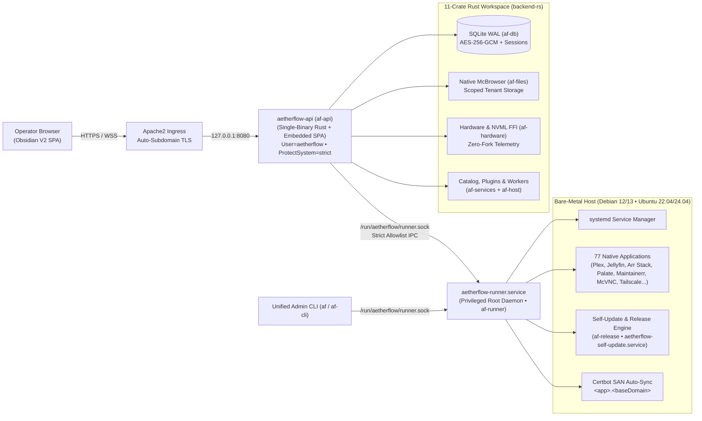

<div align="center">


[](https://github.com/McEveritts/AetherFlow/releases)
[](./backend-rs)
[](./docs/rust-admin-cli.md)
[](./frontend)
[](./setup)
[](./packages)
[](./LICENSE.md)

**[Quickstart](#-quick-installation)** • **[Architecture](#️-system-architecture)** • **[77-App Catalog](#-77-package-bare-metal-catalog)** • **[McBrowser & Streaming](#-native-mcbrowser--streaming-intelligence)** • **[FlowAI](#-human-gated-flowai)** • **[Documentation](#-documentation)** • **[Releases](https://github.com/McEveritts/AetherFlow/releases)**

</div>

---

## ⚡ Overview

**AetherFlow** is a sovereign, bare-metal infrastructure and media-server orchestration platform. Built to replace fragile scripts and heavy container overlays with a compiled, single-binary **Rust** control plane, AetherFlow orchestrates **77 native Linux services**, real-time hardware telemetry, scoped tenant file management (**McBrowser**), canonical streaming analytics, automated subdomain ingress, and human-gated AI operations directly against `systemd`.


### Why AetherFlow v4.0.0?

- **11-Crate Single-Binary Rust Control Plane (`aetherflow-api` + `af`)** — The entire **Next.js 16 (Obsidian V2)** static frontend is embedded directly inside the compiled **Rust (`Axum` + `Tokio`)** binary via `rust-embed` (`af-api`), paired with the unified **`af` (`af-cli`)** administrative CLI and bundled SQLite WAL (`af-db`), eliminating separate Node.js runtime daemons, Redis dependencies, and port-proxy sprawl.
- **Native McBrowser (`af-files`)** — Built-in left-sidebar file manager backed by a capability-scoped Rust engine (`af-files`) with private per-user storage (`/var/lib/aetherflow/mcbrowser`), resumable chunked uploads (up to 64 GiB), ETag-guarded Ace code editing, 9-format archive extraction/creation, and FlowAI natural-language BFS file search. See [McBrowser Documentation](./docs/mcbrowser.md).
- **Zero-Sudo Privileged Socket Boundary (`aetherflow-runner`)** — The API server runs as an unprivileged `aetherflow` user under `ProtectSystem=strict` and `NoNewPrivileges=yes`. Root-level package installations (15 native declarative Rust recipes + serialized Bash installers), `systemctl` transitions, WireGuard/Tailscale management, quota updates, and isolated `aetherflow-self-update.service` deployments are mediated over `/run/aetherflow/runner.sock` with strict allowlists.
- **Whatbox-Style Automatic Subdomain Ingress** — Configure a server `baseDomain` once, and installing any web-capable Marketplace application automatically provisions `<app>.<baseDomain>` (e.g., `jellyfin.example.com`, `sonarr.example.com`) through **Apache2** and the streaming **AetherFlow Subdomain Gateway**, with automated Let's Encrypt SAN expansion via **`af-certbot-sync`** and `.aether.local` LAN split-horizon routing.
- **Frame-0 Real-Time Telemetry & NVML FFI (`Hyperspeed`)** — Immediate frame-0 WebSocket state hydration, decoupled navigation/telemetry rendering, zero-fork `/proc` & `sysinfo` sampling, and dynamic `libnvidia-ml.so.1` FFI + DRM `sysfs` GPU discovery.
- **Canonical Streaming Intelligence & VPN Control** — Built-in Jellyfin/Plex streaming history explorer with snapshot-consistent pagination, CSV/JSON portability, reconciliation gates, and native **WireGuard** (`wg0`) + **Tailscale** mesh VPN management.
- **100% Bare-Metal, Zero Docker Overhead** — Every application runs natively under `systemd` cgroups and `af-systemd-sandbox` profiles—zero Docker daemons, zero container bridging latency.

---

## 🖥️ Platform Showcase

| **AetherMarketplace (77 Native Apps)** | **FlowAI Infrastructure Assistant** |
|:---:|:---:|
|  |  |
| One-click bare-metal provisioning, live SSE/WS install progress, in-place app updates, automatic subdomain wiring, and Zero-Touch Arr API discovery. | Context-aware diagnostics connected to live system metrics, service journals, McBrowser NL search, and the global **Action Approval Inbox**. |

<details>
<summary><strong>🔌 View Multi-Provider FlowAI Engine Configuration (Gemini, Claude, OpenAI, Ollama, LM Studio)</strong></summary>
<br>


</details>

---

## 🏗️ System Architecture



### 11-Crate Rust Control Plane (`backend-rs`)

| Crate | Role |
| :--- | :--- |
| **`af-api`** | Axum HTTP/WebSocket control plane, `rust-embed` Next.js 16 SPA server, JWT/TOTP/OIDC/CSRF middlewares, streaming subdomain & plugin reverse proxy, FlowAI routing, and canonical streaming history endpoints. |
| **`af-runner`** | Root UNIX socket daemon (`/run/aetherflow/runner.sock`), 15 built-in declarative Rust package recipes + locked Bash installer supervisor, `systemctl` allowlists, WireGuard/Tailscale helpers, and isolated `aetherflow-self-update.service` launcher. |
| **`af-files`** | Native **McBrowser** capability-scoped tenant file system engine, resumable 64 GiB chunked upload sessions, ETag-guarded UTF-8 editor, 9-format archive engine, and public share links. |
| **`af-db`** | Bundled `rusqlite` WAL connection pool (`max_size(1)`), schema migrations, SQLite-backed JWT revocation and session tracking (zero Redis requirement), and `enc:v1:` AES-256-GCM secret encryption. |
| **`af-services`** | 77-package Marketplace catalog & update engine, pure-Rust XML/INI/JSON/SQLite/Apache config mutators, native plugin runtime (`21000..=21999`), `af-heal` watchdog, and cluster heartbeat daemon. |
| **`af-release`** | Pull-based atomic release engine (`Deploy`, `Rollback`, `Cleanup`, `MigrateSystemd`) with 4-tier SQLite path resolution, WAL-safe pre-swap backups, executable permission normalization, and crash recovery. |
| **`af-host`** | Shared host backup & verification library (`af-host.backup-manifest.v1`), WAL-consistent `OnlineBackupApi` / `VACUUM INTO` snapshots, 5-digit chunk splitting, staged restore (`--staging-root`), and native host maintenance (`tune`, `sentinel`, `clean-logs`, `showspace`). |
| **`af-cli`** | Unified **`af`** administrative CLI binary for package lifecycle, systemd services, disk quotas (`setdisk`), sandbox drop-ins, releases, backups, maintenance, and 14-step resumable bare-metal provisioning. |
| **`af-hardware`** | Zero-fork `sysinfo` and `/proc/diskstats` telemetry collector plus dynamic `libloading` FFI bindings to `libnvidia-ml.so.1` for NVIDIA GPU metrics. |
| **`af-models`** | Shared `serde` wire contracts, catalog schemas, hardware telemetry structs, and runner IPC payloads. |
| **`af-streaming-tests`** | Contract and integration verification suite for canonical streaming playback history, reconciliation, and portability. |

---

## 📦 77-Package Bare-Metal Catalog

AetherFlow manages **77 native Linux packages** across 7 infrastructure domains, complete with idempotent install/uninstall/update lifecycles, `DPkg::Lock::Timeout` serialization, 15 native declarative Rust recipes, and Zero-Touch API key discovery for the `*Arr` ecosystem:

| Domain | Managed Applications |
| :--- | :--- |
| **🎬 Media, IPTV & YouTube Frontends (23)** | Plex Media Server, Jellyfin, Emby, Dispatcharr, Threadfin, Navidrome, Jellyseerr (Seerr), Overseerr, Maintainerr, Requestrr, Audiobookshelf, Kavita, Calibre-Web, FileBot, Unmanic, Unpackerr, Autoscan, Recyclarr, Tautulli, Ombi, FlareSolverr, Piped *(Experimental)*, Invidious *(Experimental)* |
| **🤖 Arr Automation Stack (8)** | Sonarr, Radarr, Lidarr, Readarr, Listenarr, Prowlarr, Bazarr, Jackett |
| **⬇️ Download Clients (12)** | qBittorrent (`qbittorrent-nox`), Qui, Autobrr, Flood, SeedCross, pyLoad, rTorrent, ruTorrent, SABnzbd, NZBGet, Deluge, Transmission |
| **☁️ Cloud & Union Storage (8)** | Nextcloud, Syncthing, File Browser, Duplicati, Rclone (`rclone-vfs`), MergerFS, Cloudplow, Paperless-ngx |
| **🌐 Network, DNS & Mesh VPN (8)** | WireGuard, Tailscale, Pi-hole, AdGuard Home, LibreSpeed (Obsidian V2), The Lounge, ZNC, Quassel |
| **📈 Monitoring & Security (7)** | Grafana, Prometheus, Netdata, Uptime Kuma, Scrutiny (SMART), Vaultwarden, Fail2ban |
| **⚡ Productivity, Culinary AI, Remote Desktop & DevOps (11)** | Palate (Culinary & Nutrition AI), n8n, Home Assistant, Gitea, Organizr, Notifiarr, McVNC (Rust GPU Remote Desktop), KasmVNC, XRDP, noVNC, X2Go |

---

## 🗂️ Native McBrowser & Streaming Intelligence

- **Scoped Tenant File Manager (`McBrowser`)** — Manage files directly from the dashboard sidebar without containers or separate logins. Supports drag-and-drop directory uploads, resumable multi-gigabyte transfers, Ace code editing with Markdown/KaTeX preview, password-protected public shares, and FlowAI natural-language search.
- **Canonical Streaming Analytics** — Real-time Jellyfin & Plex session monitoring paired with a snapshot-consistent playback history archive, server-identity verification, asynchronous library/genre metadata enrichment, CSV/JSON portability exports, and human-gated history reconciliation.
- **WireGuard & Tailscale Control Center** — Provision one-time WireGuard client keypairs/QR codes and manage Tailscale tailnet authentication, advertised subnet routes, and exit-node preferences directly from the **Network** tab.

---

## 🧠 Human-Gated FlowAI

AetherFlow treats AI output as untrusted until verified by an operator:

1. **Multi-Provider Routing** — Native support for **Google Gemini**, **Anthropic Claude**, **OpenAI**, **Ollama**, and **LM Studio** with API credentials encrypted at rest using **AES-256-GCM** (`enc:v1:`).
2. **Action Approval Gate** — FlowAI can inspect telemetry and service health, but any state-mutating remediation (restarting units, clearing locks, modifying quotas) is serialized into the **Approval Inbox** (`pending_actions`) and requires explicit administrator authorization before execution.
3. **Immutable Audit Trail** — Every login, 2FA verification, package lifecycle event, McBrowser file mutation, and AI action resolution is recorded in the administrator audit log.

---

## 🚀 Quick Installation

Deploy on a clean **Debian 12/13 (Bookworm/Trixie)** or **Ubuntu 22.04/24.04 LTS** server:

```bash
apt-get update && apt-get -y upgrade
apt-get -y install git curl
git clone https://github.com/McEveritts/AetherFlow.git /opt/AetherFlow
cd /opt/AetherFlow/setup
sudo bash AetherFlow-Setup
```

### Non-Interactive / Automated Provisioning

```bash
# Unattended bootstrap (writes generated credentials to /root/information.info)
sudo bash /opt/AetherFlow/setup/AetherFlow-Setup \
  --unattended \
  --username admin \
  --domain node.example.com

# Repair an existing installation while preserving saved configuration & database
sudo bash /opt/AetherFlow/setup/AetherFlow-Setup --repair
```

Upgrading an existing v3.2.x or v4.0.0 node: see **[Upgrading & Rollbacks](./docs/upgrading.md)** and **[Self-Update Lifecycle](./docs/self-update.md)**. The embedded SPA, HTTP API, runner socket, and installed `systemd` units transition seamlessly.

---

## 📚 Documentation

### Core Platform & Operations
| Guide | Description |
| :--- | :--- |
| **[About AetherFlow](./docs/about.md)** | Platform overview, architectural axioms, and core capabilities. |
| **[Quickstart Guide](./docs/quickstart.md)** | End-to-end walkthrough for bootstrapping your first bare-metal node. |
| **[System Architecture](./docs/architecture.md)** | 11-crate Rust control plane internals, embedded SPA serving, and `systemd` execution model. |
| **[Configuration Reference](./docs/configuration.md)** | Environment variables (`/etc/aetherflow/aetherflow.env`), SQLite WAL, and service tuning. |
| **[Security & Hardening](./docs/security.md)** | TOTP 2FA, AES-256-GCM secret encryption, OIDC provider, and privilege separation. |
| **[Threat Model](./docs/threat_model.md)** | CWE mapping, security boundaries, AI escapement mitigations, and socket sandboxing. |
| **[Deployment Checklist](./docs/deployment_checklist.md)** | Pre-flight production security checklist, secret generation, and post-deploy verification. |
| **[Operations Runbook](./docs/RUNBOOK.md)** | Production administration, `af` CLI workflows, health probes, backups, and recovery. |
| **[Upgrading & Rollbacks](./docs/upgrading.md)** | Release channels (`stable` / `nightly`), atomic upgrades, and rollbacks. |
| **[Self-Update Lifecycle](./docs/self-update.md)** | Isolated `aetherflow-self-update.service` execution, recovery journals, and binary verification. |

### Subsystems, Rust Crates & Marketplace
| Guide | Description |
| :--- | :--- |
| **[Native McBrowser](./docs/mcbrowser.md)** | Capability-scoped Rust file manager (`af-files`), resumable uploads, and path policies. |
| **[Network: WireGuard & Tailscale](./docs/network-vpn.md)** | Managing WireGuard peers/keypairs and Tailscale mesh VPN routes via `aetherflow-runner`. |
| **[FlowAI Assistant](./docs/flowai.md)** | Multi-provider LLM setup, Support vs. Assistant modes, and Approval Inbox workflow. |
| **[Streaming History Contract](./docs/streaming-history-contract.md)** | Canonical playback history, server-identity verification, reconciliation, and CSV/JSON portability. |
| **[AetherMarketplace](./docs/marketplace.md)** | 77-app catalog lifecycle, Palate, Maintainerr, McVNC, KasmVNC, and data retention policies. |
| **[Experimental YouTube Frontends](./docs/experimental-youtube.md)** | Native bare-metal installation and operation of Piped and Invidious. |
| **[Marketplace Developer Guide](./docs/marketplace-developer-guide.md)** | Authoring idempotent `common.sh` package installers and declarative Rust recipes. |
| **[Unified Rust Admin CLI (`af`)](./docs/rust-admin-cli.md)** | Command reference and exit codes for the `af` (`af-cli`) binary and `af provision`. |
| **[Rust Release Engine (`af-release`)](./docs/rust-release-engine.md)** | Stage-by-stage atomic release deployment, WAL-safe snapshots, and auto-rollback internals. |
| **[Rust Package Executor (`af-runner`)](./docs/rust-package-executor.md)** | Declarative Rust package recipes, advisory locking, process-group cancellation, and rollback journals. |
| **[Rust Host Management (`af-host`)](./docs/rust-host-management.md)** | Versioned backup manifests, chunking, staged restore, and native host maintenance (`tune`, `sentinel`). |
| **[Rust Migration Status](./docs/rust-migration-status.md)** | Complete crate-by-crate architecture and migration status matrix for v4.0.0. |
| **[REST & WebSocket API](./docs/API.md)** | Endpoint specifications, WebSocket ticket handshake, SSE streams, and CSRF rules. |
| **[Testing & Verification](./docs/testing.md)** | Running the Rust workspace tests, frontend Jest/Playwright suites, and Python regression tests. |
| **[Troubleshooting & FAQ](./docs/troubleshooting.md)** | Common diagnostics for ingress routing, WebSocket connections, systemd sandboxes, and APT locks. |

---

## 🧪 Verification & Development

```bash
# Run Rust control plane unit & contract tests across all 11 crates
cd backend-rs && cargo test --workspace --locked

# Build the Next.js 16 (Obsidian V2) static export and run frontend tests
cd frontend && npm run lint && npm run test:ci && NEXT_STATIC_EXPORT=1 npm run build

# Run release manager, marketplace, and build tool regression suites
python3 -m unittest discover -s tests -p 'test_*.py' -v

# Verify shell hygiene across all 260+ installer and lifecycle scripts
python3 tests/check_shell_hygiene.py

# Build the production single-binary Rust release bundle (aetherflow-api + af + SHA256SUMS)
bash scripts/build_gold.sh
```

---

## 📄 License & Security

- **License**: AetherFlow is distributed under the **[GNU General Public License v3.0 (GPL-3.0)](./LICENSE.md)**.
- **Security Policy**: Please review **[SECURITY.md](./SECURITY.md)** for supported v4.0.x release tracks and responsible vulnerability disclosure guidelines.
- **Release History**: Full version history is maintained in **[CHANGELOG.md](./CHANGELOG.md)**.
