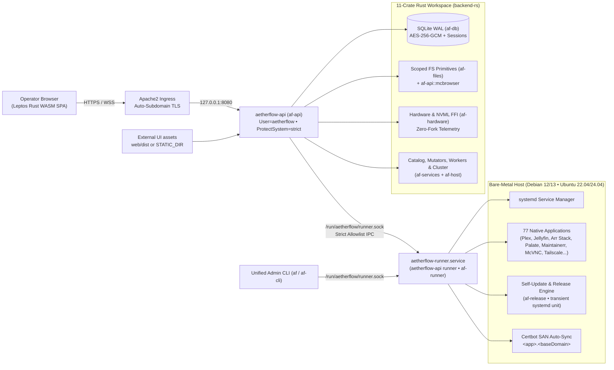

<div align="center">


[](https://github.com/McEveritts/AetherFlow/releases)
[](./backend-rs)
[](./docs/rust-admin-cli.md)
[](./frontend-rs)
[](./setup)
[](./packages)
[](./LICENSE.md)

**[Quickstart](#quick-installation)** • **[Architecture](#system-architecture)** • **[77-App Catalog](#77-package-bare-metal-catalog)** • **[McBrowser, Streaming & VPN](#native-mcbrowser-streaming-intelligence--vpn-control)** • **[FlowAI](#human-gated-flowai)** • **[Documentation](#documentation)** • **[Releases](https://github.com/McEveritts/AetherFlow/releases)**

</div>

# AetherFlow

---

## Overview

**AetherFlow** is a self-hosted, bare-metal Linux infrastructure and media-server control plane. Its **Rust** backend and **Rust WebAssembly** dashboard orchestrate **77 native Linux packages**, real-time hardware telemetry, scoped tenant file management (**McBrowser**), canonical streaming analytics, automated subdomain ingress, and human-gated AI operations directly against `systemd`.


### Why AetherFlow v4.0.0?

- **Rust Control Plane and WASM Interface** — The **Leptos** dashboard and worker modules are built in `frontend-rs` and shipped as external `web/dist` assets beside **`aetherflow-api`**, the **`af`** administrative CLI (`bin/af`), and the Rust LibreSpeed **`speedtest-backend`** (`bin/speedtest-backend`). `aetherflow-api` serves the UI from `<exe-dir>/web/dist` by default, or from `STATIC_DIR` when explicitly set (failing closed if empty or invalid). The control plane and dashboard require no Node.js, Go, or Redis daemons (host release/maintenance tooling requires `python3` and `openssl`, and specific Marketplace apps install their own runtimes).
- **Native McBrowser (`af-files` + `af-api::mcbrowser`)** — Built-in left-sidebar file manager combining low-level capability-scoped Linux `openat2` confinement (`af-files`) with HTTP routes in `af-api::mcbrowser` for per-user storage (`/var/lib/aetherflow/mcbrowser`, governed by SQLite storage quotas integrated with AetherFlow's `setdisk` wrapper invoking Linux `setquota` via **Storage Quotas**), resumable chunked uploads up to 64 GiB, ETag-guarded UTF-8 editing, 9-format archive tools, public shares, and search. See [Native McBrowser](./docs/mcbrowser.md).
- **Zero-Sudo Privileged Socket Boundary (`aetherflow-runner.service`)** — `aetherflow-api` runs as the unprivileged `aetherflow` user under `ProtectSystem=strict` and `NoNewPrivileges=yes`. Root-level package installations (locked Bash installers by default, plus 9 opt-in declarative Rust recipes enabled via `AETHERFLOW_ENABLE_RUST_PACKAGES=1`), `systemctl` transitions, WireGuard/Tailscale management, Linux POSIX user disk quota updates, managed plugin transient units, and isolated `aetherflow-self-update-<command>-<channel>-<8hex>.service` deployments run in `aetherflow-runner.service` (`aetherflow-api runner`) over `/run/aetherflow/runner.sock` with strict allowlists.
- **Subdomain Ingress & LAN Split-Horizon DNS** — Configure a server `baseDomain` once to route enabled HTTP-capable Marketplace applications at `<app>.<baseDomain>` (for example `jellyfin.example.com` or `sonarr.example.com`) through **Apache2** and the streaming **AetherFlow Subdomain Gateway** (per-app external HTTPS exposure is opt-in via **Network → External Access** / `external_access_enabled`), with automated Let's Encrypt SAN updates via `af-certbot-sync` (`/usr/local/bin/af-certbot-sync`, triggered automatically on ingress syncs or on demand via `runner.sock` IPC `/v1/certbot-sync`) and `.aether.local` LAN split-horizon DNS sync (`/etc/hosts`, `dnsmasq`, Pi-hole, or AdGuard Home via `af hosts` / `runner.sock` IPC `/v1/hosts`; see [Unified Rust Admin CLI](./docs/rust-admin-cli.md)).
- **Real-Time Telemetry & NVML FFI** — Immediate initial WebSocket state snapshots on connect, zero-fork `/proc` and `sysinfo` sampling, and dynamic `libnvidia-ml.so.1` FFI + DRM `sysfs` GPU discovery.
- **Canonical Streaming Intelligence** — Built-in **Jellyfin** (live telemetry, session control, item-summary sync, and canonical playback history), **Plex** (live `/status/sessions` telemetry, `/identity` verification, `/library/sections` enrichment, canonical playback history, and native Plex/Tautulli JSON & CSV import), and **Emby** (staged live telemetry, artwork, and canonical history; backend session commands exist while UI controls remain Jellyfin-only and item-summary sync returns HTTP 501) streaming explorer with snapshot-consistent pagination, CSV/JSON portability (`8 MiB` archive / `10 MiB` restore envelope), and reconciliation gates. See [Streaming History Contract](./docs/streaming-history-contract.md).
- **WireGuard & Tailscale VPN Control** — Native **WireGuard** (`wg0` peer and QR management) and **Tailscale** mesh VPN management directly from the **Network** tab. See [Network: WireGuard & Tailscale](./docs/network-vpn.md).
- **Native Marketplace Services** — AetherFlow manages app-specific and shared Linux services through `systemd`. See [AetherMarketplace](./docs/marketplace.md) for per-app prerequisites, launch methods, and data retention policies.

---

## Platform Showcase

| **AetherMarketplace (77 Native Apps)** | **FlowAI Infrastructure Assistant** |
| :---: | :---: |
|  |  |
| Bare-metal package provisioning, live SSE/WS install progress, in-place app updates, automatic subdomain wiring for web apps, and automated `*Arr` API key discovery. | Diagnostics grounded in live system metrics, client-supplied or audit logs, and the administrator **Action Approval Inbox** (`pending_actions`). |

<details>
<summary><strong>View Multi-Provider FlowAI Configuration (Gemini, Claude, OpenAI, Ollama, LM Studio)</strong></summary>
<br>


</details>

---

## System Architecture



### 11-Crate Rust Control Plane (`backend-rs`)

| Crate | Role |
| :--- | :--- |
| **`af-api`** | Axum HTTP/WebSocket control plane, runtime WASM asset server, JWT/TOTP/OIDC/CSRF middlewares, McBrowser HTTP/TUS/editor/archive/share routes (`af-api::mcbrowser`), native plugin manifest discovery/port allocation/scoped JWTs/proxying (`af-api::plugins`, ports `21000..=21999`), streaming subdomain reverse proxy, FlowAI routing, and canonical streaming history endpoints. |
| **`af-runner`** | Root Unix socket daemon (`/run/aetherflow/runner.sock`, executed as `aetherflow-api runner`), locked Bash installer supervisor + 9 opt-in declarative Rust package recipes (`AETHERFLOW_ENABLE_RUST_PACKAGES=1`), `systemctl` allowlists, WireGuard/Tailscale helpers, isolated `DynamicUser=yes` plugin units (`af-runner::plugins`), and transient self-update launcher (`aetherflow-self-update-<command>-<channel>-<8hex>.service`). |
| **`af-files`** | Capability-scoped Linux `openat2` / `BrowserFs` filesystem confinement primitives enforcing `0700` per-user roots and traversal guards for McBrowser. |
| **`af-db`** | Bundled `rusqlite` WAL single-writer (`max_size(1)`) + concurrent read-only (`max_size(8)`) connection pools, schema migrations, SQLite-backed JWT revocation and session tracking (no Redis dependency), and `enc:v1:` AES-256-GCM secret encryption. |
| **`af-services`** | 77-package Marketplace catalog & update watcher, SQLite/config mutators, `af-heal` service-health watchdog, MediaFlow background media-transcoding queue worker, and TLS 1.3 mTLS cluster daemon (serving both HTTP/2 gRPC `cluster.ClusterService` and `/cluster/v1/*` HTTPS REST on default `127.0.0.1:50051`). |
| **`af-release`** | Default pull-based atomic release engine (`Deploy`, `Rollback`, `Cleanup`, `MigrateSystemd`) with 4-tier SQLite path resolution, SHA-256 + Sigstore/SLSA v1 build provenance verification, WAL-safe pre-swap backups, permission normalization, and crash recovery. |
| **`af-host`** | Shared host backup & verification library (`af-host.backup-manifest.v1`), WAL-consistent `VACUUM INTO` (default) / `OnlineBackupApi` snapshots, 5-digit chunk splitting, confirmed staged restore (`execute_staged_restore`), and native host maintenance (`tune`, `sentinel`, `clean-logs`, `showspace`). |
| **`af-cli`** | Unified **`af`** administrative CLI binary (`bin/af`) for package lifecycle, systemd services, disk quotas (`setdisk`), sandbox drop-ins, releases, backups, maintenance, and the 34-step provisioner (`af provision`: 14 Rust-native foundation steps — 6 default unless named explicitly — plus 20 retained shell bootstrap steps). |
| **`af-hardware`** | Zero-fork `sysinfo` and `/proc/diskstats` telemetry collector plus dynamic `libloading` FFI bindings to `libnvidia-ml.so.1` for NVIDIA GPU utilization, VRAM, and temperature metrics. |
| **`af-librespeed`** | Native **`speedtest-backend`** (`bin/speedtest-backend`) replacement shipped in the core release bundle with SQLite WAL telemetry storage (plus legacy BoltDB v2 auto-migration), keyed ULID result-ID obfuscation, and PNG result badge rendering. |
| **`af-models`** | Shared `serde` wire contracts, catalog schemas, hardware telemetry structs, and runner IPC payloads. |

### 4-Crate Rust WASM Frontend (`frontend-rs`)

| Crate | Role |
| :--- | :--- |
| **`af-web-core`** | API/WebSocket client policies, locale catalogs, draft persistence, and shared UI algorithms. |
| **`af-web-worker`** | Dedicated WebAssembly worker modules for background search, sorting, hashing, and chunked uploads. |
| **`af-web-ui`** | Reusable accessible Leptos controls, tables, code editor, charts, and topology views. |
| **`af-web-app`** | Application shell, authentication, public routes, and sixteen dashboard tabs staged into `web/dist` (`STATIC_DIR`). |

---

## 77-Package Bare-Metal Catalog

AetherFlow manages **77 native Linux packages** across 7 functional domains (grouped into 9 Marketplace UI categories in [AetherMarketplace](./docs/marketplace.md)), serialized behind `/install/.af-package-executor.flock` with locked Bash installers by default, 9 opt-in declarative Rust recipes (`AETHERFLOW_ENABLE_RUST_PACKAGES=1`, adding `-o DPkg::Lock::Timeout=120`), and automated API key discovery for supported `*Arr` applications:

| Domain | Managed Applications |
| :--- | :--- |
| **Media, IPTV & YouTube Frontends (23)** | Plex Media Server, Jellyfin, Emby, Dispatcharr, Threadfin, Navidrome, Jellyseerr (Seerr), Overseerr, Maintainerr, Requestrr, Audiobookshelf, Kavita, Calibre-Web, FileBot, Unmanic, Unpackerr, Autoscan, Recyclarr, Tautulli, Ombi, FlareSolverr, Piped *(Experimental)*, Invidious *(Experimental)* |
| **Arr Automation Stack (8)** | Sonarr, Radarr, Lidarr, Readarr *(Retired Upstream)*, Listenarr, Prowlarr, Bazarr, Jackett |
| **Download Clients (12)** | qBittorrent (`qbittorrent-nox`), Qui, Autobrr, Flood, SeedCross, pyLoad, rTorrent, ruTorrent, SABnzbd, NZBGet, Deluge, Transmission |
| **Cloud & Union Storage (8)** | Nextcloud, Syncthing, File Browser, Duplicati, Rclone (`rclone-vfs`), MergerFS, Cloudplow, Paperless-ngx |
| **Network, DNS & Mesh VPN (8)** | WireGuard, Tailscale, Pi-hole, AdGuard Home, LibreSpeed, The Lounge, ZNC, Quassel |
| **Monitoring & Security (7)** | Grafana, Prometheus, Netdata, Uptime Kuma, Scrutiny (SMART), Vaultwarden, Fail2ban |
| **Productivity, Culinary AI, Remote Desktop & DevOps (11)** | Palate (Culinary & Nutrition AI), n8n, Home Assistant, Gitea, Organizr, Notifiarr, McVNC (Rust GPU Remote Desktop), KasmVNC, XRDP, noVNC, X2Go |

---

## Native McBrowser, Streaming Intelligence & VPN Control

- **Scoped Tenant File Manager (`McBrowser`)** — Built-in dashboard file manager without containers or separate logins. Supports flat drag-and-drop file uploads, resumable multi-gigabyte TUS transfers (`> 64 MiB`), native Rust/Leptos UTF-8 code editing (45 syntax modes) with sanitized Markdown/MathML preview, password-protected public shares, smart UI path/filename search, and deterministic API filename search with `type:`/`case:` modifiers. See [Native McBrowser](./docs/mcbrowser.md).
- **Canonical Streaming Analytics** — Real-time **Jellyfin**, **Plex**, and **Emby** (staged) session monitoring paired with a snapshot-consistent playback history archive, server-identity verification, asynchronous Jellyfin/Emby library metadata enrichment, CSV/JSON portability exports, native Plex/Tautulli playback import, and human-gated history reconciliation. See [Streaming History Contract](./docs/streaming-history-contract.md).
- **WireGuard & Tailscale Control Center** — Provision one-time WireGuard client keypairs/QR codes, manage Tailscale tailnet authentication, advertised subnet routes, exit-node IP preferences, external subdomain ingress, and host network hardware inventory directly from the **Network** tab. See [Network: WireGuard & Tailscale](./docs/network-vpn.md).

---

## Human-Gated FlowAI

AetherFlow treats AI output as untrusted until verified by an operator:

1. **Multi-Provider Routing** — Native support for **Google Gemini**, **Anthropic Claude**, **OpenAI**, **Ollama**, and **LM Studio** with API credentials encrypted at rest using **AES-256-GCM** (`enc:v1:`). See [FlowAI Assistant](./docs/flowai.md).
2. **Action Approval Gate** — FlowAI inspects instantaneous hardware telemetry and client-supplied or audit logs. Supported service `stop` and `restart` proposals require administrator approval in the **Approval Inbox** (`pending_actions`) before dispatch.
3. **Administrator Audit Log** — AetherFlow writes authentication, package lifecycle, McBrowser mutation, and manual approval events to `admin_audit_log` in SQLite. Failed audit writes are logged to the API service journal.

---

## Quick Installation

Deploy on a clean **Debian 12/13 (Bookworm/Trixie)** or **Ubuntu 22.04/24.04 LTS** server:

```bash
sudo apt-get update && sudo apt-get -y upgrade
sudo apt-get -y install git curl
sudo git clone https://github.com/McEveritts/AetherFlow.git /opt/AetherFlow
cd /opt/AetherFlow/setup
sudo bash AetherFlow-Setup
```

### Non-Interactive / Automated Provisioning

```bash
# Unattended bootstrap (--username creates the Linux owner account and records it in
# /root/information.info alongside the onboarding URL and bootstrap token path
# /var/lib/aetherflow/.setup-bootstrap-token; the first web admin account is created
# via web onboarding unless AETHERFLOW_WEB_ADMIN_PASSWORD is explicitly set)
sudo bash /opt/AetherFlow/setup/AetherFlow-Setup \
  --unattended \
  --username admin \
  --domain node.example.com

# Repair specific step(s) on an existing installation while preserving saved configuration & database
# (Run with --list-steps to view available step IDs, such as build_modern for the control plane)
sudo bash /opt/AetherFlow/setup/AetherFlow-Setup --repair build_modern
```

For fresh bare-metal host provisioning (APT repositories, Apache2, TLS, and initial admin setup), use `setup/AetherFlow-Setup`. For repeatable Rust-native foundation steps and day-2 administration on an installed host, use `af provision` (see [Unified Rust Admin CLI (`af`)](./docs/rust-admin-cli.md)).

Upgrading an existing v3.2.x or v4.0.0 node: see **[Upgrading & Rollbacks](./docs/upgrading.md)** and **[Self-Update Lifecycle](./docs/self-update.md)**. The updater switches the API binaries and the matching `web/dist` dashboard together while preserving the HTTP API and runner socket.

---

## Documentation

### Core Platform & Operations

| Guide | Description |
| :--- | :--- |
| **[About AetherFlow](./docs/about.md)** | Platform overview, architectural boundaries, and core capabilities. |
| **[Quickstart Guide](./docs/quickstart.md)** | End-to-end walkthrough for bootstrapping your first bare-metal node. |
| **[System Architecture](./docs/architecture.md)** | Rust control plane internals, external WASM asset serving, and the `systemd` execution model. |
| **[Configuration Reference](./docs/configuration.md)** | Environment variables (`/etc/aetherflow/aetherflow.env`), SQLite WAL, and service tuning. |
| **[Security & Hardening](./docs/security.md)** | TOTP 2FA, AES-256-GCM secret encryption, OIDC provider, and privilege separation. |
| **[Threat Model](./docs/threat_model.md)** | CWE mapping, security boundaries, AI escapement mitigations, and socket sandboxing. |
| **[Deployment Checklist](./docs/deployment_checklist.md)** | Pre-flight production security checklist, secret generation, and post-deploy verification. |
| **[Operations Runbook](./docs/RUNBOOK.md)** | Production administration, `af` CLI workflows, health probes, backups, and recovery. |
| **[Upgrading & Rollbacks](./docs/upgrading.md)** | Release channels (`stable` / `nightly`), atomic upgrades, and rollbacks. |
| **[Self-Update Lifecycle](./docs/self-update.md)** | Transient `aetherflow-self-update-<command>-<channel>-<8hex>.service` execution, durable receipts, and recovery journals. |

### Subsystems, Rust Crates & Marketplace

| Guide | Description |
| :--- | :--- |
| **[Native McBrowser](./docs/mcbrowser.md)** | Capability-scoped Rust file manager (`af-files` + `af-api::mcbrowser`), resumable uploads, and path policies. |
| **[Network: WireGuard & Tailscale](./docs/network-vpn.md)** | Managing WireGuard peers/keypairs, Tailscale mesh VPN routes, and external ingress via `aetherflow-runner`. |
| **[FlowAI Assistant](./docs/flowai.md)** | Multi-provider LLM setup, Support diagnostics, and Approval Inbox workflow. |
| **[Streaming History Contract](./docs/streaming-history-contract.md)** | Canonical playback history, server-identity verification, reconciliation, and CSV/JSON portability. |
| **[Streaming Validation Gate](./docs/streaming-validation.md)** | Scoped and integrated streaming verification harness (`scripts/validate-streaming.sh`) and acceptance gates. |
| **[AetherMarketplace](./docs/marketplace.md)** | 77-app catalog lifecycle, Palate, Maintainerr, McVNC, KasmVNC, and data retention policies. |
| **[Marketplace Package Architecture](./packages/README.md)** | Modular `packages/common.sh` / `packages/lib/*.sh` helper contracts, integrity checks, and per-app runtime notes. |
| **[Marketplace Lifecycle Repair](./docs/marketplace-repair.md)** | Lifecycle lock coordination, port preservation, rollback/backup contracts, and data-retention hardening. |
| **[Marketplace Log Retention](./docs/marketplace-log-retention.md)** | Bounded periodic rotation (`aetherflow-log-retention.timer` / `deploy/log-retention.py`) for installer and heal logs. |
| **[Jellyseerr / Seerr Upgrades](./docs/seerr-upgrades.md)** | Staged Seerr upgrades, private Node.js/pnpm builds, backups, and manual rollback. |
| **[Experimental YouTube Frontends](./docs/experimental-youtube.md)** | Native bare-metal installation and operation of Piped and Invidious. |
| **[Marketplace Developer Guide](./docs/marketplace-developer-guide.md)** | Authoring `common.sh` package installers and declarative Rust recipes. |
| **[Plugins Runtime & SDK](./plugins/README.md)** | Sandboxed plugin manifest contracts, `af-runner` `DynamicUser=yes` isolation, and the [Rust plugin template](./plugins/sdk-template-rust/README.md). |
| **[Unified Rust Admin CLI (`af`)](./docs/rust-admin-cli.md)** | Command reference and exit codes for the `af` (`af-cli`) binary and `af provision`. |
| **[Rust Release Engine (`af-release`)](./docs/rust-release-engine.md)** | Stage-by-stage atomic release deployment, WAL-safe snapshots, provenance checks, and auto-rollback internals. |
| **[Rust Package Executor (`af-runner`)](./docs/rust-package-executor.md)** | Declarative Rust package recipes, advisory locking, process-group cancellation, and rollback journals. |
| **[Native Declarative Packages](./docs/v4-native-packages.md)** | Opt-in native Rust package recipes (`fail2ban`, `quassel`, `threadfin`, `znc`, `xrdp`, `x2go`, `netdata`, `mergerfs`, `rclone`) and verification checks. |
| **[Rust Host Management (`af-host`)](./docs/rust-host-management.md)** | Versioned backup manifests, chunking, staged restore, and native host maintenance (`tune`, `sentinel`). |
| **[Rust Migration Status](./docs/rust-migration-status.md)** | Crate-by-crate architecture and migration status matrix for v4.0.0. |
| **[REST & WebSocket API](./docs/API.md)** | Endpoint specifications, OpenAPI 3.1 schema, WebSocket ticket handshake, SSE streams, and CSRF rules. |
| **[WASM Frontend](./frontend-rs/README.md)** | Frontend crates, pinned build tools, runtime asset layout, and browser verification. |
| **[Testing & Verification](./docs/testing.md)** | Running the Rust workspace tests, Playwright suites ([e2e/tests/e2e/README.md](./e2e/tests/e2e/README.md)), Python regression/contract suites ([tests/TEST_INFRA.md](./tests/TEST_INFRA.md), [tests/TEST_READY.md](./tests/TEST_READY.md)), and guest VM drills. |
| **[Clean-Host VM Testing](./docs/v4-clean-host-testing.md)** | Clean-OS QEMU/KVM release matrix (`scripts/v4_vm_matrix.py`) and artifact contract validation. |
| **[Lifecycle Guest Drills](./docs/v4-lifecycle-testing.md)** | Disposable systemd guest verification for release lifecycle, rollback, and quiescence (`scripts/v4_lifecycle_guest_drills.py`). |
| **[Native Package Guest Drills](./docs/v4-native-package-testing.md)** | Disposable Debian guest drills for declarative Rust recipes and native package families (`scripts/v4_native_package_guest_drills.py`). |
| **[Privileged Guest Drills](./docs/v4-privileged-testing.md)** | Disposable systemd guest verification for `af-host` backup, restore, and provenance recovery (`scripts/v4_privileged_guest_drills.py`). |
| **[Troubleshooting & FAQ](./docs/troubleshooting.md)** | Common diagnostics for ingress routing, WebSocket connections, systemd sandboxes, and APT locks. |

---

## Verification & Development

```bash
# Run Rust control plane unit & contract tests across all 11 crates
JWT_SECRET="$(openssl rand -hex 32)" \
AES_MASTER_KEY="$(openssl rand -base64 32)" \
ALLOWED_HOSTS="localhost,127.0.0.1" \
AETHERFLOW_DISABLE_BACKGROUND_WORKERS=1 \
cargo test --manifest-path backend-rs/Cargo.toml --workspace --locked -- --test-threads=1

# Test and build the Rust WASM dashboard and workers
cargo test --manifest-path frontend-rs/Cargo.toml --workspace --locked
bash scripts/install_wasm_build_tools.sh --ensure
bash scripts/build_wasm_frontend.sh --stage

# Run release manager, marketplace, and build tool regression suites (skipping host env files)
AETHERFLOW_SKIP_ENV_FILES=1 python3 tests/run_parallel_tests.py

# Verify shell hygiene across all installer, setup, and lifecycle scripts
python3 tests/check_shell_hygiene.py

# Package the API, CLI, speedtest-backend, external web/dist assets, and SHA256SUMS
bash scripts/build_gold.sh
```

---

## License & Security

- **License**: AetherFlow is distributed under the **[GNU General Public License v3.0 (GPL-3.0)](./LICENSE.md)**.
- **Security Policy**: Review **[SECURITY.md](./SECURITY.md)** for supported v4.0.x release tracks and vulnerability disclosure guidelines.
- **Release History**: Version history is maintained in **[CHANGELOG.md](./CHANGELOG.md)**.
