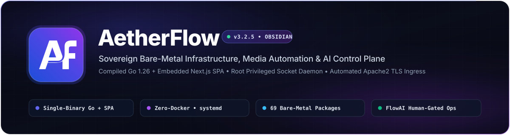
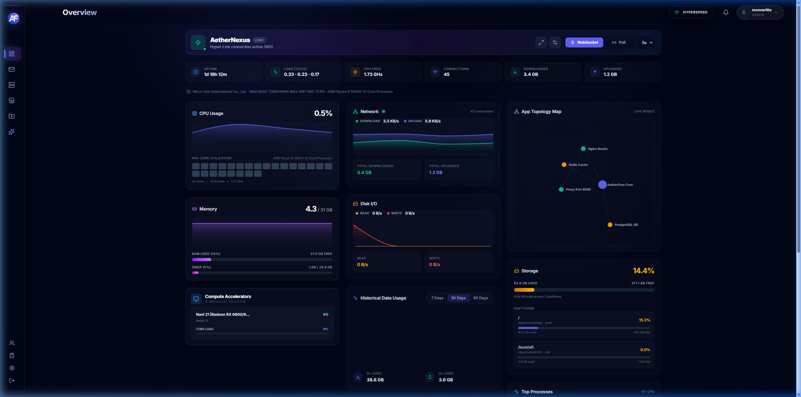
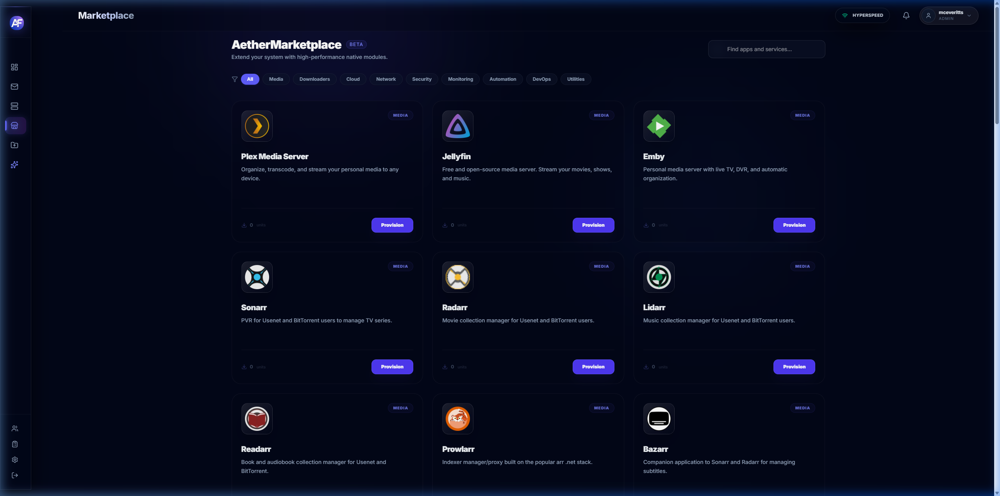
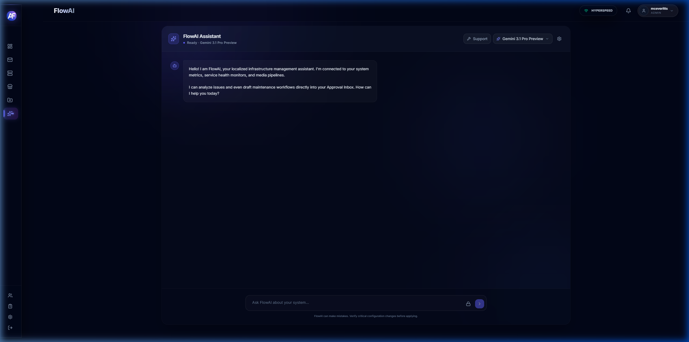
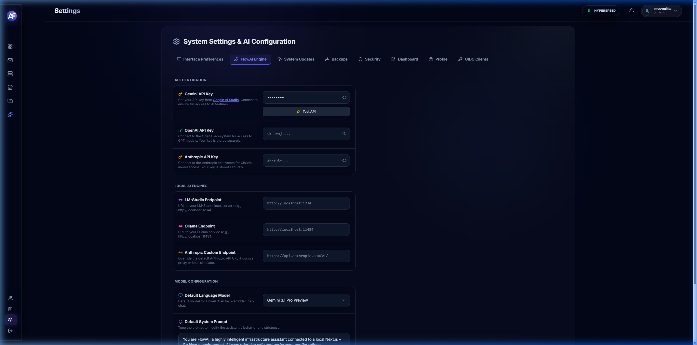
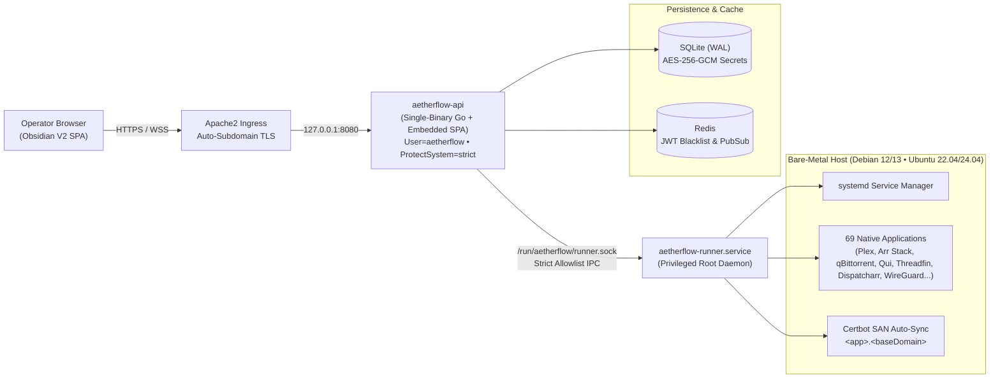

<div align="center">



[](https://github.com/McEveritts/AetherFlow/releases/latest)
[](./backend)
[](./frontend)
[](./setup)
[](./packages)
[](./LICENSE.md)

**[Quickstart](#-quick-installation)** • **[Architecture](#️-system-architecture)** • **[69-App Catalog](#-69-package-bare-metal-catalog)** • **[FlowAI](#-human-gated-flowai)** • **[Documentation](#-documentation)** • **[Latest Release](https://github.com/McEveritts/AetherFlow/releases/latest)**

</div>

---

## ⚡ Overview

**AetherFlow** is a sovereign, bare-metal infrastructure and media-server orchestration platform. Built to replace fragile scripts and heavy container overlays with a compiled, single-binary control plane, AetherFlow orchestrates **69 native Linux services**, real-time hardware telemetry, automated subdomain ingress, and human-gated AI operations directly against `systemd`.



### Why AetherFlow v3.2.1?

- **Single-Binary Control Plane (`aetherflow-api`)** — The entire **Next.js (Obsidian V2)** static frontend is embedded directly inside the compiled **Go (Gin)** binary (`CGO_ENABLED=0`), eliminating separate Node.js runtime daemons and port-proxy sprawl.
- **Zero-Sudo Privileged Socket Boundary (`aetherflow-runner`)** — The API server runs as an unprivileged `aetherflow` user under `ProtectSystem=strict` and `NoNewPrivileges=yes`. Root-level package installations, `systemctl` transitions, quota updates, and atomic rollbacks are isolated behind `/run/aetherflow/runner.sock` with strict allowlists.
- **Whatbox-Style Automatic Subdomain Ingress** — Configure a server `baseDomain` once, and installing any web-capable Marketplace application automatically provisions `<app>.<baseDomain>` (e.g., `jellyfin.example.com`, `sonarr.example.com`) through **Apache2** and the built-in **AetherFlow Subdomain Gateway**, with automated Let's Encrypt SAN expansion via **`af-certbot-sync`** and `.aether.local` LAN split-horizon routing.
- **Frame-0 Real-Time Telemetry (`Hyperspeed`)** — Immediate frame-0 WebSocket state hydration, non-blocking kernel `cpu.Times` delta sampling, per-PID CPU tracking, SMART drive health, and GPU hardware discovery (AMD VAAPI / Intel QSV).
- **100% Bare-Metal, Zero Docker Overhead** — Every application runs natively under `systemd` cgroups and optional `af-systemd-sandbox` UnionFS profiles—zero Docker daemons, zero container bridging latency.

---

## 🖥️ Platform Showcase

| **AetherMarketplace (69 Native Apps)** | **FlowAI Infrastructure Assistant** |
|:---:|:---:|
|  |  |
| One-click bare-metal provisioning, live SSE install logs, automatic subdomain wiring, and Zero-Touch Arr API discovery. | Context-aware diagnostics connected to live system metrics, service journals, and the global **Action Approval Inbox**. |

<details>
<summary><strong>🔌 View Multi-Provider FlowAI Engine Configuration (Gemini, Claude, OpenAI, Ollama, LM Studio)</strong></summary>
<br>



</details>

---

## 🏗️ System Architecture



---

## 📦 69-Package Bare-Metal Catalog

AetherFlow manages **69 native Linux packages** across 7 infrastructure domains, complete with idempotent install/uninstall lifecycles, `DPkg::Lock::Timeout` serialization, and Zero-Touch API key discovery for the `*Arr` ecosystem:

| Domain | Managed Applications |
| :--- | :--- |
| **🎬 Media & Streaming (20)** | Plex Media Server, Jellyfin, Emby, Dispatcharr, Threadfin, Navidrome, Jellyseerr, Overseerr, Requestrr, Audiobookshelf, Kavita, Calibre-Web, FileBot, Unmanic, Unpackerr, Autoscan, Recyclarr, Tautulli, Ombi, FlareSolverr |
| **🤖 Arr Automation Stack (7)** | Sonarr, Radarr, Lidarr, Readarr, Listenarr, Prowlarr, Bazarr |
| **⬇️ Download Clients (11)** | qBittorrent (`qbittorrent-nox`), Qui, Autobrr, Flood, SeedCross, pyLoad, rTorrent, ruTorrent, SABnzbd, NZBGet, Deluge, Transmission |
| **☁️ Cloud & Union Storage (8)** | Nextcloud, Syncthing, File Browser, Duplicati, Rclone (`rclone-vfs`), MergerFS, Cloudplow, Paperless-ngx |
| **🌐 Network, DNS & VPN (9)** | WireGuard, Tailscale, Pi-hole, AdGuard Home, LibreSpeed, The Lounge, ZNC, Quassel, Fail2ban |
| **📈 Monitoring & Security (6)** | Grafana, Prometheus, Netdata, Uptime Kuma, Scrutiny (SMART), Vaultwarden |
| **⚡ Productivity, Remote Desktop & DevOps (8)** | n8n, Home Assistant, Gitea, Organizr, Notifiarr, Jackett, noVNC, X2Go |

---

## 🧠 Human-Gated FlowAI

AetherFlow treats AI output as untrusted until verified by an operator:

1. **Multi-Provider Routing** — Native support for **Google Gemini**, **Anthropic Claude**, **OpenAI**, **Ollama**, and **LM Studio** with API credentials encrypted at rest using **AES-256-GCM**.
2. **Action Approval Gate** — FlowAI can inspect telemetry and service health, but any state-mutating remediation (restarting units, clearing locks, modifying quotas) is serialized into the **Approval Inbox** (`pending_actions`) and requires explicit administrator authorization before execution.
3. **Immutable Audit Trail** — Every login, 2FA verification, package lifecycle event, and AI action resolution is recorded in the administrator audit log.

---

## 🚀 Quick Installation

Deploy on a clean **Debian 12/13 (Bookworm/Trixie)** or **Ubuntu 22.04/24.04 LTS** server:

```bash
apt-get update && apt-get -y upgrade
apt-get -y install git curl
git clone https://github.com/McEveritts/AetherFlow.git /opt/AetherFlow
cd /opt/AetherFlow/setup
sudo bash AetherFlow-Setup
```

### Non-Interactive / Automated Provisioning

```bash
# Unattended bootstrap (writes generated credentials to /root/information.info)
sudo bash /opt/AetherFlow/setup/AetherFlow-Setup \
  --unattended \
  --username admin \
  --domain node.example.com

# Repair an existing installation while preserving saved configuration & database
sudo bash /opt/AetherFlow/setup/AetherFlow-Setup --repair
```

---

## 📚 Documentation

| Guide | Description |
| :--- | :--- |
| **[Quickstart Guide](./docs/quickstart.md)** | End-to-end walkthrough for bootstrapping your first bare-metal node. |
| **[System Architecture](./docs/architecture.md)** | Control plane internals, embedded SPA serving, and `systemd` execution model. |
| **[Configuration Reference](./docs/configuration.md)** | Environment variables (`/etc/aetherflow/aetherflow.env`), SQLite WAL, and Redis tuning. |
| **[Security & Hardening](./docs/security.md)** | TOTP 2FA, AES-256-GCM secret encryption, OIDC provider, and privilege separation. |
| **[Threat Model](./docs/threat_model.md)** | Security boundaries, AI escapement mitigations, and socket sandboxing. |
| **[FlowAI Assistant](./docs/flowai.md)** | Multi-provider LLM setup, Support vs. Assistant modes, and Approval Inbox workflow. |
| **[AetherMarketplace](./docs/marketplace.md)** | Catalog lifecycle, automatic subdomain ingress, and data retention policies. |
| **[Marketplace Developer Guide](./docs/marketplace-developer-guide.md)** | Authoring idempotent `common.sh` package installers and blueprint manifests. |
| **[REST & WebSocket API](./docs/API.md)** | Endpoint specifications, WebSocket ticket handshake, SSE streams, and CSRF rules. |
| **[Operations Runbook](./docs/RUNBOOK.md)** | Production administration, Blue/Green atomic updates, and disaster recovery. |
| **[Upgrading & Rollbacks](./docs/upgrading.md)** | Atomic release channels (`deploy/release-manager.sh`) and rollback procedures. |
| **[Testing & Verification](./docs/testing.md)** | Running the 4-tier E2E test suite (`tests/run_e2e.py`), Go race tests, and shell hygiene checks. |
| **[Troubleshooting & FAQ](./docs/troubleshooting.md)** | Common diagnostics for ingress routing, WebSocket connections, and APT locks. |

---

## 🧪 Verification & Development

```bash
# Run the 4-tier E2E verification suite (387 contract & boundary tests)
python3 tests/run_e2e.py --mode contract

# Verify shell hygiene across all 260+ installer and lifecycle scripts
python3 tests/check_shell_hygiene.py

# Run Go control plane unit tests
cd backend && go test ./... -count=1

# Build the production single-binary bundle (Next.js static export + Go binary)
bash scripts/build_gold.sh
```

---

## 📄 License & Security

- **License**: AetherFlow is distributed under the **[GNU General Public License v3.0 (GPL-3.0)](./LICENSE.md)**.
- **Security Policy**: Please review **[SECURITY.md](./SECURITY.md)** for responsible vulnerability disclosure guidelines.
- **Release History**: Full version history is maintained in **[CHANGELOG.md](./CHANGELOG.md)**.
