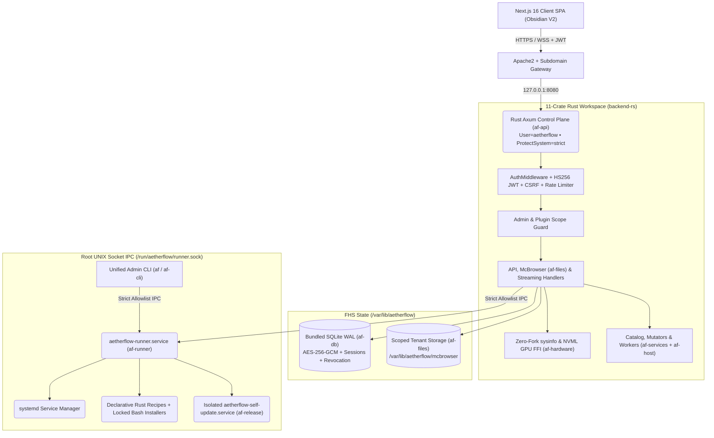

# AetherFlow Codebase Brain

> The definitive architectural and security topology for AetherFlow v4.0.0.

## 1. Core Architectural Axioms

AetherFlow explicitly rejects the complexity of heavy container overlays in favor of direct bare-metal execution. This platform is governed by three unyielding axioms:

1. **100% Bare-Metal & systemd First**: Applications run natively on the host OS. Service supervision is managed directly via `systemd` cgroups and `af-systemd-sandbox` drop-ins—zero Docker daemons, zero container bridging latency, and zero production Node.js runtime daemons. Supported target platforms are **Debian 12/13 (Bookworm/Trixie)** and **Ubuntu 22.04/24.04 LTS**.
2. **AI-Native, Human-Gated**: Intelligence is bounded by cryptographic authorization constraints. The FlowAI engine analyzes telemetry and formulates `RemediationProposals`, but **CANNOT** mutate system state without explicit operator approval via the Global Approval Inbox (`pending_actions`).
3. **Repository & Binary Truth**: Configuration drift is prevented by design. The 11-crate Rust control plane (`backend-rs`) embeds the Next.js 16 static UI (`rust-embed` in `af-api`), verifies its own physical binary path on startup, and persists all state in a single-writer bundled SQLite WAL database (`af-db`).

## 2. Component Topology & Data Flow

When executing an action on AetherFlow, the request traverses strict privilege and process boundaries:

### Constraints:
- **Loopback Binding**: `aetherflow-api` binds strictly to `127.0.0.1:8080`. All external traffic passes through the Apache2 reverse proxy and Subdomain Gateway, which enforces TLS termination and `ALLOWED_HOSTS` validation.
- **SQLite WAL & Zero Redis**: By leveraging bundled `rusqlite` in `WAL` mode (`busy_timeout = 5000`, `foreign_keys = ON`) with `r2d2` (`max_size(1)`), AetherFlow eliminates external Redis dependencies. Session tracking (`active_sessions`) and JWT revocation (`revoked_tokens`) live directly in SQLite, while blocking I/O and online backups run on dedicated worker threads.
- **Zero-Sudo Socket Isolation**: `aetherflow-api.service` runs under `NoNewPrivileges=yes` and `ProtectSystem=strict`. All root operations (`systemctl`, package installations, WireGuard/Tailscale, quotas, and self-updates) are mediated over `/run/aetherflow/runner.sock` (`0660 root:aetherflow`).

## 3. The Threat & Execution Matrix

AetherFlow's threat model extends [`docs/threat_model.md`](./threat_model.md).

### AI Escapement Mitigation
If the FlowAI engine hallucinates a destructive operation:
1. **Model Distrust**: LLM output is treated as untrusted text and structured proposals, never raw shell commands.
2. **Runner Allowlisting**: `af-runner` only accepts strongly-typed IPC structs (`SystemctlRequest`, `PackageRunnerRequest`, `QuotaRunnerRequest`) validated against strict regexes (`SAFE_SERVICE_NAME`, `SAFE_PKG_ID`, `SAFE_USERNAME`) and `lstat` ancestor-symlink checks.
3. **The Approval Inbox Gap**: Proposed actions are serialized into SQLite `pending_actions`. An action cannot execute until an authenticated administrator authorizes it via `POST /api/v1/admin/actions/:id/approve`, recording an immutable entry in `admin_audit_log`.

### JWT & Session Lifecycles
- Access tokens are 15-minute HS256 JWTs delivered via `HttpOnly`, `Secure` cookies (`aetherflow_session`) or `Authorization: Bearer`.
- Revocation is enforced on every authenticated request, OIDC introspection, and WebSocket upgrade against SQLite `revoked_tokens` and `active_sessions`, including verification that the token owner still exists.

## 4. Universal Plugin Runtime (`af-services::plugins` & `af-api`)

To prevent third-party community plugins from impacting the Rust control loop:
- Plugins are discovered via `plugins/*/plugin.manifest.json` and assigned deterministic or dynamic loopback ports (`21000..=21999`).
- `af-api` mints plugin-scoped JWTs (`POST /api/v1/admin/plugins/:id/token`), enforces segment-boundary `api_scopes` RBAC middleware, and streams reverse-proxied requests (`/api/v1/auth/plugins/:id/proxy/*path` and `/plugins/:id/*path`) without buffering response bodies in RAM.
