# AetherFlow Documentation

Documentation index for **AetherFlow v4.0.0** — a 12-crate Rust bare-metal control plane (`backend-rs`) paired with a 4-crate Leptos Rust/WASM dashboard (`frontend-rs`, shipped as external `web/dist` assets) managing native Linux services under `systemd` and `Apache2`.

---

## Getting Started

| Document | Description |
| :--- | :--- |
| [About AetherFlow](./about.md) | Architectural overview, core capabilities, security controls, and target workloads. |
| [Quickstart Guide](./quickstart.md) | Clean-host installation, onboarding URL and bootstrap token, first admin + 2FA, Marketplace install, and optional peer pairing. |
| [Deployment Checklist](./deployment_checklist.md) | Production FHS layout, required secrets, systemd hardening checks, verification commands, and rollback plan. |

---

## Operating

| Document | Description |
| :--- | :--- |
| [Configuration Reference](./configuration.md) | `/etc/aetherflow/aetherflow.env` variables, `/etc/aetherflow/transcode.env`, OIDC/OAuth, host/CSRF hardening, and systemd drop-ins. |
| [Operational Runbook](./RUNBOOK.md) | Day-2 systemd management, readiness probes, `af-heal`, OIDC, WAL-safe backup and staged restore, self-updates, and DB maintenance. |
| [Upgrading Guide](./upgrading.md) | `stable`/`nightly` channels, v3.2.x → v4.0.0 cutover, Migration 26 breaking change (legacy cluster removal), source builds, and rollback. |
| [Self-Update Lifecycle](./self-update.md) | Per-launch transient systemd units (`aetherflow-self-update-*.service`), durable receipts, running-binary checks, and recovery. |
| [Troubleshooting & FAQ](./troubleshooting.md) | Diagnostics for systemd units, WebSockets, runner IPC, `AES_MASTER_KEY`, `ProtectSystem=strict`, APT locks, and Peer Clustering. |
| [Security Guide](./security.md) | Sessions, TOTP 2FA, Subdomain Gateway and `.aether.local` auth, plugin `DynamicUser=yes` isolation, Peer Clustering trust boundaries, and CI gates. |
| [Threat Model](./threat_model.md) | CWE mapping, Peer Clustering and plugin trust boundaries, SSRF/host-header defenses, and residual risk matrix. |
| [Security Policy](../SECURITY.md) | Supported versions, in-scope components, and private vulnerability disclosure process. |

---

## Subsystems

| Document | Description |
| :--- | :--- |
| [System Architecture](./architecture.md) | Full 12-crate `backend-rs` and 4-crate `frontend-rs` architecture, FHS state boundaries, and pull-based release pipeline. |
| [Peer Clustering](./peer-clustering.md) | Operator guide for `afpeer0` WireGuard pairing, 8-area delegated grants, remote dashboard switching, NFSv4.2 media sharing, Jellyfin transcode offload, and `af cluster diagnose` ([diagram](./assets/peer-clustering.svg)). |
| [API Reference](./API.md) | Versioned `/api/v1/*` REST, SSE, WebSocket, and peer proxy endpoints backed by `config/openapi-v1.yaml`. |
| [Native McBrowser](./mcbrowser.md) | Capability-scoped per-user file manager (`af-files` + `af-api::mcbrowser`), 64 GiB TUS uploads, UTF-8 editor, 9-format archives, and public shares. |
| [Network: WireGuard & Tailscale](./network-vpn.md) | Host `wg0` client enrollment, Tailscale mesh routing, external subdomain ingress, and network hardware inventory. |
| [FlowAI Assistant](./flowai.md) | Multi-provider LLM diagnostics (Gemini, OpenAI, Anthropic, Ollama, LM Studio, Anthropic-Local) and Approval Inbox action gate. |
| [Streaming History Contract](./streaming-history-contract.md) | Canonical v1 Jellyfin/Plex/Emby playback history schema, snapshot isolation, imports, reconciliation, and JSON/CSV portability. |
| [Streaming Validation Gate](./streaming-validation.md) | Scoped and integrated contract validation harness (`scripts/validate-streaming.sh`) and real-provider acceptance matrix. |

---

## Rust Internals

| Document | Description |
| :--- | :--- |
| [Rust Migration Status](./rust-migration-status.md) | Crate-by-crate responsibility matrix for all 12 `backend-rs` crates, 4 `frontend-rs` crates, feature gates, and verification commands. |
| [Unified Rust Admin CLI (`af`)](./rust-admin-cli.md) | Complete command reference, exit codes, runner IPC domains, `af provision`, and read-only `af cluster diagnose`. |
| [Rust Package Executor (`af-runner`)](./rust-package-executor.md) | Hybrid declarative/Bash package execution, advisory locking, cancellation, pre-start sandboxing, and rollback journaling. |
| [Rust Release Engine (`af-release`)](./rust-release-engine.md) | Stage-by-stage atomic release deployment, Sigstore/SLSA v1 provenance verification, WAL snapshots, and rollback recovery. |
| [Rust Host Management (`af-host`)](./rust-host-management.md) | Shared WAL-safe SQLite snapshotting, versioned backup manifests, confirmed staged restores, and native host maintenance utilities. |
| [WASM Frontend Workspace](../frontend-rs/README.md) | 4-crate Leptos Rust/WASM workspace (`af-web-core`, `af-web-worker`, `af-web-ui`, `af-web-app`), Trunk build, and reproducibility verification. |

---

## Marketplace & Plugins

| Document | Description |
| :--- | :--- |
| [AetherMarketplace](./marketplace.md) | 77 bare-metal applications, app-specific operating notes (ruTorrent, Palate, Maintainerr, Listenarr, Dispatcharr, VPNs, remote desktops), and lifecycle locks. |
| [Marketplace Developer Guide](./marketplace-developer-guide.md) | Authoring conventions, `packages/common.sh` helper reference, database migration rollback contracts, and validation checklist. |
| [Marketplace Lifecycle Repair](./marketplace-repair.md) | Lifecycle coordination, fail-closed port preservation, atomic binary swaps, and retained-data uninstall contracts. |
| [Marketplace Log Retention](./marketplace-log-retention.md) | `aetherflow-log-retention.timer` / `deploy/log-retention.py` rotation bounds, cooperative `flock` locking, and tail preservation. |
| [Native Declarative Packages](./v4-native-packages.md) | Opt-in Rust package recipes (`AETHERFLOW_ENABLE_RUST_PACKAGES=1`) for 9 catalog packages with pinned digests and rollback semantics. |
| [Jellyseerr / Seerr Upgrades](./seerr-upgrades.md) | Private Node.js/pnpm Seerr build cutover, pre-cutover state backups, retention, and manual rollback steps. |
| [Experimental YouTube Frontends](./experimental-youtube.md) | Bare-metal Piped and Invidious build prerequisites, multi-repo update tracking, and operational caveats. |
| [Installer Packages README](../packages/README.md) | Shared `packages/lib/*.sh` modules, remote bootstrap SHA-256 pinning, migration rollback contracts, and legacy `af` shim. |
| [Installer Script Template](./installpackage-template.sh) | Starter Bash template for new Marketplace installers (`af-<app_id>.service`, `write_config_file`, loopback binding). |
| [Plugin Runtime & SDK](../plugins/README.md) | Plugin scaffolding, manifest validation, scoped tokens, `DynamicUser=yes` systemd isolation, and sandboxed iframe proxy. |
| [Rust Plugin SDK Template](../plugins/sdk-template-rust/README.md) | Standalone first-party Rust plugin template layout, HTTP contracts, and build/verification workflow. |

---

## Testing & Release

| Document | Description |
| :--- | :--- |
| [Testing AetherFlow](./testing.md) | Full verification matrix across `backend-rs` (12 crates), `frontend-rs` (4 crates), Plugin SDK, Python suites, `build_gold.sh`, and Playwright E2E. |
| [v4.0.0 Release Notes](./releases/v4.0.0.md) | Release summary, highlights, breaking changes, and upgrade checklist for AetherFlow v4.0.0. |
| [Clean-Host KVM Matrix Testing](./v4-clean-host-testing.md) | Four-OS QEMU/KVM clean-host bootstrap, upgrade, rollback, and GLIBC 2.35 baseline artifact contract (`scripts/v4_vm_matrix.py`). |
| [Lifecycle & Self-Update Guest Drills](./v4-lifecycle-testing.md) | Disposable-VM verification of transient-unit self-update cgroup survival and SQLite corruption rollback (`scripts/v4_lifecycle_guest_drills.py`). |
| [Privileged Guest Drills](./v4-privileged-testing.md) | Disposable-VM verification of `runner.sock` `SO_PEERCRED`, live WAL backups, quiesced restores, and `af-host` provenance contracts. |
| [Native Package Guest Drills](./v4-native-package-testing.md) | Clean-guest lifecycle verification for opt-in declarative Rust recipes and preinstalled family checks (`scripts/v4_native_package_guest_drills.py`). |

---

## Design Records

Historical and architectural design specifications preserved alongside the living operator guides:

| Document | Description |
| :--- | :--- |
| [Peer Clustering Design Specification](./designs/peer-clustering.md) | Architecture, non-goals, alternatives considered, SQL migrations (25–27), wire/IPC contracts, and transcode dispatcher design ([diagram](./assets/peer-clustering.svg)). |
| [Peer Clustering Implementation Drift Log](./designs/peer-clustering-drift.md) | Phase-by-phase file boundary log, line-citation drift tracking, and post-implementation verification notes for P0–P9 and Bundles A–D. |
| [v4 Post-EGM Hardening Program](./designs/v4-post-egm-hardening-program.md) | Tracks A–D security hardening specification covering gateway auth, `af-files` mount guards, plugin/metrics isolation, and FlowAI guardrails. |

---

## Screenshots

- Full-page dashboard screenshots (dark and light themes) live in `assets/screenshots/{dark,light}/`.
- Annotated step-by-step how-to guide images referenced throughout these docs live in `assets/guides/`.
