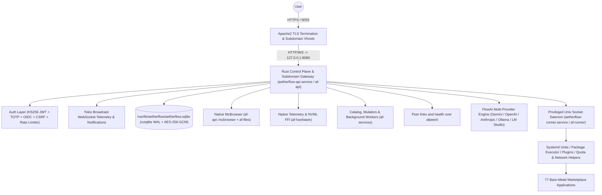

# Architecture

AetherFlow v4.0.0 runs a 12-crate Rust control plane (`backend-rs` -> `aetherflow-api`) on bare-metal Linux. It serves the 4-crate Leptos WebAssembly dashboard (`frontend-rs`) from `<exe-dir>/web/dist` by default, or from `STATIC_DIR` when explicitly set (failing closed if empty or invalid). A root-owned Unix socket daemon (`aetherflow-runner.service`, invoked as `aetherflow-api runner`, implemented by `af-runner`) isolates privileged operations. Workloads run natively under **systemd** and **Apache2**.

## System Overview

Apache2 terminates public HTTPS/WSS traffic for the control plane and `<app>.<baseDomain>` virtual hosts, forwarding HTTP/WS requests over loopback to `aetherflow-api` (`127.0.0.1:8080` when configured by `AetherFlow-Setup`). For all **10** gateway-protected applications (including `rutorrent`), `af-api` validates live administrator sessions (`aetherflow_session`, `__Host-aetherflow_app` on HTTPS, or `aetherflow_local_app` on HTTP `*.aether.local`) or rate-limited live-DB Basic auth (`role == "admin"`, `totp_enabled == 0`) and reverse-proxies requests to the application's loopback port (injecting `X-Aetherflow-Rutorrent-Token` for local `rutorrent`). Internal `<app>.aether.local` routing allows authenticated loopback, RFC 1918 LAN, link-local, ULA, and Tailscale (`100.64.0.0/10`) clients without `external_access_enabled = 1`; unauthenticated LAN access on `*.aether.local` is disabled by default (`AF_ALLOW_UNAUTH_LOCAL_LAN=1` opts in strictly for RFC 1918, link-local, and IPv6 ULA — never `100.64.0.0/10` or loopback; see [Security Guide](./security.md) and [Threat Model](./threat_model.md)).

---

## Rust Control Plane Workspace (`backend-rs`)

Twelve workspace crates in `backend-rs` compile into `aetherflow-api` (serving the unprivileged HTTP/WebSocket control plane, the zero-CDN OpenAPI 3.1 viewer at `/api/v1/public/swagger/` and `/api/v1/public/openapi.yaml`, and the `aetherflow-api runner` root socket daemon), the unified `af` (`af-cli`, packaged at `bin/af`) administrative CLI binary, the native `speedtest-backend` (`af-librespeed`, packaged at `bin/speedtest-backend`) daemon, and the Rust-native Jellyfin transcoding binary `af-transcode` (`--bin af-transcode`, packaged at `bin/af-transcode`, providing the FFmpeg shim, remote worker daemon, and capability probe), paired with the 4-crate Leptos WebAssembly workspace (`frontend-rs`: `af-web-core`, `af-web-worker`, `af-web-ui`, `af-web-app`).

### 1. `af-api` (`backend-rs/crates/af-api`) — HTTP/WS Control Plane and Dashboard

- **Rust WASM UI**: Trunk builds `frontend-rs/` into static HTML, CSS, JavaScript loaders, and WebAssembly for the app and workers using the unified dark/light flat surface and control hierarchy (see [Design System](./design-system.md)). CI stages these as external `web/dist` release assets. Serving the dashboard requires no Node.js daemon.
- **Static Serving**: `aetherflow-api` serves existing assets from `<exe-dir>/web/dist` by default (or `STATIC_DIR` when explicitly set, failing closed if empty or invalid) and returns `index.html` for supported client routes. Entry points revalidate; content-addressed assets can be cached for one year.
- **Security, Plugin RBAC & Gateway Middleware**:
  - Enforces HS256 JWT sessions (`aetherflow_session` cookie or `Authorization: Bearer`), uniform SQLite-backed token revocation and unexpired `active_sessions` enforcement (`verify_active_session_on_conn` across all HTTP, proxy, app-launch, `/metrics`, optional marketplace, WebSocket, and OIDC `/authorize` surfaces), optional per-user TOTP 2FA, OIDC/OAuth2 PKCE, outer `host_validation_middleware` (canonical loopback IPs only without `ALLOWED_HOSTS`), and per-IP rate limiting (including `/api/v1/auth/refresh` and `/api/auth/refresh`).
  - Validates double-submit `X-CSRF-Token` headers against the `csrf_token` cookie on state-mutating cookie requests (Bearer tokens exempt; cookie-authenticated `/refresh` is exempt from `X-CSRF-Token` but requires `X-Requested-With: XMLHttpRequest`; no `Origin` check in `csrf_middleware`).
  - Enforces dedicated `PluginTokenClaims` route-scope verification (`AETHERFLOW_PLUGIN_TOKEN_FILE`, default-denying `/api/v1/admin/*` and `/api/v1/ingress/*`), streaming subdomain reverse proxying (`Body::from_stream` without full-body RAM buffering), and bounded plugin reverse proxying (`backend-rs/crates/af-api/src/plugins/proxy.rs`, buffering request and response bodies up to 2 MiB in RAM).
- **Native Plugin Runtime (`backend-rs/crates/af-api/src/plugins/`)**: Discovers and validates `plugins/*/plugin.manifest.json`, allocates deterministic/dynamic loopback ports (`21000..=21999`), mints short-lived scoped plugin JWTs, verifies segment-boundary `api_scopes`, and delegates isolated plugin process execution to `af-runner::plugins`. See [Plugins Runtime & SDK](../plugins/README.md).
- **Control Plane Subsystems**:
  - Marketplace lifecycle (`routes/marketplace/`), Native McBrowser (`mcbrowser/` — 64 GiB resumable TUS uploads, ETag-guarded UTF-8 editing up to 10 MiB, 9-format archives, public shares, media previews, and search; see [Native McBrowser](./mcbrowser.md)), and FileShare (`/var/lib/aetherflow/uploads`).
  - FlowAI multi-provider intelligence (`intelligence/`), canonical Streaming History & reconciliation (`streaming_history.rs`, `streaming_portability/`), and MediaFlow transcoding queue.
  - GitHub release update checking (`storage/updater.rs` — 5-minute cache, `X-RateLimit-Reset`/`Retry-After` backoff, `stable`/`nightly` channel filtering, branch-head SHA fallback for `nightly`), chunked backup uploads/restores, peer pairing, link health, scoped peer management, peer media storage, distributed Jellyfin transcoding, and storage quotas.
- **Peer Links & Distributed Transcoding**: The API pairs servers through HTTPS and binds its peer listener (`SO_BINDTODEVICE=afpeer0`) to the local `afpeer0` address (`AF_PEER_LISTEN_PORT`, default `9443`) once a tunnel identity exists. SQLite stores link, pairing, grant, storage, and transcode worker state. The separate runner manages WireGuard (`/v1/peer-network`), peer credentials, NFSv4.2 exports/mounts (`/v1/peer-storage`), and transcode drop-ins/worker units (`/v1/peer-transcode`). See [Peer Clustering](./peer-clustering.md) and the [peer clustering topology diagram](./assets/peer-clustering.svg).
- **`aetherflow-api.service`**: Runs as unprivileged `User=aetherflow` (`Group=aetherflow`) with `SupplementaryGroups=systemd-journal adm`, `ProtectSystem=strict`, `ProtectHome=read-only`, `PrivateTmp=yes`, `NoNewPrivileges=yes`, `RestrictSUIDSGID=yes`, `DevicePolicy=closed` (`/dev/dri`, `char-drm`, `/dev/nvidiactl`, `/dev/nvidia0` single-GPU default, `/dev/nvidia-modeset`, `/dev/nvidia-uvm`), `ReadWritePaths=/var/lib/aetherflow /var/log/aetherflow /run/aetherflow` plus optional `-/srv -/mnt -/media -/data` and `-/opt/AetherFlow/backend/data`, `UMask=0027`, and `LimitNOFILE=65535`.

### 2. `af-runner` (`backend-rs/crates/af-runner`) — Privileged Unix Socket Daemon

- **`aetherflow-runner.service`**: Runs `/opt/AetherFlow/current/aetherflow-api runner` as `root` listening on `/run/aetherflow/runner.sock` (`0660 root:aetherflow`), enforcing `SO_PEERCRED` peer credential checks and `/proc/<pid>/exe` verification (authorizing sibling `aetherflow-api` and `af` binaries).
- **Allowlisted Privileged Verbs (`build_runner_router`)**:
  - **Health & Systemd**: `/v1/health`, `/v1/systemctl` (allowlisted managed units and actions), `/v1/sandbox`.
  - **Packages & Metadata**: `/v1/package` (locked Bash installers sourcing `packages/common.sh` / `packages/lib/*.sh` by default, plus 9 opt-in declarative Rust recipes via `AETHERFLOW_ENABLE_RUST_PACKAGES=1`; see [Rust Package Executor](./rust-package-executor.md)), `/v1/package/cancel`, `/v1/package/lifecycle-snapshot`, `/v1/package/probe-version`, `/v1/app-meta`, `/v1/dispatcharr-credentials`.
  - **Ingress, DNS & Blueprints**: `/v1/blueprint/apply`, `/v1/ingress/vhost` (Apache2 ACME/TLS vhost sync), `/v1/certbot-sync`, `/v1/hosts` (`/etc/hosts`, `dnsmasq`, Pi-hole, and AdGuard Home `.aether.local` LAN DNS sync).
  - **Self-Update & Backups**: `/v1/self-update` and `/v1/self-update/status` (spawns transient `aetherflow-self-update-<command>-<channel>-<8hex>.service` units running `af-release` by default, or `deploy/release-manager.sh` via `AETHERFLOW_FORCE_BASH_RELEASE=1` / `AETHERFLOW_RELEASE_ENGINE=bash`), `/v1/backup`.
  - **Network, Peer Clustering, Quotas & Plugins**: `/v1/network`, `/v1/peer-network`, `/v1/peer-storage`, `/v1/peer-transcode`, `/v1/quota`, `/v1/quota/usage`, and `/v1/plugins/{start,stop,status,token}` (transient `DynamicUser=yes` plugin isolation units).
- **Request Correlation**: Validated `X-Request-ID` headers are propagated into `aetherflow-runner` structured request logs and responses for end-to-end correlation.

### 3. `af-files` (`backend-rs/crates/af-files`) — Capability-Scoped Filesystem Sandbox

- **Tenant Confinement Primitives**: Implements `BrowserFs` using Linux `openat2` and opened directory descriptors to confine per-user storage to `0700` roots under `/var/lib/aetherflow/mcbrowser/user-<id>`, rejecting symlinks at the storage root and per-user roots and guarding path mutations against traversal escapes. The higher-level HTTP/TUS upload, editor, archive, share, and search features live in `af-api::mcbrowser`.
- **Host Path Picker Boundary**: Administrator-only host path browsing (`GET /api/v1/auth/fs` in `af-api`) defaults to `/mnt,/media,/srv,/data,/home` plus `env::current_dir()` (when outside `/opt/AetherFlow` and `/var/lib/aetherflow`; `/tmp` / `env::temp_dir()` is excluded by default), or the explicit comma-separated `AF_ALLOWED_FS_ROOTS` override.

### 4. `af-db` (`backend-rs/crates/af-db`) — Bundled SQLite WAL & Envelope Encryption

- **Split Writer/Reader SQLite WAL Pools**: Uses `rusqlite` (bundled SQLite) with a `max_size(1)` writer pool (`DB_POOL`) and a `max_size(8)` `SQLITE_OPEN_READ_ONLY` reader pool (`DB_READ_POOL`, `query_only = ON`, `busy_timeout = 750ms`) in `WAL` mode (`busy_timeout = 5000`, `synchronous = NORMAL`, `foreign_keys = ON`) over `/var/lib/aetherflow/aetherflow.sqlite`.
- **No Redis Dependency**: Session tracking, JWT revocation (`revoked_tokens`), OIDC state nonces, and audit logs (`admin_audit_log`) persist directly in SQLite; `/health/ready` retains `"redis": "disabled"` for response-schema compatibility.
- **Cryptographic Storage**: Encrypts AI provider keys, `users.totp_secret`, `streaming_servers.api_key`, `notification_channels.config`, `/var/lib/aetherflow/.master.creds`, and SQLite `system_config.master_credentials` at rest using AES-256-GCM in the single-payload format `enc:v1:<base64(nonce || ciphertext)>` derived from `AES_MASTER_KEY`.

### 5. `af-hardware` (`backend-rs/crates/af-hardware`) — Native Telemetry & NVML FFI

- Collects CPU, memory, swap, network, per-mount disk usage, and `/proc/diskstats` I/O counters via `sysinfo` and procfs without spawning shell subprocesses on polling paths.
- Dynamically loads `libnvidia-ml.so.1` via `libloading` FFI for zero-fork NVIDIA GPU utilization, VRAM, and temperature telemetry (`GpuMetric { index, name, usage_pct, memory_total, memory_used, temp }`).

### 6. `af-services` (`backend-rs/crates/af-services`) — Catalog, Mutators & Background Workers

- **Catalog & Blueprints**: Loads canonical `config/packages.json` (77 bare-metal apps) and `config/package_automation.json`, resolves dependency graphs, and checks runtime systemd/process states.
- **Native Config Mutators**: Pure-Rust mutators in `af-runner::blueprint` (selectively re-exported by `af-services::mutators`) for XML (`mutate_xml_element`), INI (`mutate_ini_key`), JSON (`mutate_json_key`), TOML (`mutate_pihole_toml`), YAML (`mutate_yaml_section_key`), systemd (`mutate_systemd_aspnetcore_urls`), and Dispatcharr ports (`mutate_dispatcharr_port`), alongside SQLite (`mutate_sqlite_setting`) in `af-services::mutators` and Apache vhost sync (`sync_apache_app_vhost` via `/v1/ingress/vhost`).
- **Background Workers**: Runs the periodic metrics recorder, `af-heal` health watchdog (`workers.rs`, 10-second polling loop with approval gate by default), smart backup scheduler (wired to `af-host` using default `SnapshotMethod::VacuumInto` + `.manifest.json` + `.sha256`), upstream release watcher, and MediaFlow transcoding queue poller (`workers.rs`).

### 7. `af-release`, `af-host`, `af-cli`, `af-transcode` & `af-models`

- **`af-release` (`backend-rs/crates/af-release`)**: Default pull-based atomic release engine (`Deploy`, `Rollback`, `Cleanup`, `MigrateSystemd`) with 4-tier SQLite DB path resolution, `stable`/`nightly` channel selection, `/releases/latest` redirect fallback, SHA-256 + Sigstore/SLSA v1 build provenance verification (`verify_release_provenance`), `web/dist` asset validation, `prepare_release_permissions`, WAL-safe pre-swap snapshots, executable runtime verification, and automatic rollback/recovery. See [Rust Release Engine](./rust-release-engine.md).
- **`af-host` (`backend-rs/crates/af-host`)**: Shared backup, verification, confirmed staged restore (`execute_staged_restore`; fail-closed `execute_destructive_restore`), and native system maintenance library (`sentinel_scan_auth_log`, `apply_network_tuning`, `clean_system_logs`, `inspect_home_disk_space`). See [Rust Host Management](./rust-host-management.md).
- **`af-cli` (`backend-rs/crates/af-cli`)**: Unified `af` administrative CLI binary (`bin/af`) supporting `package`, `service`, `quota`/`setdisk`, `sandbox`, `release`, `backup`, `maintenance` (`tune`, `sentinel`, `clean-logs`, `showspace`), `hosts`, `cluster` (`af cluster diagnose`), and `provision` (14 Rust-native foundation steps; 6 run by default). See [Unified Rust Admin CLI](./rust-admin-cli.md).
- **`af-transcode` (`backend-rs/crates/af-transcode`)**: Rust-native Jellyfin transcode binary (`--bin af-transcode`, packaged at `bin/af-transcode`) implementing the `JELLYFIN_FFMPEG` shim, the hardened remote worker daemon (`af-transcode-worker.service`, running as `User=jellyfin` with `PrivateNetwork=yes` and secret-free `/etc/aetherflow/transcode.env`), and local FFmpeg/GPU capability probing.
- **`af-models` (`backend-rs/crates/af-models`)**: Shared `serde` models for catalog entries, hardware metrics, notifications, marketplace payloads, and runner IPC requests/responses.

### 8. `af-librespeed` (`backend-rs/crates/af-librespeed`) — Native Speedtest Backend

- Compiles into the standalone `bin/speedtest-backend` binary shipped alongside `aetherflow-api`, `bin/af`, and `bin/af-transcode` in every core release bundle (replacing the external Go LibreSpeed server).
- Provides SQLite WAL telemetry persistence (with automatic legacy BoltDB v2 migration), keyed ULID result-ID obfuscation, and PNG speedtest result badge rendering.

---

## Strict FHS State, Runtime Dependencies & Pull-Based Release Pipeline

- **Immutable Releases**: `/opt/AetherFlow/releases/<timestamp>` symlinked atomically to `/opt/AetherFlow/current`.
- **Mutable State**: `/var/lib/aetherflow/aetherflow.sqlite` (`StateDirectory=aetherflow`, `0700`; database files created at `0640` via `UMask=0027`).
- **Environment Secrets**: `/etc/aetherflow/aetherflow.env`, read by `systemd` PID 1 as `root` via `EnvironmentFile=-/etc/aetherflow/aetherflow.env` before dropping privileges to `User=aetherflow` (both `aetherflow-api.service` and `aetherflow-runner.service` load this file directly; legacy `/opt/AetherFlow/current/backend/.env` fallbacks have been retired from both units). `AetherFlow-Setup` creates it as `0640 root:aetherflow`; `af provision` enforces mode `0600` on created or existing files; `af-release` legacy migration writes `0600` preserving source `uid:gid` or falling back to `aetherflow:aetherflow`. Secret-free distributed transcoding overrides live separately in `/etc/aetherflow/transcode.env` (`0640 root:jellyfin`).
- **Host Runtime Dependencies**: The control plane and dashboard require no Node.js, Go, or Redis daemons. Production hosts require `python3` and `openssl` (used by `af-release` Sigstore/SLSA provenance verification, deferred core service restarts, `deploy/log-retention.py`, and `deploy/release-manager.sh`).
- **Pull-Based CD**: `.github/workflows/release.yml` runs Gitleaks, multi-arch (`amd64` and `arm64`) release packaging, and Sigstore build provenance attestations. Local packaging uses `scripts/build_gold.sh`, which runs the Leptos WASM build (`bash scripts/build_wasm_frontend.sh --stage`), `RUST_TEST_THREADS=1 cargo test --locked --workspace` (plus `frontend-rs` workspace tests), and `cargo build --release --locked --target <rust_target> --bin aetherflow-api --bin af --bin speedtest-backend --bin af-transcode` to assemble `aetherflow-linux-<arch>.tar.gz` (default `TARGETS=amd64`) with external `web/dist` assets and `SHA256SUMS`.

See [Rust Migration Status](./rust-migration-status.md) for the crate-by-crate and contract-by-contract architecture matrix.
