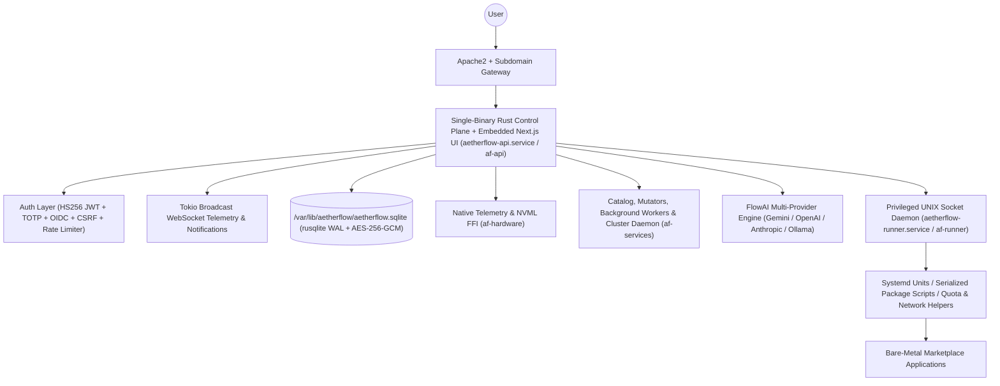

# Architecture

AetherFlow v4.0.0 is engineered as a high-concurrency, single-binary **Rust** control plane (`backend-rs` -> `aetherflow-api`) for bare-metal Linux systems. It embeds the compiled Next.js 16 static UI directly into the Rust binary (`rust-embed` in `af-api`), isolates privileged host operations behind a root-owned UNIX domain socket daemon (`aetherflow-runner.service`, implemented by `af-runner`), and orchestrates bare-metal workloads via **systemd** and **Apache2** with a strict **Zero-Docker mandate**.

## System Overview

---

## Rust Control Plane Workspace (`backend-rs`)

The six core crates compile into `aetherflow-api`, which serves the unprivileged HTTP/WebSocket control plane and the `aetherflow-api runner` root socket daemon. The workspace additionally registers `af-release`, `af-host`, and the administrative `af-cli` (`af`) binary; these migration additions are not equivalent to production cutover.

### 1. `af-api` (`backend-rs/crates/af-api`) — HTTP/WS Control Plane & Embedded SPA
- **Zero Production Node.js Runtime**: Next.js 16 compiles to a static export (`NEXT_STATIC_EXPORT=1`) during CI, is staged into `backend/web/dist/`, and is embedded into `aetherflow-api` via `rust-embed` (`backend-rs/crates/af-api/src/embed.rs`).
- **5-Step Static & RSC Resolution**: `serve_spa_request` resolves exact asset paths, `<route>/index.html`, `<route>.html`, and dynamic Next.js route shells (`/marketplace/[id]` -> `/marketplace/__placeholder__/index.html`, plus RSC `.txt` payload fallback) while serving `/_next/static/*` with `Cache-Control: public, max-age=31536000, immutable`.
- **Security & Gateway Middleware**: Enforces HS256 JWT session validation (`aetherflow_session` cookie or `Authorization: Bearer`), SQLite-backed token revocation and active session tracking, TOTP 2FA, OIDC/OAuth2 PKCE, state-changing CSRF origin/token checks, per-IP rate limiting, and streaming subdomain reverse proxying (`app_subdomain_proxy_middleware` via `Body::from_stream` without full-body RAM buffering).
- **Control Plane Subsystems**: Hosts REST and WebSocket endpoints for Marketplace management, FlowAI multi-provider intelligence (`intelligence.rs`), MediaFlow transcoding/polling, backup archive chunked uploads/restores, multi-node cluster enrollment, and billing webhooks.

### 2. `af-runner` (`backend-rs/crates/af-runner`) — Privileged UNIX Socket Daemon
- **`aetherflow-api.service`**: Runs as unprivileged `User=aetherflow` (`Group=aetherflow`) with systemd sandboxing (`ProtectSystem=strict`, `ProtectHome=yes`, `PrivateTmp=yes`, `NoNewPrivileges=yes`, `RestrictSUIDSGID=yes`, `MemoryMax=512M`).
- **`aetherflow-runner.service`**: Runs `/opt/AetherFlow/current/aetherflow-api runner` in a root cgroup listening on `/run/aetherflow/runner.sock` (`0660 root:aetherflow`).
- **Allowlisted Privileged Verbs**: Exposes `/v1/health`, `/v1/systemctl` (strictly allowlisted unit names and actions), `/v1/package` (serialized with a global `tokio::sync::Mutex` so only one package action runs at a time), `/v1/self-update`, `/v1/sandbox`, `/v1/hosts`, `/v1/network`, `/v1/quota`, and `/v1/app-meta`.

### 3. `af-db` (`backend-rs/crates/af-db`) — Bundled SQLite WAL & Envelope Encryption
- **Single-Writer SQLite Pool**: Uses `rusqlite` (bundled SQLite) with `r2d2` (`max_size(1)`) in `WAL` mode (`busy_timeout = 5000`, `synchronous = NORMAL`, `foreign_keys = ON`) over `/var/lib/aetherflow/aetherflow.sqlite`.
- **Zero Redis Dependency**: Session tracking, JWT revocation (`revoked_tokens`), OIDC state nonces, and audit logs are persisted directly in SQLite; Redis is disabled in v4.0.0 (`/health/ready` reports `"redis": "disabled"`).
- **Cryptographic Storage**: Encrypts stored secrets and API keys at rest using AES-256-GCM (`enc:v1:<nonce>:<ciphertext>`) derived from `AES_MASTER_KEY`.

### 4. `af-hardware` (`backend-rs/crates/af-hardware`) — Native Telemetry & NVML FFI
- Collects CPU, memory, swap, network, per-mount disk usage, and `/proc/diskstats` I/O counters via `sysinfo` and procfs without spawning shell subprocesses on hot polling paths.
- Dynamically loads `libnvidia-ml.so.1` via `libloading` FFI for zero-fork NVIDIA GPU utilization, VRAM, temperature, and power telemetry.

### 5. `af-services` (`backend-rs/crates/af-services`) — Catalog, Mutators & Workers
- **Catalog & Blueprints**: Loads `backend/config/packages.json` and `package_automation.json`, resolves dependency graphs, and checks runtime systemd/process states.
- **Native Config Mutators**: Pure-Rust mutators (`mutators.rs`) for XML (`xml_xpath`), INI (`ini_key`), JSON (`json_key`), SQLite (`sqlite_query`), Pi-hole (`pihole_Config`), and Apache2 domain/TLS virtual hosts (`apache_vhosts`).
- **Background Workers & Cluster Daemon**: Runs the periodic metrics recorder, `af-heal` health evaluator, smart backup scheduler, upstream release watcher, MediaFlow queue poller (`workers.rs`), and multi-node cluster heartbeat daemon (`cluster_daemon.rs`).

### 6. `af-models` (`backend-rs/crates/af-models`) — Shared Wire & Domain Contracts
- Defines shared serde models for catalog entries, hardware metrics, notifications, marketplace payloads, and runner IPC requests/responses.

---

## Strict FHS State & Pull-Based Release Pipeline

- **Immutable Releases**: `/opt/AetherFlow/releases/<timestamp>` symlinked atomically to `/opt/AetherFlow/current`.
- **Mutable State**: `/var/lib/aetherflow/aetherflow.sqlite` (`StateDirectory=aetherflow`, `0700`).
- **Environment Secrets**: `/etc/aetherflow/aetherflow.env` (`0600`).
- **Pull-Based CD**: GitHub Actions (`.github/workflows/release.yml`) and `scripts/build_gold.sh` run Gitleaks, frontend static export (`NEXT_STATIC_EXPORT=1`), `cargo test --workspace`, and `cargo build --release --bin aetherflow-api`, packaging `aetherflow-linux-amd64.tar.gz` + `SHA256SUMS`.

---

## Migration Boundaries: Shipped Rust vs. Staged / Remaining Components

To keep operational documentation accurate, the following components are **not yet ported to Rust** or remain **staged in progress**:

1. **Staged (In Progress by Other Workstreams — Not Yet Shipped or Integrated)**:
   - **Rust Package Executor**: `af-runner` (`/v1/package`) validates package names, serializes execution, and streams progress in Rust. Package operations still default to `/bin/bash` scripts under `packages/package/{install,remove,update}/*`; `AETHERFLOW_ENABLE_RUST_PACKAGES=1` opts into the native `fail2ban` recipe only. Runner tests pass in isolation; this is not a live-host rollout certification.
   - **`af-release`**: Atomic release download, SHA-256 verification, symlink swap, and rollback are currently executed by `deploy/release-manager.sh` (invoked by `af-runner` on `/v1/self-update`). The hardened `af-release` library is registered in the workspace and passes 15 isolated Linux tests; production runner cutover and live systemd validation remain deferred.
   - **`af-host`**: Privileged host-level utilities invoked by the runner or operator (`packages/system/af-systemd-sandbox`, `packages/system/setdisk`, `packages/system/af-certbot-sync`, `packages/system/af-backup`, `packages/system/af-heal`, `packages/system/af-tune`, `packages/system/af-sentinel.py`) remain Bash/Python scripts; the registered `af-host` library provides hardened backup creation, verification, and non-destructive restore preflight (13 Linux tests passing). Existing API/scheduler integration remains incomplete, and live restore is unsupported.
   - **`af-cli`**: The registered Rust `af` binary provides runner-mediated administration, local backup/release interfaces, and resumable provisioning foundations. Its 11 tests and CLI/socket smoke checks pass, but packaging still installs the legacy shell entrypoint and interactive bootstrap remains shell-owned.
2. **Dormant Plugin Runtime & Permission Enforcement**:
   - The legacy Go `PluginManager` (`backend/services/plugin_manager.go`) is dormant and has no callers.
   - `backend-rs` does not yet include an in-process Wasm/process plugin host, `plugin.manifest.json` loader, dynamic port allocator, `/plugins/*` reverse proxy, or plugin-scoped token mint/RBAC enforcement.
   - `plugins/sdk-template-rust/` provides a standalone companion service scaffold targeting verified `/api/v1/public/marketplace` and `/api/v1/auth/system/metrics` contracts while documenting these runtime gaps.
3. **Legacy Tree & Installer Cutover**:
   - The legacy Go tree (`backend/`) remains in the repository (hosting `backend/config/*.json` and `backend/web/dist/` for `rust-embed`).
   - `setup/modules/modern_stack.sh` still contains legacy build-from-source Go/Node provisioning steps that have not yet been cut over to the pull-based Rust release pipeline.

See [docs/rust-migration-status.md](rust-migration-status.md) for the complete crate-by-crate and contract-by-contract migration status matrix.
