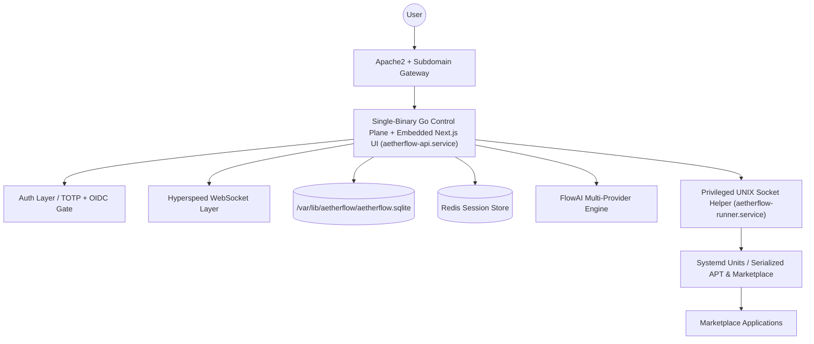

# Architecture

AetherFlow is engineered as a high-concurrency, single-binary control plane for modern Linux systems. It embeds the compiled Next.js static UI directly into the Go binary (`go:embed`), isolates privileged host operations behind a root-owned UNIX domain socket (`aetherflow-runner.service`), and orchestrates bare-metal workloads via **systemd** and **Apache2**.

## System Overview

---

## Component Breakdown

### 1. Single-Binary Control Plane & Embedded UI (`backend/web/embed.go`)
- **Zero Production Node.js Runtime**: Next.js 16 compiles to a static export (`NEXT_STATIC_EXPORT=1`) during CI and is embedded directly into the Go binary via `go:embed`.
- **Same-Origin Delivery**: `aetherflow-api` serves both `/api/v1/*` and the SPA frontend with immutable cache headers (`/_next/static/*`), eliminating cross-origin port `3000` zombie locks (`EADDRINUSE`) and public-IP CORS lookups.

### 2. Privilege Separation (`backend/services/privileged_runner.go`)
- **`aetherflow-api.service`**: Runs as unprivileged `User=aetherflow` with full systemd namespace isolation (`ProtectSystem=strict`, `ProtectHome=yes`, `PrivateTmp=yes`, `NoNewPrivileges=yes`, `RestrictSUIDSGID=yes`).
- **`aetherflow-runner.service`**: Runs `/opt/AetherFlow/current/aetherflow-api runner` in a separate root cgroup listening on `/run/aetherflow/runner.sock` (`0660 root:aetherflow`). It validates and executes allowlisted `systemctl` verbs, serialized Marketplace package scripts (with a global `sync.Mutex` and `DPkg::Lock::Timeout=120`), and atomic self-updates.

### 3. Strict FHS State & Pull-Based Release Pipeline (`deploy/release-manager.sh`)
- **Immutable Releases**: `/opt/AetherFlow/releases/<epoch>` symlinked atomically to `/opt/AetherFlow/current`.
- **Mutable State**: `/var/lib/aetherflow/aetherflow.sqlite` (`StateDirectory=aetherflow`, `0700`).
- **Environment Secrets**: `/etc/aetherflow/aetherflow.env` (`0600`).
- **Pull-Based CD**: GitHub Actions (`.github/workflows/release.yml`) runs Gitleaks, SAST, unit/E2E tests, builds the pure-Go static binary (`CGO_ENABLED=0`), attests build provenance, and publishes `aetherflow-linux-amd64.tar.gz` + `SHA256SUMS` to GitHub Releases (`stable`, `beta`, `nightly`). Production nodes pull and verify the SHA-256 digest without compiling code on production.
