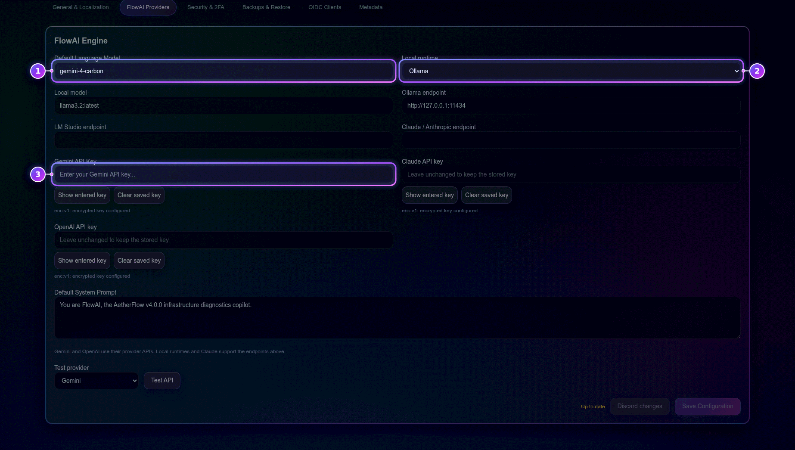
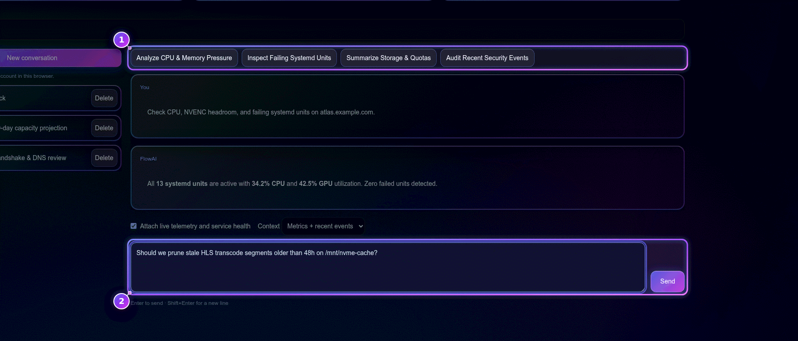
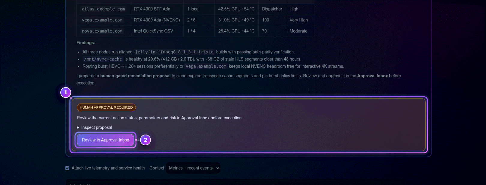
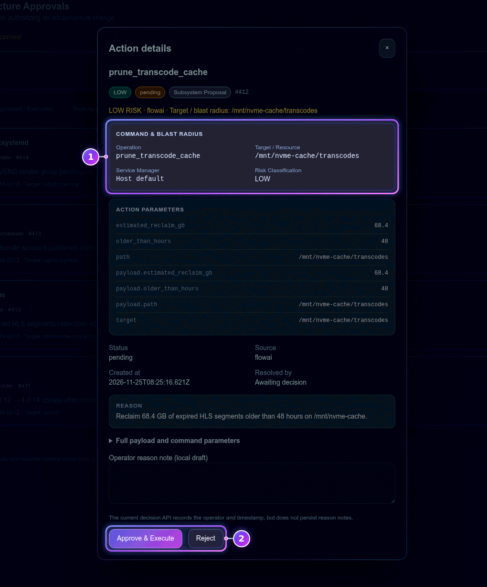

# FlowAI Assistant

FlowAI is AetherFlow's integrated AI operations layer, routing chat and diagnostic requests across cloud and local LLM providers while gating AI-proposed service mutations behind manual administrator approval.

## Key Features

- **Live Telemetry Context**: Injects instantaneous host hardware telemetry for administrator requests and supports diagnostic context modes (including UI-supplied `metrics_snapshot.service_health`) on the admin support endpoint.
- **Action Approval Gate**: Intercepts AI-proposed service restarts and stops into `pending_actions` (**Approval Inbox**) for explicit administrator review before execution.
- **Multi-Provider Support**: Routes requests to Gemini, OpenAI, Anthropic, or local runtimes (LM Studio, Ollama, Anthropic-Local) through a single Rust abstraction layer.

## Step-by-Step Workflow

1. **Configure an AI provider**: Open **Settings → FlowAI Providers**, select a cloud provider (Gemini, OpenAI, Anthropic) or local runtime (LM Studio, Ollama, Anthropic-Local), enter your API key or endpoint URL, click **Test API**, and save.

   

2. **Ask FlowAI**: Open the **FlowAI** tab (`/?tab=ai`), type a diagnostic question in the prompt box or select a quick action, and send.

   

3. **Review proposed service actions**: When FlowAI detects a supported `restart` or `stop` proposal for an administrator, a **HUMAN APPROVAL REQUIRED** card appears below the reply—click **Review in Approval Inbox**.

   

4. **Approve or reject in the Approval Inbox**: Open **Approval Inbox** (`/?tab=inbox`), verify the target service and impact, and click **Approve & Execute** (or **Approve & Queue Restart** for core control-plane units) or **Reject**.

   

---

## Architecture Overview

FlowAI uses a provider-agnostic routing layer in the Rust control plane (`backend-rs/crates/af-api/src/intelligence.rs`, delegating to `intelligence/ai_providers.rs` and `intelligence/flowai.rs`) without vendor SDK lock-in.

```text
┌────────────────────────────────────────────────────────────────────┐
│  WASM Frontend (Leptos / frontend-rs)                              │
│  tabs/ai_chat.rs -> sends { message, model, provider, history }    │
│  tabs/settings/providers.rs -> provider config & Test API action   │
└───────────────────────────────┬────────────────────────────────────┘
                                │ POST /api/v1/auth/ai/{chat,support}
                                ▼
┌────────────────────────────────────────────────────────────────────┐
│  Rust API Layer (af-api::intelligence::{ai_providers,flowai})      │
│    1. Decrypt AES-256-GCM keys from SQLite (af-db)                 │
│    2. Validate model ID / provider & reject forbidden aliases      │
│    3. Inject instantaneous metrics (admin) / support context       │
│    4. Dispatch HTTPS/local request & parse proposed actions        │
└───────────────────────────────┬────────────────────────────────────┘
                                │
         ┌──────────────────────┼──────────────────────┐
         ▼                      ▼                      ▼
   ┌──────────┐           ┌──────────┐          ┌──────────────┐
   │ Gemini   │           │ OpenAI   │          │ Anthropic    │
   │ (HTTPS)  │           │ (HTTPS)  │          │ (HTTPS)      │
   └──────────┘           └──────────┘          └──────────────┘
                                │
                 ┌──────────────┴──────────────┐
                 │ Local Runtimes              │
                 │ (LM Studio / Ollama /       │
                 │  Anthropic-Local)           │
                 └─────────────────────────────┘
```

### Provider Routing & Model Validation

Provider selection follows this order:

1. **Explicit `provider` field** in the request body (highest priority: `gemini`, `openai`, `anthropic`, `localai`, `lm-studio`, `ollama`, or `anthropic-local`).
2. **Runtime-prefixed local model ID**: `<runtime>:<model>` where `<runtime>` is `lm-studio`, `ollama`, or `anthropic-local` (e.g., `ollama:llama3.2`).
3. **Model ID prefix auto-detection**: `gemini*` -> Gemini, `gpt*` / exact `o3` / `o3-*` / `o4-*` -> OpenAI, `claude*` -> Anthropic (`resolve_provider()` matches `gemini`, `gpt`, and `claude` without requiring a trailing hyphen, so unhyphenated custom local IDs such as `gpt4all` should pass an explicit `provider`).
4. **Non-allowlisted valid local model IDs**: Any model ID not in `ALLOWED_AI_MODELS` that passes `is_valid_local_model_id` routes to `localai` (`infer_local_runtime`).
5. **Default fallback**: Gemini (default model `gemini-4-argon`; if Gemini returns HTTP `404` on `gemini-4-argon`, FlowAI performs a single retry against `gemini-2.5-pro`).

> [!IMPORTANT]
> **Forbidden Model Aliases**: Bare provider or locality aliases (`lm-studio`, `ollama`, `anthropic-local`, `localai`, `local-test`, `local`, `gemini`, `openai`, `anthropic`) are rejected as `model` IDs with HTTP `400` (`FORBIDDEN_MODEL_ALIASES`). Pass the runtime in `provider` / `local_provider` alongside an actual model ID in `model` / `local_model`, or use `<runtime>:<model>`.

---

## Endpoints & Operational Behavior

FlowAI exposes two conversation endpoints rather than separate autonomous execution modes. Both endpoints extract proposed service actions for administrators:

### 1. Chat (`POST /api/v1/auth/ai/chat`)

- **Access**: Authenticated users (`admin` or standard user). Non-admin requests do not receive host telemetry context and do not queue `pending_actions` proposals. By default, dispatching paid cloud providers (`gemini`, `openai`, or cloud `anthropic`) is **administrator-only** (`403 AI_PROVIDER_ADMIN_ONLY`); non-admin users may use local runtimes (`ollama`, `lm-studio`, `anthropic-local` / `localai`) unless the operator explicitly opts into non-admin cloud access via `AF_AI_ALLOW_USER_CLOUD_PROVIDERS=1` (or case-insensitive `true`, default `false`).
- **Grounding**: For administrators, `af-api` injects instantaneous host hardware telemetry (CPU, memory, disks, uptime, load average) from `get_system_metrics_context()` (not historical time-series, `journald` streams, or live service status — service health is supplied by the UI inside `metrics_snapshot.service_health` on `/api/v1/auth/ai/support`).

### 2. Diagnostic Support (`POST /api/v1/auth/ai/support`)

- **Access**: **Administrator-only** (non-admin callers receive HTTP `403 FORBIDDEN`).
- **Context Modes**: `full` (metrics + logs), `logs` (logs only), or `metrics` (metrics only).
- **Grounding**: On `metrics` and `full` modes, `build_support_prompt` unconditionally prepends instantaneous host metrics from `get_system_metrics_context()` and appends any caller-supplied `metrics_snapshot` in addition. For logs (`logs` / `full`), it uses caller-supplied `system_logs` when non-empty and falls back to the latest 25 `admin_audit_log` rows when omitted or empty (the current WASM UI sends an empty `system_logs` array).

---

## The Action Approval Gate

LLM output is treated as untrusted. FlowAI queues detected service mutations in SQLite for human approval:

1. **Proposal & Detection**: `extract_proposed_action()` (`backend-rs/crates/af-api/src/intelligence/flowai.rs`) runs on both `/api/v1/auth/ai/chat` and `/api/v1/auth/ai/support` for administrator requests. It detects `restart` and `stop` directives (never `start`) targeting bare allowlisted names defined in `flowai.rs` (such as `aetherflow-api`, `aetherflow-runner`, `apache2`, `nginx`, `postgresql`, `valkey`, `qbittorrent`, `qui`, `autobrr`, `sonarr`, `radarr`, `lidarr`, `plex`, etc.; prefixed names like `af-plex` are not matched because `-` is an identifier character). On approval, `af-api` first enforces `af_services::authorize_service_control_target` (`af-services/src/catalog.rs`), which permits **only** `CORE_SERVICE_IDS` (`aetherflow-api`, `aetherflow-runner`, `aetherflow-frontend`, `apache2`) and catalog packages in `config/packages.json` (and `af_services::control_service` resolves catalog names such as `plex` to their host systemd unit `plexmediaserver` via `resolve_service_units_with_catalog` before calling `af-runner`). Non-catalog host daemons detected by `extract_proposed_action()`—such as `nginx`, `postgresql`, `valkey`, and `traefik`—are rejected inside `af-api` with HTTP `403 SERVICE_CONTROL_FORBIDDEN` (`"<name> is not a managed AetherFlow service"`) before reaching `af-runner`; reject those proposals in the Approval Inbox and manage them directly on the host.
2. **Queue**: Detected proposals are inserted into `pending_actions` with `"danger_level": "warn"` and surfaced in the **Approval Inbox** tab.
3. **Human Review & Execution**: Only when an administrator clicks **Approve & Execute** (or **Approve & Queue Restart** for core control-plane restarts; `POST /api/v1/admin/actions/:id/approve`) does `af-api` dispatch the allowlisted service action over `/run/aetherflow/runner.sock` and record the decision in `admin_audit_log`.
4. **Deferred Core Restarts**: Approving a restart of `aetherflow-api` or `aetherflow-runner` schedules a deferred transient unit via `af-runner`, records its `job_unit` receipt on `pending_actions`, and returns `202 Accepted` (`status: "queued"`). Duplicate retries return `409 Conflict` permanently for any non-`pending` action (including after terminal completion) without replaying host work. Polling `GET /api/v1/admin/services/restart/status` reconciles the `pending_actions` row to `executed`, `failed`, or `unavailable` (surfaced on Approval Inbox reads and `409 Conflict` responses), while its own JSON payload reports `state` (`"running"` / `"complete"` / `"failed"`) and `status` (`"launching"` / `"running"` / `"succeeded"` / `"failed"`), or HTTP `404`/`503` `UPDATE_STATUS_ERROR` when the receipt is missing or unreadable.

> [!WARNING]
> Review every proposed service action carefully in the Approval Inbox before approving it.

---

## Configuration & Credentials

### Provider Setup

Configure providers in **Settings → FlowAI Providers**:

| Provider | Stored Key / Env Var | Endpoint Setting / Env Var | Default Endpoint & Notes |
| :--- | :--- | :--- | :--- |
| **Gemini** | `gemini_api_key` / `GEMINI_API_KEY` | N/A | Default provider (`gemini-4-argon`; single 404 retry to `gemini-2.5-pro`). |
| **OpenAI** | `openai_api_key` / `OPENAI_API_KEY` | N/A | Supports `gpt-6-astra`, `gpt-6.2-astra`, `gpt-6.1-sol`, `gpt-6.2-sol`, `gpt-6.1-terra`, `gpt-6-luna`, `gpt-4o`, `gpt-4o-mini`, `o3`. |
| **Anthropic** | `anthropic_api_key` / `ANTHROPIC_API_KEY` | `anthropic_endpoint` | Supports `claude-fable-5-1`, `claude-opus-5-6`, `claude-opus-5-5`, `claude-sonnet-5-5`, `claude-haiku-5-5`, `claude-sonnet-4-5`, `claude-opus-4-6`. Defaults to `https://api.anthropic.com`. |
| **LM Studio** | N/A | `lm_studio_endpoint` / `LM_STUDIO_ENDPOINT` | Defaults to `http://localhost:1234`. OpenAI-compatible API. Select via `local_provider="lm-studio"` and `local_model`. |
| **Ollama** | N/A | `ollama_endpoint` / `OLLAMA_ENDPOINT` | Defaults to `http://localhost:11434`. OpenAI-compatible API. Select via `local_provider="ollama"` and `local_model`. |
| **Anthropic-Local** | None (never attaches stored cloud `anthropic_api_key`) | `anthropic_endpoint` | Defaults to `http://127.0.0.1:8081` (`DEFAULT_ANTHROPIC_LOCAL_ENDPOINT`). Select via `local_provider="anthropic-local"` and `local_model`. |
| **LocalAI (`localai`)** | Inherits resolved runtime | Inherits resolved runtime | Generic local-runtime router (`infer_local_runtime`): uses explicit `local_provider`, else custom `anthropic_endpoint` (`anthropic-local`), else custom `ollama_endpoint` (`ollama`), else `lm-studio`. |

**Settings API JSON Field Naming**: `GET /api/v1/auth/settings` and `GET`/`PUT /api/v1/admin/settings` serialize all provider settings in camelCase (`aiModel`, `localProvider`, `localModel`, `geminiApiKey`, `openaiApiKey`, `anthropicApiKey`, `anthropicEndpoint`, `lmStudioEndpoint`, `ollamaEndpoint`), backed by the snake_case SQLite `settings` columns listed in the table above. By contrast, `POST /api/v1/admin/settings/test-ai` accepts snake_case request fields (`model`, `local_provider`, `api_key`, `endpoint`, etc.; `test_ai_connection()` reads `model` rather than `local_model` and falls back to the saved SQLite `local_model`).

> [!IMPORTANT]
> **Local Runtime Key Isolation, Default Port & Self-Target Guard**: When `anthropic_endpoint` is unset, `anthropic-local` defaults to `http://127.0.0.1:8081` (`DEFAULT_ANTHROPIC_LOCAL_ENDPOINT`) to avoid colliding with `aetherflow-api`'s default port `8080`. Local runtimes (`ollama`, `lm-studio`, `anthropic-local` / `localai`) never attach stored cloud API keys (including `anthropic_api_key`) and never fall back to `https://api.anthropic.com`. All AI endpoint saves (`PUT /api/v1/admin/settings`), probes (`test-ai`), and outbound dispatches reject URLs targeting `aetherflow-api`'s own listener (`localhost`, `127.0.0.0/8`, `::1`, `::ffff:127.0.0.0/104`, `0.0.0.0`, `[::]`, or configured `BIND_ADDR` on configured `PORT`, including implicit `80`/`443`) with HTTP `400 AI_SELF_TARGET_REJECTED`. Because cloud **Anthropic** and **Anthropic-Local** share the single `anthropic_endpoint` setting, overriding it redirects cloud Anthropic away from `https://api.anthropic.com` and triggers `400 ENDPOINT_KEY_REBIND_DENIED` on cloud Anthropic calls if a cloud `anthropic_api_key` is already stored unless you supply or clear `anthropicApiKey` in the same update.

### Credential & Endpoint Security

- API keys are **AES-256-GCM encrypted** (`enc:v1:<base64(nonce || ciphertext)>`) at rest in the SQLite `settings` table (`af-db`) and decrypted in memory only when dispatching a provider request.
- The Settings API (`mask_secret()` in `routes/settings.rs`) masks stored keys for administrators as `****<last4>` for keys longer than 4 characters (`****` otherwise; the WASM UI normalizes any non-empty key to `****`) and clears provider keys and local endpoint URLs for non-admin users (`redact_settings_for_role`).
- **Endpoint Rebinding, Self-Target & Transport Guards**: Changing `anthropicEndpoint` (`anthropic_endpoint`) while an `anthropic_api_key` is stored requires supplying a fresh `anthropicApiKey` **or clearing it** (`""`) in the same update (`400 ENDPOINT_KEY_REBIND_DENIED`). Endpoints targeting `aetherflow-api`'s own host/port are rejected at save, probe, and dispatch time (`400 AI_SELF_TARGET_REJECTED`). Non-loopback endpoints carrying an API key must use `https://` (`400 INSECURE_AI_ENDPOINT`). All configured endpoints are validated via `af_services::validate_server_url` (allowing loopback and private LAN hosts while blocking unspecified, link-local, cloud metadata, multicast, and redirects).

### Model Allowlist

Cloud model allowlists are enforced in `backend-rs/crates/af-api/src/intelligence/ai_providers.rs` (`ALLOWED_AI_MODELS`) and surfaced in `frontend-rs/crates/af-web-app/src/tabs/ai_chat.rs` and `frontend-rs/crates/af-web-app/src/tabs/settings/providers.rs`:

- **Gemini**: `gemini-4-argon`, `gemini-4-carbon`, `gemini-4-neon`, `gemini-4-hydrogen`, `gemini-3.1-pro-preview`, `gemini-3-flash-preview`, `gemini-3.1-flash-lite-preview`, `gemini-3-pro-image-preview`, `gemini-3.1-flash-image-preview`, `gemini-2.5-pro`, `gemini-2.5-flash`, `gemini-2.0-flash`, `gemini-2.0-flash-lite`, `gemini-1.5-pro`, `gemini-1.5-flash`.
- **OpenAI**: `gpt-6-astra`, `gpt-6.2-astra`, `gpt-6.1-sol`, `gpt-6.2-sol`, `gpt-6.1-terra`, `gpt-6-luna`, `gpt-4o`, `gpt-4o-mini`, `o3`.
- **Anthropic**: `claude-fable-5-1`, `claude-opus-5-6`, `claude-opus-5-5`, `claude-sonnet-5-5`, `claude-haiku-5-5`, `claude-sonnet-4-5`, `claude-opus-4-6`.
- **Local models**: Validated by `is_valid_local_model_id` (1–128 ASCII chars `[A-Za-z0-9-_.:/@]`, excluding `FORBIDDEN_MODEL_ALIASES`).

---

## Troubleshooting FlowAI

| Symptom | Cause | Fix |
| :--- | :--- | :--- |
| "Model Unreachable" | Missing or invalid API key | Verify key in **Settings → FlowAI Providers** or environment variables. |
| `400` "Invalid AI model" | Model not in `ALLOWED_AI_MODELS` or uses a forbidden alias (`ollama`, `lm-studio`, etc.) | Select an allowlisted cloud model or pass a concrete `local_model` / `<runtime>:<model>`. |
| `400 ENDPOINT_KEY_REBIND_DENIED` | `anthropicEndpoint` (`anthropic_endpoint`) changed while reusing a stored API key | Supply a fresh `anthropicApiKey` or clear it (`""`) alongside the new `anthropicEndpoint`. |
| `400 INSECURE_AI_ENDPOINT` | Non-loopback `http://` endpoint paired with an API key | Switch the remote endpoint to `https://`. |
| `400 AI_SELF_TARGET_REJECTED` | AI endpoint points at `aetherflow-api`'s own host and `PORT` (default `8080`) | Point the local runtime at a distinct port (e.g., `http://127.0.0.1:8081` for `anthropic-local`, `11434` for Ollama, `1234` for LM Studio). |
| `403 AI_PROVIDER_ADMIN_ONLY` | Non-admin user attempted to dispatch a paid cloud provider (`openai`, `gemini`, or cloud `anthropic`) | Use a local runtime (`ollama`, `lm-studio`, `anthropic-local`) or opt into non-admin cloud access via `AF_AI_ALLOW_USER_CLOUD_PROVIDERS=1`. |
| Action not queued in Approval Inbox | Non-admin user, unsupported verb (`start`), or non-bare service name (`af-plex`) | Sign in as admin and propose `restart`/`stop` on an allowlisted managed service name (e.g., `jellyfin`, `plex`, `apache2`). |

---

## API Contract

### `POST /api/v1/auth/ai/chat`

```json
{
  "message": "string (required)",
  "model": "string (optional, defaults from settings)",
  "provider": "gemini | openai | anthropic | localai | lm-studio | ollama | anthropic-local (optional)",
  "history": [{ "role": "user | assistant", "text": "..." }]
}
```

### `POST /api/v1/auth/ai/support` (Admin Only)

Extends the chat request with optional diagnostic fields:

```json
{
  "message": "string (required)",
  "context_mode": "full | logs | metrics",
  "metrics_snapshot": {},
  "system_logs": ["optional log lines; omitted/empty falls back to latest 25 admin_audit_log rows"]
}
```

### Chat & Support Response

Both `POST /api/v1/auth/ai/chat` and `POST /api/v1/auth/ai/support` return:

```json
{
  "reply": "string",
  "proposed_action": {
    "type": "system_action",
    "action_id": 123,
    "title": "Restart nginx",
    "description": "AI-proposed: Restart nginx",
    "danger_level": "warn",
    "impact": "Service will be temporarily unavailable during restart (5-30 seconds)."
  }
}
```

`proposed_action` is omitted or `null` when no allowlisted admin service `restart`/`stop` directive is detected (`stop` proposals emit `"impact": "Service will become unavailable until manually started."`).

### `POST /api/v1/admin/settings/test-ai` (Admin Only)

Tests connectivity for the selected provider and accepts unsaved credentials or endpoints for pre-save validation:

```json
{
  "provider": "gemini | openai | anthropic | localai | lm-studio | ollama | anthropic-local",
  "model": "string (optional)",
  "local_provider": "lm-studio | ollama | anthropic-local (optional)",
  "gemini_api_key": "string (optional)",
  "openai_api_key": "string (optional)",
  "anthropic_api_key": "string (optional)",
  "endpoint": "string (optional generic endpoint override)",
  "anthropic_endpoint": "string (optional)",
  "lm_studio_endpoint": "string (optional)",
  "ollama_endpoint": "string (optional)"
}
```

Model selection precedence for `test-ai`:

1. Explicit `model` in the request body (validated against the chosen provider and `FORBIDDEN_MODEL_ALIASES`).
2. Saved matching provider model (`settings.ai_model` for cloud providers; `settings.local_model`, then non-allowlisted non-alias `settings.ai_model` for local runtimes).
3. Provider fallback defaults: `gemini` -> `gemini-4-argon`, `openai` -> `gpt-6.1-sol`, `anthropic` -> `claude-sonnet-5-5`, and local runtimes (`localai`, `lm-studio`, `ollama`, `anthropic-local`) -> `qwen2.5-coder:7b` when neither request `model`, `settings.local_model`, nor a non-allowlisted non-alias `settings.ai_model` is provided.

In **Settings → FlowAI Providers**, select the provider in the dropdown and click **Test API** to validate unsaved keys or endpoints before saving.
