# Peer clustering

Use **Cluster** (`/?tab=cluster`) to link AetherFlow servers over an AetherFlow-managed WireGuard tunnel (`afpeer0`), grant scoped remote access, manage a peer from your local dashboard, share media folders over NFSv4.2, offload Jellyfin `ffmpeg` transcoding to paired workers, and diagnose links with `af cluster diagnose`.


> **Document role:** Operator guide for configuring and operating peer clustering. Architecture diagrams, [non-goals](designs/peer-clustering.md#non-goals), [alternatives considered](designs/peer-clustering.md#alternatives-considered), SQL migrations, and wire/IPC schemas live in the [peer clustering design specification](designs/peer-clustering.md).

> [!WARNING]
> **Upgrade notice (Migration 26):** Upgrading to this peer clustering release runs Migration 26, which permanently removes legacy single-master clustering (`CLUSTER_MODE`, `CLUSTER_PSK`, `cluster_nodes`, `cluster_enrollment_tokens`, and `cluster_commands`). Before upgrading, create a WAL-safe backup via **Settings → Backups & Restore** or `sudo af backup create`—never copy a live WAL-mode `.sqlite` file while `aetherflow-api.service` is running. Rolling back Migration 26 requires a stopped-service swap from `af backup restore --target-root` (see [Migrating from legacy master/worker clustering](#migrating-from-legacy-masterworker-clustering), [database and backup inspection](configuration.md#database--backup-inspection), and [backup and staged restore](RUNBOOK.md#backup--staged-restore-af-host)). After upgrading, re-pair previously enrolled servers through **Cluster**.

## Prerequisites

- **Scope, packages, and rollout validation:** Both servers must run **Debian 13 (`trixie`)** (required for `nfs-utils` `/etc/nfs.conf.d/` support) with direct reachability between their chosen WireGuard endpoints (no NAT traversal or relays). Peer clustering does not provide high availability or service failover (see [non-goals](designs/peer-clustering.md#non-goals)), and distributed transcoding supports **Jellyfin 12.4** only (not Plex or Emby).
  - **Automatic package installation:** First-time pairing automatically installs `wireguard-tools` via `apt-get` (`aetherflow-runner` serialized under AetherFlow's Marketplace package lock), and first-time NFS export, mount, or transcode sync automatically installs `nfs-kernel-server` and `nfs-common`. Pre-install those packages only on air-gapped or apt-restricted hosts.
  - **Staging validation:** Validate live two-server pairing, NFS mounts and reboots, Jellyfin 12.4 scan retention, and hardware transcoding on a staging pair before production cutover.
- **Administrator access, HTTPS origin, SSRF guard, and clocks:** Sign in as an administrator on both servers and synchronize both clocks within **5 minutes** (`300 s`, the `CLOCK_SKEW` limit). Initial pairing sends a server-to-server HTTPS request from the initiating server to the receiving server's public HTTPS origin using strict OS-trusted TLS with redirects and proxy env overrides disabled:
  - **SSRF and private-network guard:** Pairing validates both literal IP hosts and DNS-resolved pinned IPs, blocking loopback, link-local/cloud metadata, unspecified, multicast, broadcast/reserved, and the `afpeer0` tunnel CIDR unconditionally. RFC 1918 private, CGNAT (`100.64.0.0/10`), and IPv6 unique-local (`fc00::/7`) HTTPS origins are also blocked by default; set `AF_PEER_ALLOW_PRIVATE_PAIRING_URLS=true` in `/etc/aetherflow/aetherflow.env` and restart `aetherflow-api.service` on the initiating server when pairing over a private LAN/VLAN HTTPS origin.
  - **Explicit override:** Enter a bare `https://host[:port]` origin in the **Public HTTPS origin (optional)** field of Step 1's pairing dialog whenever `PUBLIC_URL` is unset and proxy/`Host` headers do not resolve to your public HTTPS origin.
  - **`PUBLIC_URL`:** When the dialog field is left blank, AetherFlow checks `PUBLIC_URL` in `/etc/aetherflow/aetherflow.env` first; an invalid or non-HTTPS `PUBLIC_URL` fails with `INVALID_REQUEST`.
  - **Reverse proxy and `Host` fallback:** If `PUBLIC_URL` is unset, AetherFlow checks `X-Forwarded-Host` and `X-Forwarded-Proto` from trusted reverse proxies—either the comma-separated IPs/CIDRs listed in `TRUSTED_PROXIES` (which, when non-empty, overrides both default loopback trust and `TRUST_PROXY_HEADERS=false`/`0`) or loopback by default unless `TRUST_PROXY_HEADERS=false`/`0`. A trusted proxy sending `X-Forwarded-Proto: http` fails with `INVALID_REQUEST`. If no trusted proxy headers apply, AetherFlow falls back to a validated `Host` header (checked against `ALLOWED_HOSTS`, configured base/ingress domains, and configured origins, defaulting to `localhost:8080`; see [cookie, host, proxy, webhook, and CSRF hardening](configuration.md#cookie-host-proxy-webhook--csrf-hardening)).
- **Privileged runner:** `aetherflow-runner.service` is AetherFlow's root-privileged helper daemon managing WireGuard, NFS, and systemd units on behalf of unprivileged `aetherflow-api.service` (see [system architecture](architecture.md)). Verify it is active and `/health/ready` on the local API reports `"runner": "ok"`:

  ```bash
  sudo systemctl is-active aetherflow-runner.service && curl -fsS http://127.0.0.1:8080/health/ready
  ```

  Packaged `aetherflow-api.service` sets `PRIVILEGED_RUNNER_ENABLED=true` by default; ensure `/etc/aetherflow/aetherflow.env` does not override it to `false`. Peer networking remains dormant until first pairing, when the runner provisions `afpeer0` on demand while the **Network** tab (`/?tab=network`) continues managing `wg0` independently.
- **Tunnel identity settings (optional overrides; set before first pairing):** Defaults are compiled into `aetherflow-runner` and `aetherflow-api` (not pre-populated in `/etc/aetherflow/aetherflow.env`; see [peer clustering configuration](configuration.md#peer-clustering-and-api-logs)). To override the tunnel subnet or ports, add the variables below to `/etc/aetherflow/aetherflow.env` and restart **both** services (`sudo systemctl restart aetherflow-runner.service aetherflow-api.service`) **before** first pairing, because `aetherflow-runner.service` reads `AF_PEER_TUNNEL_CIDR` and `AF_PEER_WG_PORT` while `aetherflow-api.service` reads `AF_PEER_LISTEN_PORT`:
  - `AF_PEER_TUNNEL_CIDR` (default `10.231.0.0/16`): tunnel subnet avoiding existing host and VPN routes. **Must match across paired servers.** Each host automatically picks an unused IP inside this subnet during first pairing.
  - `AF_PEER_LISTEN_PORT` (default `9443`): peer API TCP port on the local tunnel IP. **Must match across paired servers.** Invalid or zero values log a warning (`tracing::warn!`) and fall back to `9443`. Unlike CIDR and WireGuard port, `AF_PEER_LISTEN_PORT` is not locked in `peer_identity`; changing it later requires updating `/etc/aetherflow/aetherflow.env` and restarting `aetherflow-api.service` on paired hosts.
  - `AF_PEER_WG_PORT` (default `51821`): local WireGuard UDP port on `afpeer0`. May differ per server (update firewall rules to match each host's port).
  - **Validation and post-initialization lock-in:** Invalid syntax in `AF_PEER_TUNNEL_CIDR` or `AF_PEER_WG_PORT` fails with `INVALID_REQUEST` both before and after first pairing. Once first pairing writes `/etc/wireguard/afpeer0.conf` and persists the host's identity in SQLite (`peer_identity`), changing `AF_PEER_WG_PORT` in `aetherflow.env` is ignored (passing a differing port in the pairing modal fails with `KEY_MISMATCH`). Changing `AF_PEER_TUNNEL_CIDR` afterward so an existing local or peer tunnel IP falls outside the new CIDR causes storage and worker mount-sync operations to fail with `INVALID_REQUEST` (while saving an enabled worker on the controller still returns `200 OK` with parity failed). To change a host's CIDR or WireGuard port after initialization, follow [Resetting `afpeer0` identity](#common-recovery-runbooks).
- **Runtime API tuning settings (optional; restart `aetherflow-api.service` only):** Invalid or non-positive values for the numeric settings below log a warning (`tracing::warn!`) and fall back to their defaults:
  - `AF_PEER_RTT_WARN_MS` (default `25`): RTT threshold (ms) for NFS latency warnings in **Cluster**.
  - `AF_PEER_MAX_CONN` (default `64`) and `AF_PEER_MAX_WS` (default `16`): configurable per-link concurrent HTTP and WebSocket caps.
  - `AF_PEER_ALLOW_PRIVATE_PAIRING_URLS` (default `false`): set to `true` on the initiating server to allow RFC 1918, CGNAT, or IPv6 ULA HTTPS origins during initial pairing (loopback, link-local/metadata, and `afpeer0` CIDR remain blocked unconditionally).
  - `AF_SERVER_NAME` (optional): overrides the local server display name used in peer errors, pairing requests, and revoke notices (falls back to `HOSTNAME`, `/etc/hostname`, then `"aetherflow"`).
- **Transcode overrides (optional; dedicated `/etc/aetherflow/transcode.env`):** Advanced `AF_TRANSCODE_*` and `AETHERFLOW_TRANSCODE_BIN` overrides are documented in the [design specification](designs/peer-clustering.md#rust-native-transcode-dispatcher). Enabling transcoding idempotently provisions a dedicated secret-free **`/etc/aetherflow/transcode.env`** (`0640 root:jellyfin`) loaded via `EnvironmentFile=-/etc/aetherflow/transcode.env` by all four consuming units (`af-transcode-worker.service`, `jellyfin.service.d/20-aetherflow-transcode.conf`, `aetherflow-api.service.d/20-aetherflow-transcode.conf`, and `aetherflow-runner.service.d/20-aetherflow-transcode.conf`). Never place API keys, tokens, or secrets in `transcode.env`, and `af-transcode-worker.service` **never** loads `/etc/aetherflow/aetherflow.env`:
  - `AF_TRANSCODE_REAL_FFMPEG` (default `/usr/lib/jellyfin-ffmpeg/ffmpeg`): set in `/etc/aetherflow/transcode.env` and restart all affected units (`aetherflow-api`, `aetherflow-runner`, `jellyfin`, `af-transcode-worker`).
  - `AF_TRANSCODE_WORKER_MAX_JOBS` (default `8`, clamped `1..=64`): set in `/etc/aetherflow/transcode.env` on a worker and restart `af-transcode-worker.service` and `aetherflow-api.service`. The worker advertises its effective `worker_max_jobs` over tunnel `GET /health` so controllers auto-clamp scheduling.
  - `AF_TRANSCODE_DISPATCHER_SOCK` spans `aetherflow-api.service` and `jellyfin.service`; `AF_TRANSCODE_HANDSHAKE_TIMEOUT_MS` is shim-only (`jellyfin.service`); `AETHERFLOW_TRANSCODE_BIN` is runner-only (`aetherflow-runner.service`); `AF_TRANSCODE_WORKER_SOCKET_MODE` fails closed on invalid or world-accessible permissions.
- **Firewall rules:** Allow server-to-server **HTTPS** (for example TCP `443`) from the initiating server to the receiving server for initial pairing, and allow each host's **WireGuard UDP port** (`51821` or `AF_PEER_WG_PORT`) between the two chosen endpoints (prefer private VLAN addresses and restrict rules to intended peers). On **`afpeer0` only**, allow **TCP 9443** (or `AF_PEER_LISTEN_PORT`) for peer API traffic and **TCP 2049** for NFSv4.2 storage.

## Pair two servers

1. On the receiving server, open **Cluster** and click **Allow a server to manage this one**. Leave **Public HTTPS origin (optional)** blank to use `PUBLIC_URL` (or trusted proxy/host fallback) or enter a bare `https://host[:port]` override, and pick the reachable WireGuard endpoint. Leave **WireGuard UDP port** blank/default to use `AF_PEER_WG_PORT` (before first initialization, entering a port here overrides `AF_PEER_WG_PORT`; after initialization, a differing value fails with `KEY_MISMATCH`).

   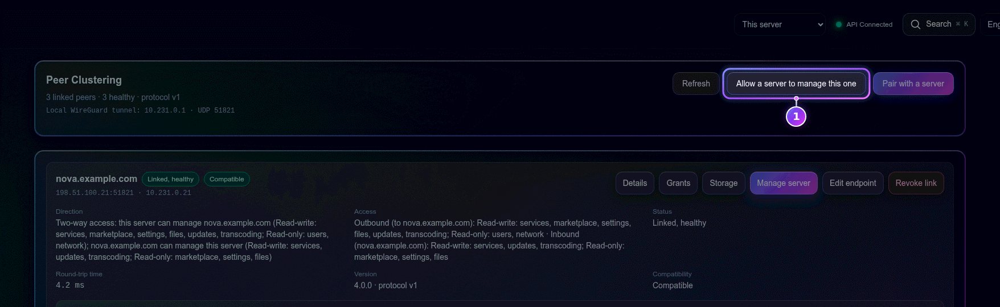

2. Click **Open pairing window**, then **Copy pairing string**. Share it only with the intended administrator; the window and subsequent pending confirmation each expire after **10 minutes** (single-use).

   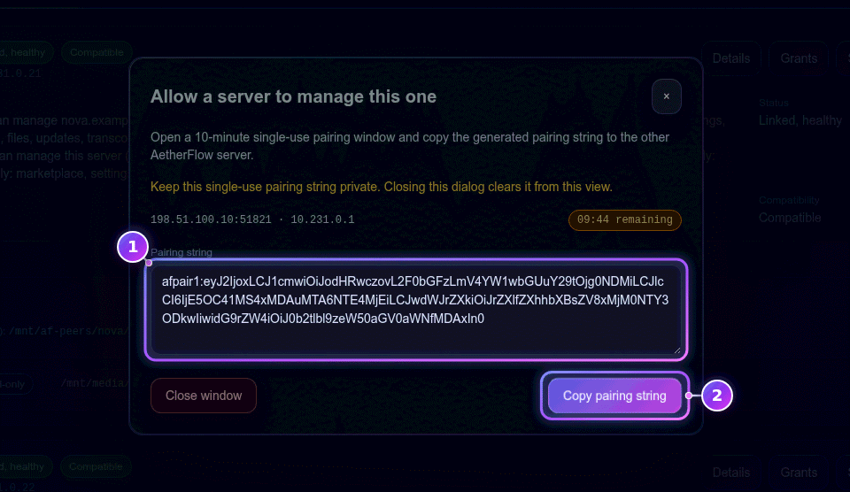

3. On the initiating server, open **Cluster**, click **Pair with a server**, paste the pairing string, set **Peer display name (optional)** if desired, pick the local WireGuard endpoint reachable by the receiver, and click **Start pairing** (on first initialization, the initiator uses `AF_PEER_WG_PORT`, default `51821`).

   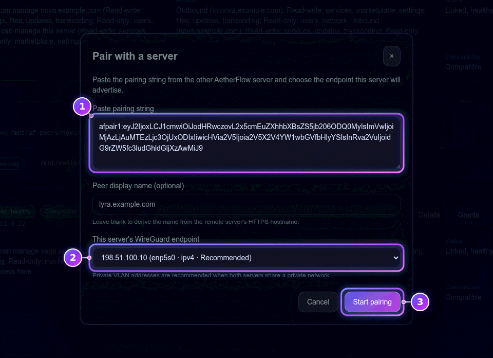

4. Compare the six-digit verification codes shown on both dashboards. On the receiving server, set **Local peer name (optional)** if desired and click **Approve & link** only when both codes match; if they differ, click **Cancel request** (receiver) or **Cancel pairing** (initiator).

   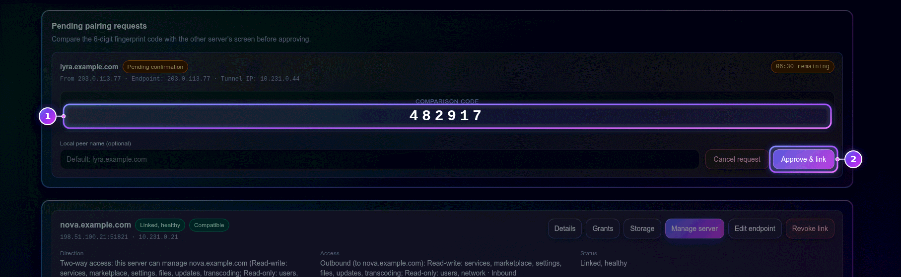

5. Confirm the link appears healthy on both **Cluster** pages with status, software version, peer protocol compatibility, and RTT.

   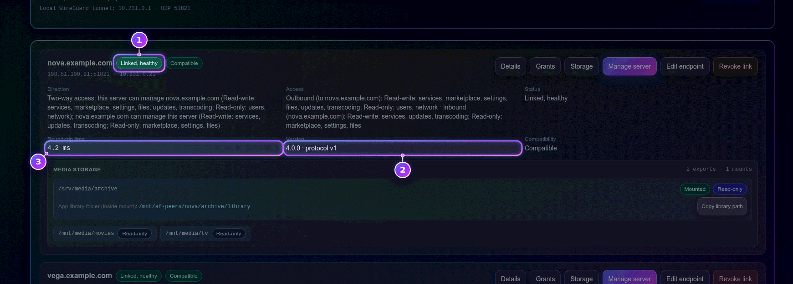

- **Closing an unused window:** Click **Close window** before a peer submits a pairing request. (Once a request consumes the window, cancel the pending attempt with **Cancel request** or **Cancel pairing** as in Step 4.)
- **Updating a moved peer's address:** Open **Edit endpoint** on the *other* server (whose stored remote endpoint for the moved host changed), update the address (and optional WireGuard UDP port), click **Update endpoint**, and confirm link health recovers.

## Grant access to a linked peer

Pairing establishes an encrypted link with **zero access by default** (`None` across all eight areas).

1. Open the peer's **Grants** editor in **Cluster** on the server whose resources you want to share, choose **None**, **Read-only**, or **Read and write** per area—or use **Read-only (everything)** or **Read and write (everything)**—and click **Save grant**. Any non-`None` grant unlocks baseline overview reads (readiness, system metrics, hardware/topology, inbox notifications at `/api/v1/auth/notifications`, and filtered telemetry WebSockets that stream only frames and service details permitted by granted read areas; live logs require `services: read`).

   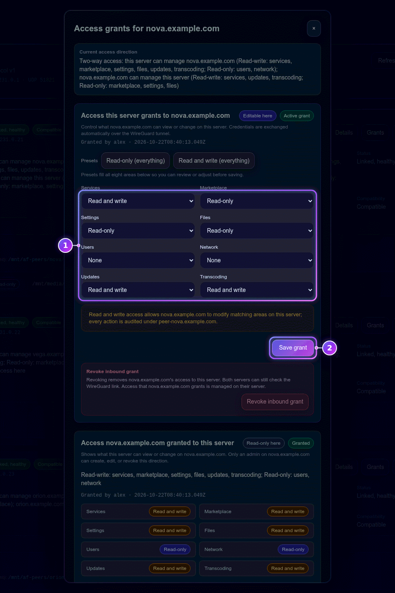

| Area | Scope covered |
| :--- | :--- |
| `services` | Service list, status, live logs, plugins, Approval Inbox (queued host/self-heal approvals), and **Streaming** (`/?tab=streaming`—Plex/Jellyfin/Emby media-server integrations) observability and import status (`read`); `start`/`stop`/`restart`, Approval Inbox decisions, plugin control, log bookmarks, and Streaming sync/session/import/reconciliation/demo actions (`write`) |
| `marketplace` | Installed app catalog and blueprints (multi-app deployment templates) (`read`); install, reinstall, uninstall, package update checks, all Marketplace package updates (`POST /api/v1/admin/packages/{id}/update`), blueprint sync (also requires `network: write`), and app deployment (also requires `services: write` and `network: write`) (`write`) |
| `settings` | Server settings, audit log, backups metadata, OIDC client list (`GET /api/v1/admin/oidc/clients`), notification rules/channels, Streaming tracking policies, and FlowAI (built-in AI assistant) views (`read`); setting changes, backup runs/uploads/downloads, Streaming server config, Streaming tracking policies and portability export/preview/restore/upstream-probe, notification rules/channels and mark-read/dismiss, and FlowAI actions (`write`) |
| `files` | Built-in file browser (McBrowser), FileShare (managed share links) browsing, filesystem listing, and own McBrowser policy (`read`); uploads, edits, archives, shares, deletes, plus upload-session inspection (`GET`/`HEAD /api/v1/auth/mcbrowser/uploads*`) and archive ticket downloads (`write`). Per-user McBrowser policy (`GET`/`PUT /api/v1/auth/mcbrowser/policy/{user_id}`) requires both `files` and `users` at the matching read or write level |
| `users` | User accounts, quotas, and Streaming user links (`read`); user, role, quota, and Streaming user link mutations (`write`) |
| `network` | WireGuard (`wg0`), Tailscale, interface, and ingress status (`read`); WireGuard, Tailscale, ingress, and AI bandwidth QoS (automated traffic-shaping) mutations (`write`) |
| `updates` | AetherFlow system update check and status (`read`); AetherFlow system update runs and updating **`jellyfin` / `jellyfin-ffmpeg*`** via `POST /api/v1/admin/packages/{id}/update` (`write`; updating any other Marketplace package requires `marketplace: write`. Both Cluster **Update to match** when updating a peer and direct API calls for `jellyfin`/`jellyfin-ffmpeg*` accept `updates: write` **or** `marketplace: write`) |
| `transcoding` | MediaFlow (automated media scan/approval) queue (`read`); MediaFlow scan/approve/decline actions, remote Jellyfin transcode jobs, and worker path-parity mounts (`write`) |

The editor displays both grant directions: **inbound** (access this server grants the peer) and **outbound** (access the peer grants this server). To ask the other server's administrator for reciprocal access, click **Send access offer**; this delivers an informational notification in the remote server's **Notifications** panel directing that administrator to open **Cluster → Grants** on the peer link and save their inbound grant locally (it does not create or change any grant automatically). Saving grant changes and sending access offers require an active, reachable link.

### Revoke a grant

Saving all eight areas as **None** is blocked in the UI (and rejected with `INVALID_REQUEST` by the API). To revoke an inbound grant (which takes effect locally even when the link is down), click **Revoke inbound grant** → **Confirm revoke**:

- **Immediate enforcement:** Local token rejection is immediate, active management WebSockets **and** in-flight non-WebSocket HTTP proxy streams (both managing-side and target-side, including large file/backup transfers and SSE streams) are canceled within 1 second (`<< 1 s`), and active remote transcode jobs running under that grant are terminated (`SIGKILL`).
- **Automatic offline revocation reconciliation:** If you revoke an inbound grant while the link is down, the best-effort revoke notice cannot be delivered immediately; once connectivity recovers, the 15-second health loop inspects `"inbound_grant_generation": null` from link-authenticated tunnel `GET /health` and automatically clears the peer's stale outbound grant row, deletes its held grant token file, broadcasts revocation to close any lingering streams, and tears down any worker transcode mounts.
- **Remaining resources:** The WireGuard link, health checks, any reciprocal grant, and existing peer media NFS mounts remain active until individually removed or the link is revoked.
- **Automatic worker transcode mount teardown:** Revoking an inbound grant or downgrading `transcoding` below `write` on a worker server automatically tears down that link's local `transcode_bind` and `transcode` NFS mounts (`peer_mounts` rows and managed `.mount` units). On the controller side, transcode exports stay active until the worker is disabled, global transcoding is toggled off, or the link is revoked.

## Manage another server

Once the peer grants this server access and the link is healthy:

1. Select that server from the header **Active server switcher (1)** or click **Manage server (2)** on its peer card in **Cluster**.

   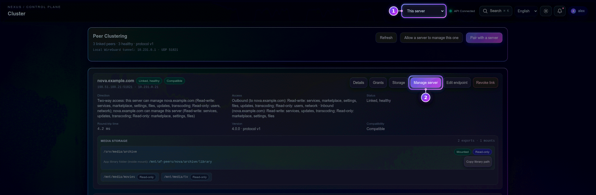

2. Confirm the colored **identity bar** displays the active remote server across every tab; click **Exit to This server** to return to your local dashboard.

   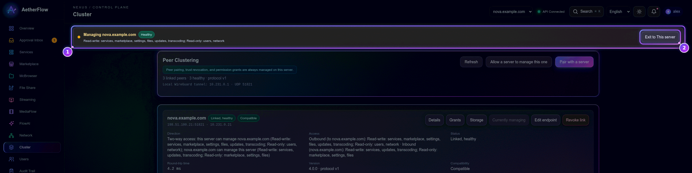

- **Permissions:** Read access lets you view an area; mutations require write access to every affected area (with `jellyfin` / `jellyfin-ffmpeg*` package updates accepting `updates: write` or `marketplace: write`, and all other Marketplace package updates requiring `marketplace: write`). Destructive confirmations always name the target server.
- **Local-only operations and app links:**
  - **Account, session, and peer admin:** Account authentication, session management, profile/password/2FA/avatar controls, own-quota queries, pairing, peer/grant/storage/transcode administration (`/api/v1/admin/peers/*`), and nested peer proxying (`/api/v1/peers/*`) stay local in the UI and fail closed with **`PEER_SCOPE_DENIED`** over the proxy or tunnel (never grantable).
  - **OIDC, plugins, and public shares:** OIDC client mutations (`POST`/`DELETE`—reading the OIDC client list is allowed under `settings: read`), OIDC consent/device/public routes, local-only **Plugin Sandbox** (the plugin iframe, plugin proxies/tokens, and host Apache third-party app-launch cookie minting), anonymous **public McBrowser share redemption** (public FileShare links), and CSRF/OpenAPI/Swagger routes also fail closed with **`PEER_SCOPE_DENIED`**.
  - **Unclassified paths and app UIs:** Non-`/api/v1/` and unmapped paths fail closed with **`PEER_ROUTE_UNCLASSIFIED`**. Third-party app links open directly on the selected server's own host URL (your browser must reach that server; app UIs are not tunneled over `afpeer0`).
- **Long-running jobs:** Operations started on a peer continue running on that peer if your browser disconnects. Reopen the peer's job status before retrying an interrupted action.
- **Revocation:** If the peer revokes your grant while you are managing it, further requests fail immediately and active management WebSockets and in-flight HTTP proxy streams terminate within 1 second.

## Share media folders over NFS

Peer media sharing uses **NFSv4.2 over `afpeer0`** backed by runner-managed systemd `.mount` units. It requires an active link only (no management grant is needed). On the first export or mount, `aetherflow-runner` automatically installs `nfs-kernel-server` and `nfs-common` via `apt-get` (serialized under AetherFlow's package lock) and creates `.af-peer-sentinel` (`0644`) inside each exported folder.

> [!IMPORTANT]
> Exporting a peer media folder (or enabling distributed transcoding) binds `nfs-server.service` exclusively to `afpeer0` via `/etc/nfs.conf.d/aetherflow-peers.conf` and adds `/etc/systemd/system/nfs-server.service.d/20-aetherflow-peers.conf` (`After=wg-quick@afpeer0.service`, `Wants=wg-quick@afpeer0.service`). Review [Host-wide NFS binding, reboot ordering, and restoring LAN NFS](#operational-limits-and-safeguards) before enabling exports on a host that serves LAN NFS clients.

1. On the server holding the media, open **Cluster**, open the peer's **Storage** controls, pick the parent folder containing the library subfolder, and click **Export folder**.
   - **Allowed roots and directory access:** Exported folders must be real non-symlink directories inside `AF_ALLOWED_FS_ROOTS` (default `/mnt,/media,/srv,/data,/home`, plus non-service `env::current_dir()` when unset; `/tmp` is excluded by default—set `AF_ALLOWED_FS_ROOTS` explicitly on production hosts; see [storage configuration](configuration.md#storage--native-mcbrowser-af-files--af-apimcbrowser)) and traversable by `User=aetherflow`. Exporting under a `0700` home directory requires granting `aetherflow` directory traverse access (for example `chmod 0710`/`0750` or an ACL) in addition to any `SupplementaryGroups` drop-in per [systemd service hardening](configuration.md#systemd-service-hardening--operator-drop-ins).
   - **Forbidden paths and limits:** Paths cannot lie under forbidden system/peer prefixes (such as `/mnt/af-peers`, `/etc`, `/var/lib/aetherflow`, `/opt/AetherFlow`, `/usr`, `/root`, `/var/run`; see the [design specification](designs/peer-clustering.md#media-sharing-nfsv42-inside-the-tunnel) for all 18 prefixes) and cannot be exact forbidden roots (`/`, `/tmp`, `/var/tmp`, `/var`, `/home`). Each link supports up to 64 exports.
   - **Permissions:** Exports are restricted to the peer's tunnel IP and default to read-only (`ro,root_squash,secure,no_subtree_check`). Opt-in writable exports (`rw,all_squash,anonuid=<uid>,anongid=<gid>,secure,no_subtree_check`) reject root-owned directories (`uid == 0` or `gid == 0`) and run remote writes as the folder owner. Because NFS uses `sec=sys`, root on a compromised peer can spoof non-root UIDs to read files beneath read-only exports—export only folders whose entire subtree the peer is permitted to read.
2. On the consuming server, open the same link's **Storage** controls and click **Mount folder**. AetherFlow mounts the remote export at `/mnt/af-peers/<link>/<export>` (appending a unique suffix on duplicate basenames) and displays **App library folder (inside mount)** (`/mnt/af-peers/<link>/<export>/library`) with a **Copy library path** button—intentionally hiding the bare mount root. AetherFlow does **not** create `library/`; `/library` is a placeholder example for an existing subfolder inside the exported parent directory. Request a writable mount only when the export allows writes and the application needs them.

   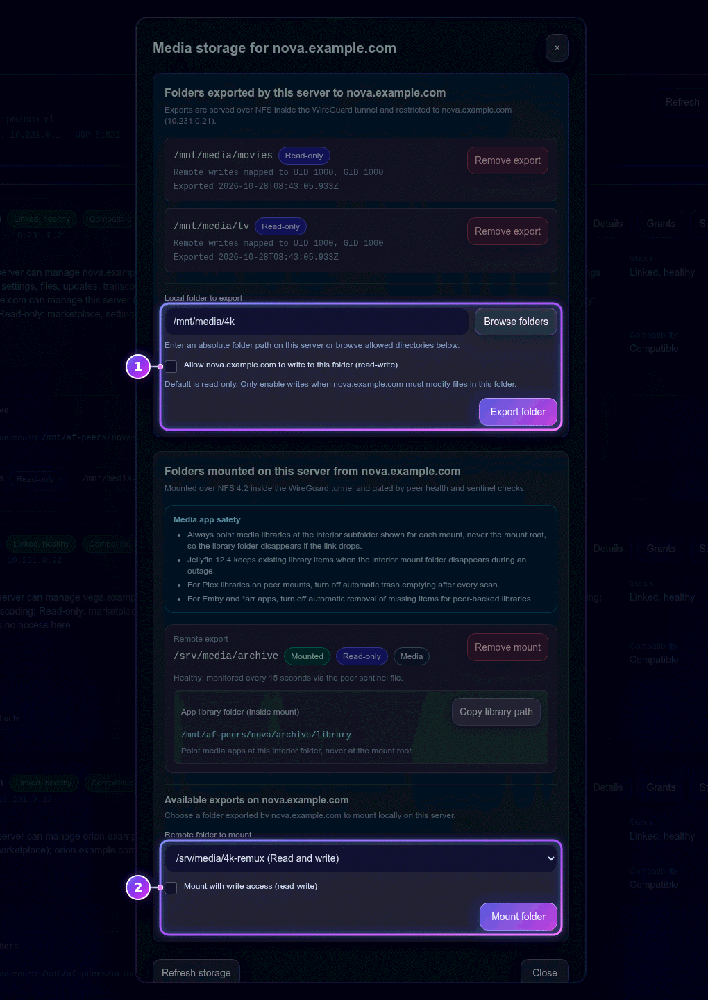
3. Click **Copy library path** and point your media application at that interior subfolder (replacing the trailing `/library` segment with your actual subfolder inside the exported parent directory); do not append a second `/library` or strip it back to the bare mount root. When a mount stops, the interior folder disappears so applications can distinguish an offline library from an empty folder.

Adding or removing a **Storage** export or mount automatically triggers a best-effort mount resync for active enabled transcode workers on that link.

### Unmount or unexport a folder

To remove an individual mount or export without revoking the link:

1. On the consuming server, open **Cluster → Storage** and click **Remove mount** → **Confirm remove**.
2. On the exporting server, open **Cluster → Storage** and click **Remove export** → **Confirm remove**.

If no peer media or transcode exports remain and you need to restore LAN NFS service, see [Host-wide NFS binding, reboot ordering, and restoring LAN NFS](#operational-limits-and-safeguards).

### Health gating

Every 15 seconds, AetherFlow checks WireGuard peer status and probes `<mount>/.af-peer-sentinel` (5-second timeout, deduplicated single-flight per mount and capped globally at 4 concurrent probes on dedicated OS threads in `aetherflow-runner`) for peer **media mounts** (worker transcode and bind mounts are not health-gated). AetherFlow stops a media mount on the first failing tick if the WireGuard peer is removed or its handshake is older than **180 seconds**, or after **two consecutive sentinel failures**. Once WireGuard peer status and tunnel `/health` recover, AetherFlow automatically remounts stopped media mounts and re-probes `.af-peer-sentinel`. Because media `.mount` units are not systemd-enabled at boot and the health loop skips the initial `t = 0` tick, a consuming server reboot leaves `/mnt/af-peers/*` unmounted for **at least ~45 seconds** (three 15-second health ticks after `aetherflow-api.service` starts: two failed sentinel probes marking the mount stopped with a transient alert, followed by automatic remount on the third tick). **Cluster** shows mount state, last error, and an RTT warning above `AF_PEER_RTT_WARN_MS`.

### Media-app safeguards

- **Boot-time scan race:** Because consuming hosts leave `/mnt/af-peers/*` unmounted for at least ~45 seconds after reboot, disable or delay startup library scans and automated missing-item cleanups on peer-backed libraries.
- **Plex:** AetherFlow makes a best-effort `PUT /:/prefs?autoEmptyTrash=0` call when peer mounts or Plex settings in **Streaming** (`/?tab=streaming`) are saved **only if Plex already has a library pointing under `/mnt/af-peers`**. After adding a peer-backed library in Plex, re-save Plex settings in **Streaming** (or verify **Empty trash automatically after every scan** is turned off in Plex settings).
- **Emby, Sonarr, Radarr, and Lidarr (`*arr` apps):** Manually disable automatic removal of missing items for libraries backed by peer mounts.
- **Jellyfin 12.4:** Jellyfin has no separate empty-trash toggle and relies on the missing interior library path when a mount stops. Back up Jellyfin's database and verify scan retention on a staging pair before relying on unattended cleanups.

## Distributed Jellyfin transcoding

AetherFlow offloads Jellyfin 12.4 `ffmpeg` jobs from the **controller** (the server running Jellyfin) to paired **worker** servers over `afpeer0`, falling back locally when a job cannot be dispatched before it is sent to a worker. For socket isolation, wire protocol, and systemd drop-in internals, see the [design specification](designs/peer-clustering.md#rust-native-transcode-dispatcher).

> [!IMPORTANT]
> Saving an enabled transcode worker exports Jellyfin's cache and transcode directories over NFSv4.2 and binds `nfs-server.service` exclusively to `afpeer0` via `/etc/nfs.conf.d/aetherflow-peers.conf`. Review [Host-wide NFS binding, reboot ordering, and restoring LAN NFS](#operational-limits-and-safeguards) before enabling distributed transcoding on a host with LAN NFS clients.

### Enable distributed transcoding

1. **Prepare packages, worker Jellyfin state, and upgraded-host sandbox:** Install identical **Jellyfin 12.4** (via AetherFlow Marketplace so `10-aetherflow-sandbox.conf` and Marketplace updates work) and `jellyfin-ffmpeg` package versions on both servers so the `jellyfin` user/group and binaries match. Hardware-accelerated jobs also require compatible DRM render nodes under `/dev/dri/renderD*` on the worker. On every dedicated worker, immediately stop and disable local Jellyfin so it never writes into `/var/cache/jellyfin*`:

   ```bash
   sudo systemctl disable --now jellyfin.service
   ```

   On the **controller** only, if Jellyfin was installed before this release (or had an older single-file `transcode.sock` sandbox drop-in), refresh its AetherFlow systemd sandbox drop-in (`10-aetherflow-sandbox.conf`, which mounts directory `-/run/aetherflow-transcode`) and restart Jellyfin once:

   ```bash
   sudo af sandbox apply jellyfin && sudo systemctl restart jellyfin.service
   ```

2. **Enable the worker server:** On the worker, grant the controller `transcoding: write` (add `updates: write`—which is narrowed to `jellyfin`/`jellyfin-ffmpeg*`—or `marketplace: write` only if you want **Update to match**). Open **Jellyfin transcoding** in **Cluster** (`/?tab=cluster`) and enable **Run this server as a transcode worker** (`af-transcode-worker.service`). AetherFlow provisions `/etc/aetherflow/transcode.env` (`0640 root:jellyfin`), installs the hardened `af-transcode-worker.service` (`PrivateNetwork=yes`, `ProtectSystem=strict`, `DevicePolicy=closed`, dynamic `30-aetherflow-transcode-paths.conf`), and ensures `aetherflow-api.service.d/20-aetherflow-transcode.conf` and `aetherflow-runner.service.d/20-aetherflow-transcode.conf`. The first time this is enabled on a host (or if `aetherflow-api.service` does not yet hold group `jellyfin`), AetherFlow schedules a debounced deferred 1-second `aetherflow-api.service` restart—wait a few seconds for the restart to complete before proceeding.
3. **Share media folders before saving workers:** Share your media libraries over **Storage** between the two servers (either exported by the controller and mounted on the worker, or exported by the worker and mounted on the controller; read-only suffices). When you save an enabled worker in Step 5, AetherFlow automatically:
   - Exports and mounts Jellyfin's transcode, temp (`TMPDIR`), and cache paths (`<TranscodingTempPath>` from Jellyfin's `encoding.xml`, default `/var/cache/jellyfin/transcodes`; `/var/cache/jellyfin/af-tmp`; and `/var/cache/jellyfin`) at matching host paths on the worker, pruning same-filesystem child exports under `/var/cache/jellyfin` by `st_dev` while preserving separate-filesystem `<TranscodingTempPath>` mounts.
   - Auto-binds media shared via **Storage** on that link onto matching local paths on the worker so verbatim `ffmpeg` input paths resolve. Worker-holds-media binds are confined strictly to `/mnt/af-peers/<calling-link>/`; controller-holds-media binds validate against allowed media roots (`AF_ALLOWED_FS_ROOTS` or default media roots), refuse non-empty local directories (`PEER_CONFLICT`) rather than shadowing local data, and bind their lifecycle (`BindsTo=`/`After=`) to the backing `/mnt/af-peers/*` NFS `.mount` unit. **Do not create manual systemd `.mount` units** at those paths (unmanaged units fail AetherFlow's safety check).
   - Adding or removing **Storage** exports/mounts on that link automatically triggers a best-effort mount resync on active enabled workers. Playing a local Jellyfin library never shared via **Storage** still causes remote `ffmpeg` to fail mid-job without local fallback.
4. **Enable offloading on the controller:** Open **Jellyfin transcoding** in **Cluster** on the controller and enable **Use paired servers for Jellyfin transcoding**. AetherFlow provisions `/etc/aetherflow/transcode.env`, copies the `af-transcode` shim to `/usr/lib/aetherflow/transcode/ffmpeg` (symlinking `ffprobe`), writes `/etc/systemd/system/jellyfin.service.d/20-aetherflow-transcode.conf`, and restarts Jellyfin. If `aetherflow-api.service.d/20-aetherflow-transcode.conf` was newly written (or `aetherflow-api.service` lacks group `jellyfin`), AetherFlow schedules a debounced deferred 1-second API restart and binds the dispatcher socket after restart (with automatic health-loop recovery if boot-time path inspection fails transiently)—wait a few seconds before Step 5.
   - **Shim verification:** If Jellyfin is configured in **Streaming** (`/?tab=streaming`) and responds within ~5 seconds after restart, AetherFlow verifies Jellyfin reports `/usr/lib/aetherflow/transcode/ffmpeg` and rolls back (`PEER_CONFLICT`) on a mismatch or missing path (for example, if a competing systemd drop-in or explicit `--ffmpeg`/environment setting overrides `20-aetherflow-transcode.conf`). If Jellyfin is unconfigured or takes longer than ~5 seconds to start, automatic rollback is skipped (the transcode status view probes Jellyfin live and reports no path whenever Jellyfin is unconfigured or unreachable). Confirm `JELLYFIN_FFMPEG=/usr/lib/aetherflow/transcode/ffmpeg` manually via `systemctl show -p Environment jellyfin.service`, Jellyfin logs, or Jellyfin's dashboard.
   - **After `aetherflow-api.service` restarts or AetherFlow self-updates:** Because Jellyfin's sandbox mounts the directory `-/run/aetherflow-transcode` (rather than the single socket file `transcode.sock`), `aetherflow-api.service` restarts no longer strand `jellyfin.service` on an unlinked socket inode (upgraded hosts pick this up once via `sudo af sandbox apply jellyfin && sudo systemctl restart jellyfin.service` in Step 1). During AetherFlow self-updates, the release engine automatically refreshes an existing `/usr/lib/aetherflow/transcode/ffmpeg` shim atomically (dormant if absent; refuses symlinks) and restarts `af-transcode-worker.service` only if active.
5. **Enable, configure, and verify each worker:** For each worker on the controller, check **Enable worker**, set **Weight (1–100)** (weighted random preference: higher weight receives proportionally more jobs; default `1`) and **Max jobs (1–64)** (default `2`), then click **Save worker**.
   - **Worker concurrency cap and auto-clamping:** `af-transcode-worker.service` defaults to `8` concurrent jobs (`AF_TRANSCODE_WORKER_MAX_JOBS`, clamped `1..=64`, read from `/etc/aetherflow/transcode.env`) and advertises `worker_max_jobs` over link-authenticated tunnel `GET /health`. The controller automatically clamps dispatch concurrency to `effective_max_jobs = min(worker.max_jobs, worker_max_jobs)`, preventing post-`Start` busy rejections when controller **Max jobs** exceeds the worker's configured limit. To raise a worker above `8` concurrent jobs, set `AF_TRANSCODE_WORKER_MAX_JOBS=<N>` in `/etc/aetherflow/transcode.env` and restart `af-transcode-worker.service` and `aetherflow-api.service` on the worker.
   - **Link WebSocket cap:** If concurrent worker transcode jobs (1 WebSocket per job) plus management WebSockets on that link will exceed `16`, also raise `AF_PEER_MAX_WS` in `/etc/aetherflow/aetherflow.env` and restart `aetherflow-api.service` on both the worker and controller (hitting `AF_PEER_MAX_WS` fails pre-start and falls back locally).
   - **Parity test and atomic mount rollback:** Saving an enabled worker syncs transcode exports/mounts (180 s controller timeout) and automatically runs **Run parity test** whenever parity has not yet passed (subsequent saves of an already-verified worker skip auto-parity unless you click **Run parity test**). The test has the worker encode a 1-second software `libx264` clip (5-second timeout) into the shared transcode folder and verifies local readability on the controller (it does not test GPU hardware encoding or media bind mounts). If mount or bind setup fails partway through, the worker rolls back newly applied transcode and bind mounts atomically (wrapping `peer_mounts` replacement in a SQLite transaction) and persists `parity_ok = false` with `parity_error` in **Cluster**.

   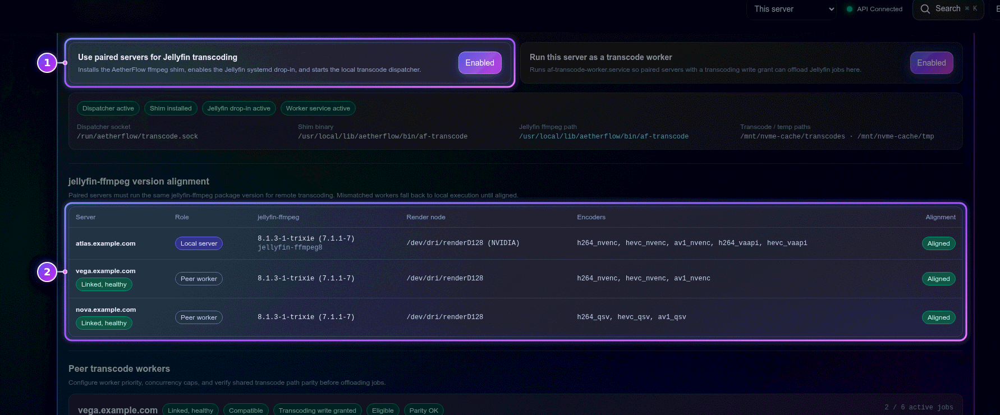

### Eligibility, version alignment, and failure behavior

- **Eligibility:** A worker accepts jobs only when all of the following hold:
  - **Enable worker** is checked and the last parity test passed.
  - The link is active and advertises the `transcode` capability (upgrade the peer if missing).
  - The held grant includes `transcoding: write`.
  - The worker is outside the 60-second unhealthy cooldown and its running jobs are below `effective_max_jobs` (`min(worker.max_jobs, worker_max_jobs)`).
  - Both servers have known, matching `jellyfin-ffmpeg` package and `ffmpeg -version` outputs (cold/unknown caches fall back locally).
  - **Hardware and encoder matching caveats:** Capability probing checks `/dev/dri/renderD*` only (excluding headless NVIDIA workers exposing only `/dev/nvidia*`), inspects compile-time `ffmpeg -encoders` rather than verifying per-GPU hardware codec-generation support (older GPUs missing compiled-in codecs such as `av1_vaapi`/`av1_qsv`/`av1_nvenc` can pass pre-start checks and fail mid-job without local fallback), and briefly wildcard-matches GPU vendors from cached render-node paths after a controller API restart until the first 60-second capability refresh completes. Restrict Jellyfin's enabled hardware codecs to the common denominator supported by all workers and verify hardware playback on each worker before relying on hardware offload.
- **Keeping `jellyfin-ffmpeg` aligned:**
  - **Automatic refresh and Update to match:** On paired servers (and controllers with offloading active), link-authenticated tunnel `GET /health` (on `afpeer0`) and the 15-second health loop refresh cached `jellyfin-ffmpeg` version and encoder capabilities every 60 seconds (skipping no-op SQLite writes when unchanged). When versions diverge (including after unattended OS updates), the worker becomes ineligible, new jobs run locally, a notification is sent, and **Update to match** triggers a `jellyfin` package update on the older server (defaulting to the peer if differing strings tie under Debian version order; requires `updates: write` or `marketplace: write` when updating a peer).
  - **Point-release alignment:** Because Debian's `jellyfin` package uses a `>=` dependency on `jellyfin-ffmpeg*`, if a point-release mismatch persists after clicking **Update to match**, align `jellyfin-ffmpeg*` directly with `sudo apt-get update && sudo apt-get install --only-upgrade 'jellyfin-ffmpeg*'`. After updating a dedicated worker, verify `jellyfin.service` stays stopped and disabled (`sudo systemctl disable --now jellyfin.service`).
- **Fallback, network-input bypass, and hard-kill cleanup:** Probe invocations (for example `-version`, `-encoders`, `-hwaccels`, or calls without `-i`) and non-UTF-8 arguments always execute local `ffmpeg` directly. Jobs with network-protocol inputs (such as `http://`, `rtsp://`, `rtmp://`, `tcp://`, etc.) or non-local `-protocol_whitelist` flags immediately return `RunLocal` from the dispatcher so network-isolated workers (`PrivateNetwork=yes`, local-only protocol whitelist `file,pipe,fd,crypto,data,subfile`) never process network streams. On failures before the job start message begins sending to a worker (within the 1,500 ms dispatcher / 2,000 ms default shim handshake budget, including `AF_PEER_MAX_WS` exhaustion), the dispatcher marks that worker unhealthy for 60 seconds and tries another eligible worker or falls back locally. Once dispatch begins sending a job to a worker, timeouts, mid-job stream drops, or worker post-start rejections (busy, device unavailable, or spawn failure) exit non-zero without launching a duplicate local encode (marking the worker unhealthy for 60 s so Jellyfin handles retry). If Jellyfin hard-kills the shim (`SIGKILL`) or the link/grant is revoked, AetherFlow terminates the worker's `ffmpeg` process group.
- **Job history:** Transcode job records are pruned automatically after 7 days in `aetherflow-api`'s 15-minute maintenance loop.

### Disable distributed transcoding

- **Controller:**
  - To disable a single worker while keeping offloading active for other workers, uncheck **Enable worker** and click **Save worker** on that worker (removing its transcode exports and sending remote teardown).
  - To disable distributed transcoding globally on the controller, toggle off **Use paired servers for Jellyfin transcoding** in **Cluster**. AetherFlow stops the dispatcher, deletes `/etc/systemd/system/jellyfin.service.d/20-aetherflow-transcode.conf`, reloads systemd, restarts Jellyfin using `/usr/lib/jellyfin-ffmpeg/ffmpeg`, tears down controller transcode NFS exports for all configured workers, sends best-effort remote teardown to enabled workers, and marks those workers disabled. If a remote worker was unreachable during global disable, verify `systemctl list-units '*.mount'` on that worker once back online (or toggle off worker mode on that server).
- **Worker server:** Toggle off **Run this server as a transcode worker** in **Cluster**. AetherFlow automatically tears down all local `transcode_bind` and `transcode` NFS mounts (`peer_mounts` rows and managed `.mount` units) **before** stopping and removing `af-transcode-worker.service` (systemd removes `/run/aetherflow-transcode-worker` when the unit stops).

**Post-disable notes and optional cleanup:** After disabling both sides, `/etc/aetherflow/transcode.env`, `/etc/nfs.conf.d/aetherflow-peers.conf`, `/etc/systemd/system/nfs-server.service.d/20-aetherflow-peers.conf`, `/etc/systemd/system/aetherflow-api.service.d/20-aetherflow-transcode.conf`, `/etc/systemd/system/aetherflow-runner.service.d/20-aetherflow-transcode.conf`, `/usr/lib/aetherflow/transcode/{ffmpeg,ffprobe}`, `/etc/tmpfiles.d/aetherflow-transcode.conf`, `/run/aetherflow-transcode`, `/var/cache/jellyfin/af-tmp`, and any custom operator drop-ins under `/etc/systemd/system/af-transcode-worker.service.d/` remain on disk (managed `30-aetherflow-transcode-paths.conf` is removed automatically once no worker transcode mounts remain).

- To restore LAN NFS once no peer exports remain, see [Host-wide NFS binding, reboot ordering, and restoring LAN NFS](#operational-limits-and-safeguards).
- To drop `SupplementaryGroups=jellyfin` from `aetherflow-api.service`, delete `/etc/systemd/system/aetherflow-api.service.d/20-aetherflow-transcode.conf`, run `sudo systemctl daemon-reload`, and restart `aetherflow-api.service`.

## Operational limits and safeguards

- **Write-grant and reverse transcode blast radius:** Read-write grants in administrative areas allow host-impacting actions. `updates: write` is narrowed on `POST /api/v1/admin/packages/{id}/update` strictly to `jellyfin` and `jellyfin-ffmpeg*` (other Marketplace packages require `marketplace: write`). `af-transcode-worker.service` runs hardened as `User=jellyfin` (`PrivateNetwork=yes`, `RestrictAddressFamilies=AF_UNIX`, `ProtectSystem=strict`, `ProtectHome=read-only`, `WorkingDirectory=/run/aetherflow-transcode-worker`, `DevicePolicy=closed` + DRM/NVIDIA `DeviceAllow=`, dynamic `30-aetherflow-transcode-paths.conf`), enforces local-only `ffmpeg` protocols (`file,pipe,fd,crypto,data,subfile`) and clamped `cwd`, restricts `MountTranscodeDirs` to the explicit Jellyfin cache/transcode allowlist, confines `BindMedia` to the calling link's `/mnt/af-peers/<segment>/` prefix, and rejects non-empty local target directories on controller-holds-media binds. Even with these confinements, `transcoding: write` grants GPU access and read-write access to shared Jellyfin cache/transcode paths (and enabling a worker exports the controller's Jellyfin cache/transcode tree read-write to that worker even if the worker holds no grant on the controller). Two-way write grants expose both servers if either host is compromised; grant `transcoding: write` only to trusted controllers and prefer read-only or single-area grants.
- **Host-wide NFS binding, reboot ordering, and restoring LAN NFS:**
  - **Exclusive `afpeer0` binding:** Exporting a peer media folder or enabling distributed transcoding writes `/etc/nfs.conf.d/aetherflow-peers.conf` with `[nfsd] host=<tunnel_ip>`, restricting `nfs-server.service` to `afpeer0` only (and logging a warning in `aetherflow-runner` if pre-existing active unmanaged lines exist in `/etc/exports`). Do not enable peer exports or distributed transcoding on a server serving unrelated LAN NFS clients.
  - **Managed reboot ordering:** `ConfigureNfsd` automatically installs `/etc/systemd/system/nfs-server.service.d/20-aetherflow-peers.conf` (`After=wg-quick@afpeer0.service`, `Wants=wg-quick@afpeer0.service`) and runs `systemctl daemon-reload` so `nfs-server.service` waits for `afpeer0` at boot. Neither media nor transcode/bind `.mount` units are enabled at boot (consuming hosts auto-recover media mounts after at least ~45 s via the health loop).
  - **Restoring LAN NFS:** After removing all peer exports and links, delete `/etc/nfs.conf.d/aetherflow-peers.conf` and `/etc/systemd/system/nfs-server.service.d/20-aetherflow-peers.conf`, then run `sudo systemctl daemon-reload && sudo systemctl restart nfs-server.service`.
- **Dedicated transcode workers and reboot/link-flap recovery:** A transcode worker mounts the controller's `/var/cache/jellyfin*` directories globally (and bind-mounts shared controller media onto matching local paths) and serves **one Jellyfin controller at a time**; do not run an active local `jellyfin.service` on a worker. Worker transcode and bind `.mount` units are excluded from the 15-second media health loop:
  - **After `wg-quick@afpeer0.service` restarts:** `aetherflow-api` automatically detects `afpeer0` `ifindex` changes, clears pooled outbound tunnel HTTP clients, and rebinds the tunnel listener without requiring an `aetherflow-api.service` restart.
  - **After a worker reboot or media-mount stop/recovery:** Because controller-holds-media `transcode_bind` units declare `BindsTo=`/`After=` on their backing `/mnt/af-peers/*` NFS `.mount` unit, systemd automatically stops the bind unit whenever the backing media mount stops (preventing stale active binds over unmounted directories). After a worker reboot or media-mount outage, wait for `/mnt/af-peers/*` media mounts to auto-recover (at least ~45 seconds), then re-save the worker in **Cluster** on the controller to re-sync transcode and bind mounts. (If starting units manually on the worker instead, wait for `/mnt/af-peers/*` recovery, check exact unit names via `sudo af cluster diagnose <link>`, start `var-cache-jellyfin.mount` before nested child transcode mounts—single-quoting any unit names containing `\x2d`—and then start any `transcode_bind` units.)
- **Scale limits & health-loop latency:** Compile-time limits cap each server at **256 peers**, **64 exports per link**, and **32 transcode/media-bind paths per sync** (per-link HTTP/WS defaults are documented in [Prerequisites](#prerequisites)). Because the 15-second health loop probes links and media mounts sequentially (5 s tunnel `/health` + 5 s sentinel timeout per mount), even 1 unresponsive peer with 2+ mounts (or 2 unresponsive peers with 1 mount each) overruns a 15-second tick and stretches mount-stop latency past 30 seconds; keep at most **1 active media mount per link** if strict sub-30 s outage stops matter.
- **Proxy audit load & transcode bandwidth:** Every proxied request writes a synchronous row to `admin_audit_log` with no automatic pruning—avoid high-rate automated polling through `/api/v1/peers/*` and monitor database growth. Distributed transcoding sends media reads and HLS segment writes over the tunnel and is suited to links within `AF_PEER_RTT_WARN_MS` (default `25 ms`, e.g., LAN/VLAN), not high-latency WAN links.
- **Public `/health` metadata isolation:** Unauthenticated public `GET /health` unconditionally returns `"transcode": null` so local FFmpeg and GPU hardware inventory is never disclosed publicly; cached `transcode` capabilities (including `worker_max_jobs`) are served exclusively over link-authenticated tunnel `GET /health` on `afpeer0`.
- **Backup and restore caveats:** Dashboard backups (**Settings → Backups & Restore**) capture only `aetherflow.sqlite` (omitting `/etc/aetherflow/peers/*`, `/etc/wireguard/afpeer0.conf`, `/etc/exports.d/`, `/etc/nfs.conf.d/aetherflow-peers.conf`, and systemd `.mount` units), while `sudo af backup create` includes `/etc/aetherflow` + SQLite but still omits `/etc/wireguard/afpeer0.conf`, `/etc/exports.d/`, `/etc/nfs.conf.d/aetherflow-peers.conf`, and systemd units. Restoring an older backup onto a clustered server can **resurrect previously revoked links or grants** (immediately re-accepting old bearer tokens), rewind grant generations (causing `409 PEER_CONFLICT` on subsequent grant saves), or desync `peer_identity` from `afpeer0.conf` (`KEY_MISMATCH`). Follow [Post-backup-restore reconciliation](#common-recovery-runbooks) immediately after any SQLite backup restore.

## Revoke a link

Click **Revoke link** on the peer card in **Cluster** and confirm **Revoke link** in the dialog. AetherFlow tracks whether it confirmed creating each link's WireGuard peer (**AetherFlow-owned**) versus encountering a pre-existing peer or an interrupted/uncertain `wg` apply (**`*_unowned`**, shown in `af cluster diagnose` via `internal_state` such as `active_unowned` and `wg_peer_owned: false`), skipping automated WireGuard peer deletion on `*_unowned` links so it never deletes an operator-managed peer. On the initiating server, revocation runs in order:

1. Disables local link and grant authorization in SQLite, cancels active management WebSockets **and** in-flight non-WebSocket HTTP proxy streams (`<< 1 s`), terminates active remote transcode jobs (`SIGKILL`), and records the `peer_link_revoked` audit entry.
2. Sends a best-effort authenticated revoke notice to the peer while the held link token and WireGuard peer still exist.
3. Tears down transcode exports, mounts, and bind mounts **first** (so `transcode_bind` units sitting atop `/mnt/af-peers/*` unmount cleanly), then tears down peer media NFS mounts/exports, deletes link, grant, and pending-issuer credentials, and removes the WireGuard peer from `afpeer0` for **AetherFlow-owned links**. (For `*_unowned` links, remove the peer manually from both `/etc/wireguard/afpeer0.conf` and live `afpeer0` per [Common recovery runbooks](#common-recovery-runbooks).)
4. Deletes the local link record once transcode, storage, and WireGuard cleanup succeed; transient transcode, storage, or WireGuard runner errors propagate after credentials and owned WireGuard access are severed, retaining retryable `revoking`/`revoking_unowned` state for automatic retry on the 15-second health loop.

### Remote-peer behavior

- **Peer reachable:** Upon receiving the revoke notice, the remote peer immediately disables authorization, revokes inbound/outbound grants, cancels active WebSockets, in-flight HTTP proxy streams, and transcode jobs, and tears down its local transcode exports/mounts/bind mounts, media mounts/exports, credentials, and owned WireGuard peer. Only the revoked link row stays visible in **Cluster** until an administrator clicks **Remove link**.
- **Peer unreachable:** Because the initiating server deletes its local link row once local cleanup succeeds, the offline peer retains its local media exports, controller/worker transcode exports and mounts, grant rows, and WireGuard peer entry, and stays `down` even after connectivity returns until an administrator on that server clicks **Revoke link**.

## CLI diagnostics (`af cluster diagnose`)

Run `sudo af cluster diagnose <link>` (matching link ID or name; `sudo` or the `aetherflow` user is required to read `/var/lib/aetherflow/aetherflow.sqlite` and query `/run/aetherflow/runner.sock`):

```bash
sudo af cluster diagnose media-2
sudo af cluster diagnose media-2 --json
```

Run `af help cluster` for full `af cluster diagnose` usage (see [Admin CLI global flags](rust-admin-cli.md#global-flags) for shared `af` global options). Key options:

- `--json` for structured output; `--dry-run` (`-n`) to print the resolved `db_path` and `socket_path` without opening SQLite or querying the runner.
- `--db <path>` or `--socket <path>` to override database or runner socket paths.
- Global `--root <path>` confines database path resolution via shared `af_models` helpers (`try_resolve_active_db_path_from_env` and `validate_path_within_isolated_root`), enforcing that `--db` stays within `--root` when active and defaulting through `AF_DB_PATH`, `DB_PATH`, `AETHERFLOW_DB_PATH`, `DATA_DIR`/`STATE_DIRECTORY`, env files, or `/var/lib/aetherflow/aetherflow.sqlite` under `--root`. `--socket` / `AETHERFLOW_RUNNER_SOCK` are not rebased under `--root`.
- Because `sudo` strips `AF_DB_PATH`, `DB_PATH`, `AETHERFLOW_DB_PATH`, and `AETHERFLOW_RUNNER_SOCK`, pass `-E`, `--db`, or `--socket` when overriding defaults under `sudo`.

The command opens SQLite read-only, prints SQLite-backed sections with live WireGuard/mount fields marked unavailable if `aetherflow-runner.service` is offline, and redacts all tokens and keys. Output includes:

- The link record with canonical public `state` (`pending`, `active`, `down`, `revoked`), `internal_state` (such as `active` or `active_unowned`), `wg_peer_owned`, live `afpeer0` WireGuard handshake age, and byte counters.
- Grant summaries using canonical `inbound` (this server → peer) and `outbound` (peer → this server) JSON keys and human labels.
- NFS exports and mounts with systemd unit names, live status, and `.af-peer-sentinel` probe results for `purpose == "media"` mounts; `transcode` and `transcode_bind` rows skip `/v1/peer-storage` probes cleanly (`probe: null` with `probe_skipped_reason`).
- Transcode worker settings, up to 10 recent transcode jobs, and the last 20 redacted audit entries. Check **Cluster** or `GET /api/v1/admin/peers` for the protocol compatibility verdict.

## Troubleshooting

### Diagnostic commands

Peer API errors (including request-body size, media-type, and JSON extractor rejections across all peer endpoints) return a structured `{code, server, step, message, action, request_id?}` payload surfaced in **Cluster** error banners (`PeerErrorAlert`, displaying `request_id` when present) and API JSON. `X-Request-ID` is echoed on HTTP responses and propagated across `aetherflow-api` logs, `/run/aetherflow/runner.sock` IPC into `aetherflow-runner` logs (`request_id=...`), transcode job rows, and audit entries (set `AF_LOG_FORMAT=json` for structured JSON logs—see [peer clustering configuration](configuration.md#peer-clustering-and-api-logs)):

```bash
sudo af cluster diagnose <link>
sudo journalctl -u aetherflow-api -n 100 --no-pager
sudo journalctl -u aetherflow-runner -n 100 --no-pager
sudo wg show afpeer0
sudo systemctl status af-transcode-worker.service
```

### Error codes

| Code | Recovery |
| :--- | :--- |
| `CODE_EXPIRED`, `CODE_USED`, `WINDOW_CLOSED` | Open a new pairing window on the receiving server and use its new pairing string. |
| `CLOCK_SKEW` | Synchronize both server clocks within 5 minutes (`300 s`), then retry. |
| `KEY_MISMATCH` | Compare peer identity and both six-digit codes, verify no conflicting or duplicate peer key exists in `/etc/wireguard/afpeer0.conf` or `sudo wg show afpeer0`, and check that the pairing modal's WireGuard UDP port matches the host's initialized `afpeer0` port. Cancel the pending attempt and restart pairing once resolved. |
| `TUNNEL_IP_CONFLICT` | Paired servers must share one `AF_PEER_TUNNEL_CIDR` while holding distinct auto-assigned host IPs inside it. If two already-initialized hosts picked the same IP or the subnet overlaps an existing route, reset `afpeer0` identity on one unlinked host (or realign `AF_PEER_TUNNEL_CIDR`) per [Common recovery runbooks](#common-recovery-runbooks). |
| `ENDPOINT_UNREACHABLE`, `HANDSHAKE_TIMEOUT` | Verify the receiving server's public HTTPS URL and OS CA TLS trust (during initial pairing), each selected WireGuard endpoint, each host's `AF_PEER_WG_PORT` (default UDP 51821), VLAN routing, and `AF_PEER_LISTEN_PORT` (TCP 9443 on `afpeer0`). |
| `VERSION_INCOMPATIBLE` | Verify both servers share a supported peer protocol version and upgrade the older server. |
| `RATE_LIMITED` | Wait for the `Retry-After` interval before retrying (pairing requests allow 5 requests/minute per source IP; `Retry-After: 60` s). |
| `PEER_BUSY` | Wait for the in-progress peer operation to finish, then retry. |
| `PEER_SCOPE_DENIED` | Check the grant on the granting server (mutations require write access to every affected area; `transcoding: write` for remote transcoding; `updates: write` for `jellyfin`/`jellyfin-ffmpeg*` or `marketplace: write` for any Marketplace package update). If an inbound grant was revoked while the link was down, wait one 15-second health tick after connectivity returns for automatic reconciliation. Permanently local-only routes (see [Manage another server](#manage-another-server)) always return `PEER_SCOPE_DENIED`. |
| `PEER_ROUTE_UNCLASSIFIED` | Use a supported `/api/v1/` peer management endpoint or perform the action directly on the target server. |
| `PEER_UNAUTHORIZED` | Link or grant credentials were rejected; check link health, wait one health tick for offline grant reconciliation, and re-save or re-issue the grant (or re-pair if the link token is out of sync). |
| `PEER_NOT_FOUND` | Verify the link, grant, export, or mount ID still exists on the server and refresh **Cluster**. |
| `INVALID_REQUEST` | Check path/allowlist rules, port/CIDR format (including post-init `AF_PEER_TUNNEL_CIDR` drift), `PUBLIC_URL` HTTPS format (or a trusted proxy sending `X-Forwarded-Proto: http`), pairing SSRF rules (set `AF_PEER_ALLOW_PRIVATE_PAIRING_URLS=true` for private LAN/VLAN HTTPS pairing), or JSON parameters reported in `message` and retry. |
| `PAYLOAD_TOO_LARGE` | Reduce request payload size (public pairing requests cap at 4 KiB; admin grants/storage and tunnel endpoints cap at 8 KiB; admin transcode settings cap at 32 KiB; admin `pair`/`endpoint` routes cap at 2 MiB). All peer endpoints return structured `PeerError` JSON (`code: "PAYLOAD_TOO_LARGE"`, with `request_id`). |
| `UNSUPPORTED_MEDIA_TYPE` | Send `Content-Type: application/json` on JSON requests (optional-body `pairing-window`, `confirm`, and `grant-offer` routes accept an empty/whitespace body with defaults, and require `application/json` for non-empty payloads). All peer endpoints return structured `PeerError` JSON (`code: "UNSUPPORTED_MEDIA_TYPE"`, with `request_id`). |
| `PEER_CONFLICT` | A duplicate link name, export path, or mount target exists; a worker controller-holds-media bind target directory is non-empty; grant-epoch rewind after backup restore rejected a save; or enabling transcoding rolled back because Jellyfin reported a mismatched/missing `ffmpeg` path (for example, a competing systemd override or `--ffmpeg`/env setting). Inspect existing rows in **Cluster**, target directories on the worker, Jellyfin's `JELLYFIN_FFMPEG` environment, or grant state before retrying. |
| `LINK_DOWN`, `LINK_REVOKED` | Check the selected endpoint and the other server's **Cluster** page. Click **Remove link** (for revoked links) or **Revoke link** (for stale links) before pairing again. |
| `PEER_INTERNAL_ERROR` | Grep the reported `request_id` (shown in the **Cluster** banner, JSON body, and `X-Request-ID` response header) across both `sudo journalctl -u aetherflow-api` and `sudo journalctl -u aetherflow-runner`. |

### Common recovery runbooks

- **Expired confirmation with an active/down link on the initiator:** Revoke or remove the stale link on the initiating server before opening a new pairing window.
- **Removing an orphaned or `*_unowned` WireGuard peer:** Because `/etc/wireguard/afpeer0.conf` uses `SaveConfig = false`, running `wg set ... remove` alone leaves the `[Peer]` block on disk (blocking re-pairing with `KEY_MISMATCH` and resurrecting on reboot). Inspect `sudo journalctl -u aetherflow-api` and `sudo journalctl -u aetherflow-runner` using the `request_id` (or timestamp), revoke or remove any stale link in **Cluster**, delete the matching `[Peer]` block from `/etc/wireguard/afpeer0.conf` (preserving `0600 root:root` and `SaveConfig = false`), sync live state via `sudo bash -c 'wg syncconf afpeer0 <(wg-quick strip afpeer0)'`, and verify the public key is absent from both `sudo wg show afpeer0` and `/etc/wireguard/afpeer0.conf` before retrying pairing.
- **Resetting `afpeer0` identity (to change `AF_PEER_TUNNEL_CIDR`, `AF_PEER_WG_PORT`, or clear `TUNNEL_IP_CONFLICT`):** There is no built-in UI/CLI identity reset command. On the unlinked host:
  1. Close any open pairing windows (**Close window**), cancel pending pairing attempts, and revoke and remove all peer links in **Cluster**.
  2. Stop the API and tear down `afpeer0`: `sudo systemctl stop aetherflow-api.service && sudo systemctl disable --now wg-quick@afpeer0.service`.
  3. Remove `/etc/wireguard/afpeer0.conf` and `/etc/aetherflow/peers/afpeer0.key`. If this host previously exported peer media or transcode directories, delete `/etc/nfs.conf.d/aetherflow-peers.conf` and `/etc/systemd/system/nfs-server.service.d/20-aetherflow-peers.conf`, run `sudo systemctl daemon-reload`, and stop or restart `nfs-server.service`. Then clear stored identity and pairing state as `aetherflow` (never run `sqlite3` as `root`, which can leave root-owned `-wal`/`-shm` sidecars; install the `sqlite3` CLI package if absent, substitute `AF_DB_PATH` if overridden, and confirm `.sqlite*` files remain `aetherflow:aetherflow` before restarting):

     ```bash
     sudo -u aetherflow sqlite3 /var/lib/aetherflow/aetherflow.sqlite \
       'DELETE FROM peer_identity; DELETE FROM peer_pairing_windows; DELETE FROM peer_pairing_attempts;'
     ```

  4. Update `/etc/aetherflow/aetherflow.env` if changing CIDR/port, then restart both services: `sudo systemctl restart aetherflow-runner.service aetherflow-api.service`.
- **Manual cleanup of leftover transcode mounts and exports:** If an offline peer prevented remote teardown or a host crashed mid-cleanup:
  - **Worker:** Find managed units with `sudo af cluster diagnose <link>` and `sudo grep -lE 'AetherFlow-Peer-Purpose: (transcode|transcode-bind)' /etc/systemd/system/*.mount`. Stop each leftover unit (`sudo systemctl stop '<unit>'`, single-quoting names containing `\x2d`), delete those managed `.mount` files under `/etc/systemd/system/`, remove `/etc/systemd/system/af-transcode-worker.service.d/30-aetherflow-transcode-paths.conf` if no worker transcode mounts remain, and run `sudo systemctl daemon-reload`.
  - **Controller:** Delete `/etc/exports.d/aetherflow-peer-<link_id>-transcode.exports` and run `sudo exportfs -ra`.
- **Post-backup-restore reconciliation:** Immediately after restoring a SQLite backup on a clustered host, audit **Cluster** links and grants, re-revoke any link or grant that was revoked after the snapshot, verify `/etc/wireguard/afpeer0.conf` and `/etc/aetherflow/peers/` match restored links (re-pair or reset `afpeer0` identity on `KEY_MISMATCH`), re-save any grant that fails with `409 PEER_CONFLICT` after epoch rewind, and reconcile `/etc/exports.d/` and systemd `.mount` units.
- **Parity test failures or unexpected local transcode fallback:**
  - Run `sudo af cluster diagnose <link>` and confirm `af-transcode-worker.service` is active on `/run/aetherflow-transcode-worker/worker.sock`.
  - Confirm `aetherflow-api.service` restarted with `20-aetherflow-transcode.conf` and that `jellyfin.service`'s `10-aetherflow-sandbox.conf` includes directory `-/run/aetherflow-transcode` (on upgraded hosts, run `sudo af sandbox apply jellyfin && sudo systemctl restart jellyfin.service` once). Note that network-protocol inputs (such as IPTV/HTTP/RTSP streams) intentionally fall back locally (`RunLocal`) rather than running on network-isolated workers.
  - Check `jellyfin-ffmpeg` alignment and worker GPU/codec support per [Eligibility, version alignment, and failure behavior](#eligibility-version-alignment-and-failure-behavior).
  - Verify `AF_TRANSCODE_WORKER_MAX_JOBS` in `/etc/aetherflow/transcode.env` (controller auto-clamps to `effective_max_jobs`) and recover worker mounts after reboots or media-mount outages per [Dedicated transcode workers and reboot/link-flap recovery](#operational-limits-and-safeguards).

## Security model

Peer clustering enforces layered transport, authentication, scope, and OS-isolation boundaries (see [Security Guide](security.md#peer-clustering--distributed-transcoding) and [Threat Model](threat_model.md)):

- **Public pairing bootstrap (`POST /api/v1/peer-pairing/request`)**: Single-use 10-minute pairing windows with 6-digit operator code verification, strict 4 KiB request body limit, 5 req/min/IP rate limit, 300-second clock-skew check, OS CA TLS validation with redirects/proxies disabled, and an SSRF/private-network guard (loopback, link-local/cloud metadata, multicast, broadcast/reserved, and `afpeer0` CIDR blocked unconditionally; RFC 1918, CGNAT, and IPv6 ULA blocked unless `AF_PEER_ALLOW_PRIVATE_PAIRING_URLS=true`).
- **Dedicated tunnel & credential separation**: Peer API traffic runs strictly over the AetherFlow-managed WireGuard interface (`afpeer0`) on `<tunnel_ip>:<AF_PEER_LISTEN_PORT>` (default `9443`) pinned via `SO_BINDTODEVICE`. Link bearer tokens (`X-AF-Link-Token`) and grant bearer tokens (`X-AF-Grant-Token`) are distinct, stored in mode `0600` files under `/etc/aetherflow/peers/`, and paired with SHA-256 hashes in SQLite.
- **Fail-closed authorization & sub-second revocation**: Links start with zero access (`None` across all 8 areas). Local-only routes (auth/session, profile/2FA, `/api/v1/admin/peers/*`, nested `/api/v1/peers/*`, OIDC mutations, Plugin Sandbox, public shares) fail closed with `PEER_SCOPE_DENIED`; unmapped routes fail closed with `PEER_ROUTE_UNCLASSIFIED`. Revoking a grant or link immediately rejects tokens, cancels active management WebSockets and in-flight HTTP proxy streams within 1 second (`<< 1 s`), and sends `SIGKILL` to active remote transcode jobs.
- **Storage & worker isolation**: `nfs-server.service` is bound exclusively to `afpeer0` via `/etc/nfs.conf.d/aetherflow-peers.conf`, exports are IP-pinned to the peer's tunnel address (default `ro,root_squash,secure,no_subtree_check`), and `af-transcode-worker.service` runs hardened as `User=jellyfin` (`PrivateNetwork=yes`, `RestrictAddressFamilies=AF_UNIX`, `ProtectSystem=strict`, `DevicePolicy=closed`, local-only `ffmpeg` protocols) reading only the secret-free `/etc/aetherflow/transcode.env` (never `/etc/aetherflow/aetherflow.env`).

## Migrating from legacy master/worker clustering

Migration 26 permanently retires the legacy single-master cluster implementation (`CLUSTER_MODE`, `CLUSTER_PSK`, `CLUSTER_ALLOW_INSECURE_LOOPBACK`, `/api/v1/admin/cluster/*`, `/cluster/v1/*`, HTTP/2 gRPC `cluster.ClusterService` on `:50051`, and SQLite tables `cluster_nodes`, `cluster_enrollment_tokens`, and `cluster_commands`). See [Upgrading Guide — Migration 26](upgrading.md#migration-26-removal-of-legacy-masterworker-clustering).

1. **Before upgrading**: Create a WAL-safe backup via **Settings → Backups & Restore** or `sudo af backup create` on every node in the legacy cluster.
2. **Upgrade each host**: Deploy v4.0.0 (`sudo af release deploy --channel stable` or **Settings → System Updates**); Migration 26 runs automatically on first `aetherflow-api` startup.
3. **Clean up obsolete environment variables**: Remove legacy `CLUSTER_MODE`, `CLUSTER_PSK`, and `CLUSTER_ALLOW_INSECURE_LOOPBACK` entries from `/etc/aetherflow/aetherflow.env` (and any firewall rules previously opened only for TCP `50051`) and restart `aetherflow-api.service`.
4. **Re-pair servers as peers**: Follow [Pair two servers](#pair-two-servers) in **Cluster** (`/?tab=cluster`), then grant explicit per-area permissions in **Cluster → Grants**.

## Reference

- [Peer API reference](API.md#8-peer-clustering)
- [Peer clustering configuration](configuration.md#peer-clustering-and-api-logs)
- [Security guide](security.md#peer-clustering--distributed-transcoding)
- [Threat model](threat_model.md)
- [Upgrading guide (Migration 26)](upgrading.md#migration-26-removal-of-legacy-masterworker-clustering)
- [Admin CLI reference](rust-admin-cli.md#10-read-only-peer-clustering-diagnostics-af-cluster)
- [System architecture](architecture.md)
- [Peer clustering design specification](designs/peer-clustering.md)
