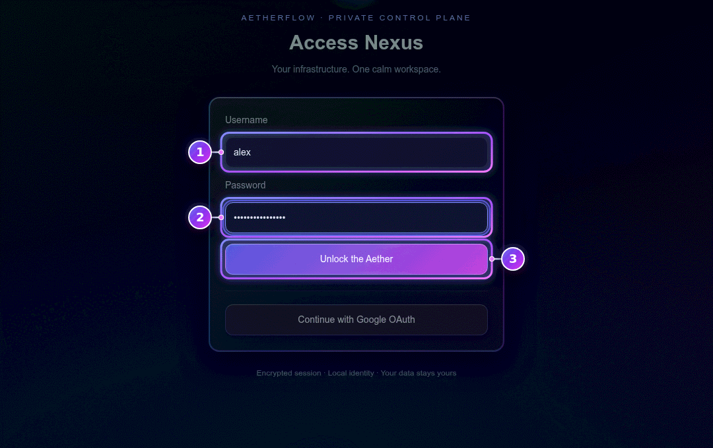
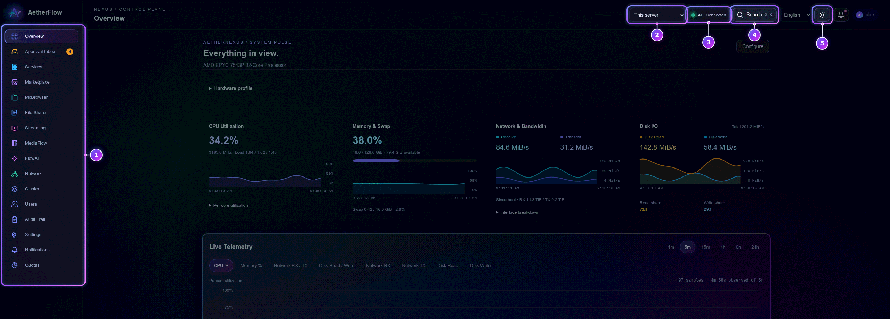
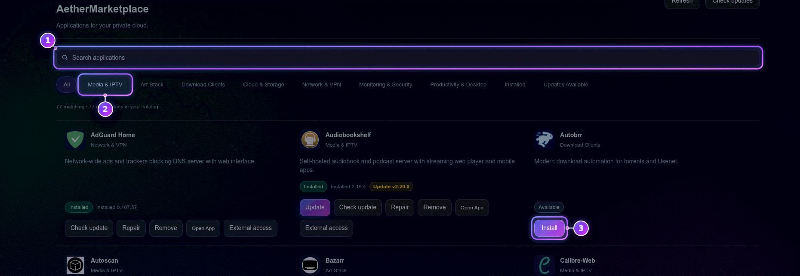

# Quickstart Guide

Deploy AetherFlow v4.0.0 on a clean Debian or Ubuntu bare-metal host and walk through initial onboarding, your first Marketplace application, and optional multi-server peer pairing. Depending on host performance and OS package updates, bootstrap typically completes in 10 to 45 minutes.

## Prerequisites

- **Operating System**: Debian 12/13 (Bookworm/Trixie) or Ubuntu 22.04/24.04 LTS. *(Peer Clustering NFSv4.2 media sharing and distributed Jellyfin transcoding require **Debian 13 `trixie`**.)*
- **Privileges**: Root or `sudo` access.
- **Network, DNS & Firewall**: Ports `80/tcp` and `443/tcp` reachable for Let's Encrypt TLS; DNS records for your control-plane host (for example `node.example.com`) plus wildcard `*.example.com` (or per-app A/AAAA records matching your `baseDomain`) for `<app>.<baseDomain>` HTTPS ingress. Raw-IP installations use a self-signed Apache2 certificate until a domain is configured.
- **Clean Host**: A freshly installed Linux server avoids existing Apache, port, and unit conflicts.

---

## 1. Bootstrap Installation

Clone the repository onto the target server and run `setup/AetherFlow-Setup`:

```bash
sudo apt-get update && sudo apt-get -y upgrade
sudo apt-get -y install git curl
sudo git clone https://github.com/McEveritts/AetherFlow.git /opt/AetherFlow
cd /opt/AetherFlow/setup
sudo bash AetherFlow-Setup
```

*(Omit `sudo` if running directly as `root` on a minimal image.)*

For non-interactive provisioning (`--username` creates the Linux host owner account; `--domain` configures the control-plane hostname; `--channel stable|nightly` selects the release channel; the first web admin account is created through web onboarding unless `AETHERFLOW_WEB_ADMIN_PASSWORD` is explicitly passed in the environment):

```bash
sudo bash /opt/AetherFlow/setup/AetherFlow-Setup \
  --unattended \
  --username admin \
  --domain node.example.com
```

To repair a single bootstrap step on an existing host while preserving SQLite state and `/etc/aetherflow/aetherflow.env` (run `--list-steps` to view step IDs; `build_modern` reinstalls the control plane):

```bash
sudo bash /opt/AetherFlow/setup/AetherFlow-Setup --repair build_modern
```

> [!NOTE]
> `setup/AetherFlow-Setup` installs the verified prebuilt v4 release bundle into `/opt/AetherFlow/current` (`aetherflow-api`, `bin/af`, `bin/speedtest-backend`, `bin/af-transcode`, and external `web/dist` WASM dashboard assets), enables `aetherflow-runner.service` (`aetherflow-api runner` on `/run/aetherflow/runner.sock`) and `aetherflow-api.service`, installs `/usr/local/bin/af` (delegating wrapper to `/opt/AetherFlow/current/bin/af`), configures Apache2 reverse-proxy ingress, and writes `/etc/aetherflow/aetherflow.env` (`0640 root:aetherflow`) with generated `JWT_SECRET` and `AES_MASTER_KEY`.
>
> For day-2 administration and repeatable Rust-native foundation steps after bootstrap, use `af` and `af provision` ([Unified Rust Admin CLI](./rust-admin-cli.md)).

---

## 2. Verify Services, Onboarding URL & Bootstrap Token

At the end of setup, `AetherFlow-Setup` prints the web onboarding URL and writes a root-only summary to `/root/information.info` (`0600`) containing:

- `Dashboard Onboarding: https://<domain-or-ip>/`
- `Admin Username: <username>`
- `Setup Bootstrap Token File (for remote/proxied first-admin setup): /var/lib/aetherflow/.setup-bootstrap-token`

Verify that both core units, the privileged runner socket, and the readiness probe are healthy:

```bash
sudo systemctl status aetherflow-runner aetherflow-api
sudo af health
sudo af release status
curl -fsS http://127.0.0.1:8080/health/ready
```

Read the one-time setup bootstrap token if you are completing initial web onboarding remotely or through Apache2 (required by `POST /api/v1/public/auth/setup` when `users` is empty and requests arrive over Apache2 or a non-loopback address, unless `AETHERFLOW_SETUP_TOKEN` or `AETHERFLOW_WEB_ADMIN_PASSWORD` was explicitly configured):

```bash
sudo cat /var/lib/aetherflow/.setup-bootstrap-token
```

By default, `AetherFlow-Setup` writes `BIND_ADDR=127.0.0.1` and `PORT=8080` in `/etc/aetherflow/aetherflow.env` so `aetherflow-api` binds strictly to loopback behind Apache2. Direct `:8080` access is disabled by default; if you explicitly enable plain-HTTP direct `:8080` testing (`AF_ALLOW_DIRECT_8080=1` during setup, or `BIND_ADDR=0.0.0.0` with `PORT=8080`), also add the host IP to `ALLOWED_HOSTS`, set `COOKIE_SECURE=false` (never over untrusted networks), open `8080/tcp` in the firewall, and restart `aetherflow-api`.

> [!CAUTION]
> Changing `AES_MASTER_KEY` in `/etc/aetherflow/aetherflow.env` after setup invalidates all previously encrypted secrets (`enc:v1:` AI keys, enrolled 2FA TOTP secrets, streaming API keys, notification channel credentials, `/var/lib/aetherflow/.master.creds`, and `system_config.master_credentials`). After editing `/etc/aetherflow/aetherflow.env`, restart both units with `sudo systemctl restart aetherflow-runner aetherflow-api`.

---

## 3. Create the First Admin, Sign In & Tour the Dashboard

1. **Complete Onboarding & Sign In**: Visit `https://<domain-or-ip>/` from `/root/information.info`, supply the bootstrap token from `/var/lib/aetherflow/.setup-bootstrap-token` (or `AETHERFLOW_SETUP_TOKEN`) to create your local administrator account, then enter your credentials in the login form and click **Sign in**. *(Google OAuth2 denies unknown emails by default, only auto-provisions standard `role = 'user'` accounts, and never auto-bootstraps an `admin`; see [Configuration Reference](./configuration.md#google-oauth2--oidc-provider).)*

   

2. **Tour the Dashboard**: After signing in, locate the main shell controls: the **navigation sidebar (1)** across all 16 tabs, the **Active server switcher (2)** for local or paired peers, the **API status pill (3)**, global **search (4)**, and the dark/light **theme toggle (5)**.

   

3. **Configure Base Domain**: In the Onboarding Wizard or **Settings → General & Localization**, set `baseDomain` (for example `example.com`) so enabled HTTP apps resolve at `<app>.example.com`.
4. **Enroll TOTP 2FA (Recommended)**: In **Settings → Security**, scan the QR code with an authenticator app and verify a 6-digit code.

> [!IMPORTANT]
> **Store your recovery codes.** If you lose access to your authenticator device, you will need a recovery code (or root SQLite access on the host) to recover administrative login.

---

## 4. Install Your First Marketplace Application

1. Open the **Marketplace** tab, use the **search bar (1)** or a **category pill (2)** to locate any of the **77 bare-metal applications** (for example **Jellyfin**, **qBittorrent**, **Qui**, **Sonarr**, **Palate**, or **Tailscale**), and click **Install (3)** (or run `sudo af package install qbittorrent`).

   

2. Follow live progress in the **Deployment Status** drawer (logs persist at `/var/log/aetherflow/install-<app>.log`).
3. Once installed, check the app's allocated loopback `<port>` in **Services**. Complete any first-run app setup over an SSH tunnel (`ssh -L <port>:127.0.0.1:<port> <user>@<host>`) or `http://<app>.aether.local` (after syncing local DNS via `af hosts`; see [Unified Rust Admin CLI](./rust-admin-cli.md)), then enable external HTTPS (`<app>.<baseDomain>`) per app in **Network → External Access** (`external_access_enabled=1`). Non-HTTP packages such as Tailscale, WireGuard, Fail2ban, and XRDP do not use an HTTP subdomain route.

---

## 5. Optional: Pair a Second Server (Peer Clustering)

To link two AetherFlow hosts over an AetherFlow-managed WireGuard mesh (`afpeer0`) for delegated remote management, NFSv4.2 media sharing, or distributed Jellyfin transcoding (Debian 13 hosts; see [Peer Clustering](./peer-clustering.md)):

1. On the receiving server, open **Cluster** (`/?tab=cluster`), click **Allow a server to manage this one**, verify the HTTPS origin and WireGuard endpoint (default UDP `51821`), click **Open pairing window**, and copy the single-use 10-minute pairing string. *(For private LAN/VLAN HTTPS origins, set `AF_PEER_ALLOW_PRIVATE_PAIRING_URLS=true` in `/etc/aetherflow/aetherflow.env` and restart `aetherflow-api.service` on the initiating server.)*
2. On the initiating server, open **Cluster**, click **Pair with a server**, paste the pairing string, select the local WireGuard endpoint, and click **Start pairing**.
3. Compare the 6-digit verification codes shown on both dashboards and click **Approve & link** on the receiving server only when they match.
4. Configure per-area grants in **Cluster → Grants** (links start with zero access by default), and optionally verify link health from the CLI with `sudo af cluster diagnose <link>`.

---

## Next Steps

- **Documentation Index**: Browse all guides in the [Documentation Index](./README.md).
- **Architecture**: Explore the 12-crate Rust workspace and 4-crate WASM UI in [System Architecture](./architecture.md).
- **Peer Clustering**: Configure grants, NFSv4.2 storage federation, and Jellyfin transcode offload in [Peer Clustering](./peer-clustering.md).
- **McBrowser**: Manage per-user files and resumable uploads in [Native McBrowser](./mcbrowser.md).
- **Admin CLI**: Learn the `af` command suite in [Unified Rust Admin CLI](./rust-admin-cli.md).
- **Configuration**: Review all environment variables in the [Configuration Reference](./configuration.md).
- **Security**: Review authentication, sandboxing, and trust boundaries in [Security Guide](./security.md).
- **FlowAI**: Configure multi-provider AI diagnostics in [FlowAI Assistant](./flowai.md).

> [!TIP]
> If you encounter installation or service issues, inspect logs with `sudo journalctl -u aetherflow-api -u aetherflow-runner -f` or check the [Troubleshooting Guide](./troubleshooting.md).
