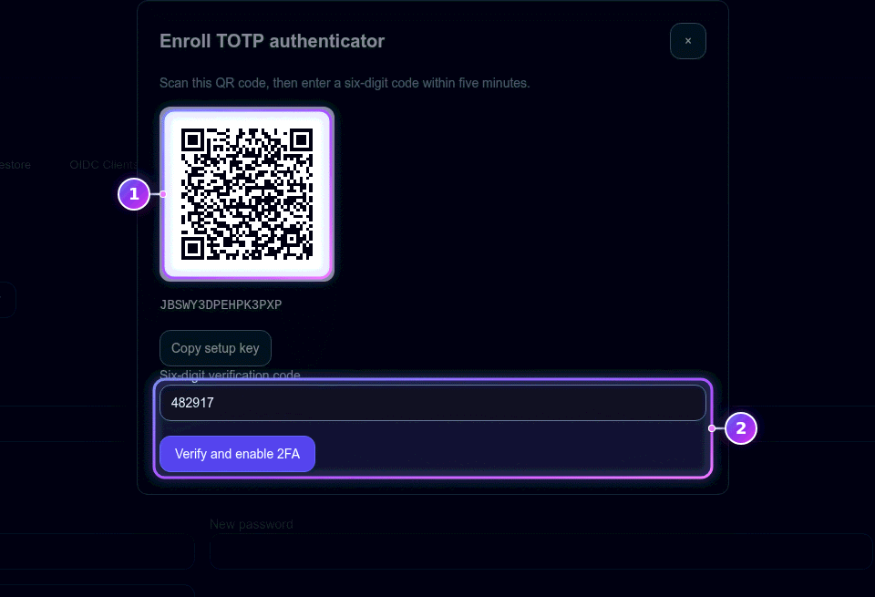
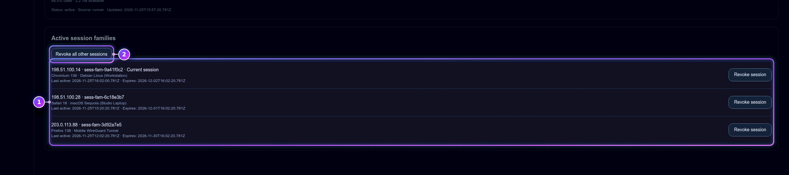

# Security Guide

AetherFlow v4.0.1 implements defense-in-depth across authentication, encryption at rest, capability-scoped file access, systemd namespace sandboxing, and CI/CD supply-chain verification.

## Authentication & Perimeter SSO

1. **TOTP and Recovery Codes**: Two-factor authentication (TOTP) is optional until enrolled in **Settings → Security** and applies to all enrolled user accounts (both local password and Google OAuth sign-ins). Newly generated recovery codes are hashed with `bcrypt` (`$2b$...`); legacy `sha256:v1:` hashes remain accepted during verification while unsalted 64-hex hashes fail closed.

   

2. **Hardened JWT Sessions & CSRF**:
   - `HttpOnly` HS256 session cookies (`aetherflow_session`; `Secure` over HTTPS) carry a 15-minute access TTL with a 2-hour refresh grace window and 30-day session cap.
   - All human-session surfaces (API middleware, `/api/v1/public/auth/verify`, Subdomain Gateway `aetherflow_session`, `__Host-aetherflow_app` and `aetherflow_local_app` app-launch cookies, `/metrics` admin session auth, optional authenticated `GET /api/v1/public/marketplace`, WebSocket tickets/refresh, and OIDC `/authorize`) validate sessions through shared `verify_active_session_on_conn` against JWT signature, SQLite `revoked_tokens`, unexpired `active_sessions`, client fingerprint, active user state, and `sessions_revoked_after`. `POST /api/v1/auth/refresh` fails closed with `401` if a session's `active_sessions` row was deleted (never resurrecting deleted rows); concurrent browser tabs share a 10-second strict-fingerprint in-memory `ROTATED_TOKEN_GRACE` window gated on the successor `leaf_jti` holding an unexpired `active_sessions` row.
   - Active sessions can be inspected and individually revoked from **Settings → Security** (`GET /api/v1/auth/sessions`, `DELETE /api/v1/auth/sessions/{jti}`).

   
   - State-mutating cookie-authenticated requests enforce double-submit CSRF validation (`X-CSRF-Token` header matching the `csrf_token` cookie; no `Origin`/`Referer` header check is performed). Bearer-token requests and refresh routes are exempt from double-submit CSRF, while cookie-authenticated `POST /api/v1/auth/refresh` (without `Authorization`) requires `X-Requested-With: XMLHttpRequest` (`403 REFRESH_HEADER_REQUIRED`). Both `POST /api/v1/auth/refresh` and legacy `POST /api/auth/refresh` (alongside `/api/v1/public/auth/refresh`) enforce `auth_rate_limit_middleware` (10 req/min/IP). Both `CSRF_DISABLED=true` and `AF_DISABLE_RATELIMIT=1|true` are ignored whenever `AETHERFLOW_ENV` is `production` or `release`.
   - `host_validation_middleware` executes outside `security_headers_middleware`, implicitly accepting only canonical loopback IP literals (`127.0.0.0/8`, `::1`) without an explicit entry in `ALLOWED_HOSTS`, `PUBLIC_URL`, `OIDC_ISSUER`, or `ALLOWED_CORS_ORIGIN`, rejecting unlisted IPv4/IPv6 `Host` and trusted `X-Forwarded-Host` values with `400 INVALID_HOST`, and passing the validated host via a `Request` extension so `security_headers_middleware` never reflects unvalidated `Host` values into SPA CSP `connect-src` (omitting SPA CSP on non-200 error responses).
   - **First-Admin Onboarding Bootstrap Token (`POST /api/v1/public/auth/setup`)**: When `users` is empty, `af-api` creates a `0600` one-time 64-hex token at `/var/lib/aetherflow/.setup-bootstrap-token` (or honors `AETHERFLOW_SETUP_TOKEN`) and rejects proxied (`X-Forwarded-For` / `X-Real-IP` / `Forwarded`) or non-loopback setup calls with HTTP `403 SETUP_TOKEN_REQUIRED` unless `setup_token` or `X-AetherFlow-Setup-Token` matches. Direct unproxied loopback (`127.0.0.1:8080`) requests bypass the bootstrap token until the first admin exists — keep `aetherflow-api` off untrusted hosts and complete onboarding promptly.
3. **Perimeter Gateway & External Subdomain Authentication**:
   - `/api/v1/public/auth/verify` is a forward-auth check subrequest enforcing active, unrevoked administrator sessions via `verify_active_session_on_conn` (validating JWT signature, SQLite `revoked_tokens`, unexpired `active_sessions`, `sessions_revoked_after`, client fingerprint, and active admin role while rejecting plugin-scoped tokens) and returning `200 OK` with `X-Aetherflow-User` and `Remote-User` response headers. Because `/verify` does not proxy downstream requests, the reverse proxy must strip untrusted client-supplied identity headers (`X-Aetherflow-*`, `Remote-User`, `X-Remote-User`, `X-Forwarded-User`) before forwarding upstream.
   - The Rust Subdomain Gateway strips spoofable client identity headers (`X-Aetherflow-*`, `Remote-User`, `X-Remote-User`, `X-Forwarded-User`, etc.) and injects `X-Aetherflow-User` only (never `Remote-User`), plus `X-Aetherflow-Rutorrent-Token` when forwarding to `rutorrent`. On both external `<app>.<baseDomain>` and internal `<app>.aether.local` hosts, it requires an active administrator session (including `__Host-aetherflow_app` on HTTPS external hosts or scoped `aetherflow_local_app` on HTTP `*.aether.local` for TOTP-enrolled admins) or rate-limited Basic authentication for all **10** gateway-protected applications: McVNC, Scrutiny, Prometheus, FlareSolverr, Threadfin, ruTorrent, Unmanic, Netdata, Autoscan, and Jackett.
   - **Strict Live-Admin Basic Auth**: `verify_proxy_basic_credentials` authenticates exclusively against live SQLite `users` rows with `role == "admin"`, `totp_enabled == 0`, and a matching bcrypt hash — provisioning secrets in `.master.creds`, `/install/.aetherflow.conf`, or `system_config.master_credentials` are never accepted as Basic Auth fallbacks. Deleting, demoting, suspending, rotating the password of, or enrolling TOTP on an admin account immediately revokes Subdomain Gateway Basic Auth.
   - **Authenticated `.aether.local` & Opt-In Unauthenticated LAN Bypass**: `*.aether.local` internal-domain routing permits authenticated clients from loopback, RFC 1918 LAN, link-local, IPv6 ULA, and RFC 6598 Tailscale (`100.64.0.0/10`) without requiring `external_access_enabled = 1` or listing `*.aether.local` in `ALLOWED_HOSTS`. By default, all 10 gateway-protected apps require administrator authentication on `*.aether.local` (TOTP admins launch protected apps over HTTP `*.aether.local` using the scoped `HttpOnly` `SameSite=Lax` `aetherflow_local_app` cookie minted by `POST /api/v1/admin/apps/launch`). Single-owner LAN operators may explicitly opt into unauthenticated LAN access on `*.aether.local` by setting `AF_ALLOW_UNAUTH_LOCAL_LAN=1` (or `true`; default `false`), which applies **only** to RFC 1918 (`10.0.0.0/8`, `172.16.0.0/12`, `192.168.0.0/16`), link-local (`169.254.0.0/16`, `fe80::/10`), and IPv6 ULA (`fc00::/7`) — unconditionally excluding `100.64.0.0/10` (Tailscale/CGNAT) and loopback (`127.0.0.0/8`, `::1`). Note that `172.16.0.0/12` includes local Docker bridge subnets when `AF_ALLOW_UNAUTH_LOCAL_LAN=1` is enabled.
   - **ruTorrent Loopback Secret & Legacy Apache `htpasswd` Fallback**: Standard external `rutorrent` ingress routes through the Rust Subdomain Gateway (`RequestHeader set x-aetherflow-external-app rutorrent`, supporting TOTP SSO via `app_launch`), while `rutorrent`'s local loopback vhost (`127.0.0.1:8087`) enforces `<RequireAll>` combining `Require local` with a single-purpose shared proxy secret (`/etc/aetherflow/rutorrent-proxy-token` `0640 root:aetherflow` read by `af-api`, paired with `/etc/aetherflow/rutorrent-proxy-token.conf` `0640 root:www-data` verifying `X-Aetherflow-Rutorrent-Token` and mapping `X-Aetherflow-User` to `REMOTE_USER` via `SetEnvIf`). `/etc/apache2/AetherFlow/rutorrent.htpasswd` is created only when `AF_APACHE_LISTEN_ALL=1`, and `/etc/apache2/AetherFlow/htpasswd` is used strictly as a legacy fallback for inherited custom Apache blocks or non-loopback `BIND_ADDR` (and `af provision` never writes silent random passwords into `htpasswd` when `.master.creds` is encrypted). Fresh installations skip legacy MD5 Digest seedbox aliases (`aliases-seedbox.conf` and `/etc/htpasswd`) unless explicitly enabled with `AF_ENABLE_LEGACY_SEEDBOX_ALIASES=1` (existing upgraded hosts with those files already present are preserved). Applications with native logins authenticate upstream.
4. **Plugin-Scoped RBAC & OS/Filesystem Isolation**:
   - Third-party plugins receive bounded tokens (`POST /api/v1/admin/plugins/:id/token` and read-only rotating `/run/aetherflow-plugin-token/runtime.token`) restricted to method- and route-matched `api_scopes` validated against manifest permissions, with administrative, session, auth, and plugin-control prefixes default-denied.
   - Managed plugin backends and `lifecycle_hooks.on_stop` hooks are never spawned directly by `af-api` as the `aetherflow` API user. `af-api` delegates lifecycle control (`start`, `stop`, `status`, `token`) over `/run/aetherflow/runner.sock` to `aetherflow-runner.service`, which independently validates `plugin.manifest.json` and launches a hardened transient systemd unit (`aetherflow-plugin-<id>.service`):
     - **Identity & Privilege**: `DynamicUser=yes` (unique UID/GID distinct from `root`, `aetherflow`, and sibling plugins), empty `SupplementaryGroups=`, `NoNewPrivileges=yes`, empty `CapabilityBoundingSet=`, `KillMode=control-group`.
     - **Filesystem & Process Sandboxing**: `ProtectSystem=strict`, `ProtectHome=yes`, `PrivateTmp=yes`, `PrivateDevices=yes`, `ProtectProc=invisible`, per-plugin `StateDirectory=aetherflow-plugin-<id>` (`0700`).
     - **Mounted Assets & Secret Masking**: Read-only bind mounts for validated plugin assets (`/run/aetherflow-plugin-app`) and rotating token directory (`/run/aetherflow-plugin-token`, backed by `0700 root:root` `/run/aetherflow-runner-plugin-tokens`), plus `InaccessiblePaths=` masking `/var/lib/aetherflow`, `/etc/aetherflow`, `/etc/AetherFlow`, `/run/aetherflow`, and `/var/log/aetherflow`.
     - **Systemd Network Enforcement & Loopback Boundary**: Managed units enforce `RestrictAddressFamilies=AF_UNIX AF_INET AF_INET6`, `SocketBindDeny=any`, `SocketBindAllow=ipv4:tcp:<allocated_port>`, `IPAddressDeny=any`, and `IPAddressAllow=localhost` (blocking outbound LAN/internet connections and unauthorized port binds), backed by an `ensure_systemd_isolation_ready` preflight requiring unified cgroup v2 (`/sys/fs/cgroup/cgroup.controllers`) and `systemd >= 249`. `/metrics` requires `Authorization: Bearer <METRICS_BEARER_TOKEN>` or an active admin session even from `127.0.0.1` / `::1` (unless `METRICS_PUBLIC=1` is explicitly enabled), and loopback `rutorrent` requires `/etc/aetherflow/rutorrent-proxy-token`. Because `IPAddressAllow=localhost` filters by IP rather than destination TCP port without `PrivateNetwork=yes`, managed plugins can still initiate TCP connections to sibling loopback-bound Marketplace apps on `127.0.0.1:<port>` — install only reviewed/trusted plugins.
   - If `aetherflow-runner.service`, systemd, cgroup v2, or `systemd >= 249` is unavailable, managed plugin execution fails closed with HTTP `503` (`PLUGIN_ISOLATION_UNAVAILABLE`) without falling back to the API OS identity. External plugin backends (manifests without a managed executable or local stop hook) operate independently.

---

## Data, Tenant Storage & Secret Isolation (FHS Layout)

- **Database Location**: `/var/lib/aetherflow/aetherflow.sqlite` (managed via `StateDirectory=aetherflow`, directory mode `0700`, file mode `0600`/`0640` under `UMask=0027`), using bundled `rusqlite` in `WAL` mode (`busy_timeout = 5000`, `foreign_keys = ON`).
- **Secrets File**: `/etc/aetherflow/aetherflow.env`, kept outside immutable code release directories. Under systemd, PID 1 (`root`) reads `EnvironmentFile=-/etc/aetherflow/aetherflow.env` before dropping privileges, so `0600 root:root` works for systemd-managed services. `AetherFlow-Setup` creates `0640 root:aetherflow`, `af provision` tightens existing or newly created files to `0600`, and `af-release` legacy migration writes `0600` preserving source `uid:gid` or falling back to `aetherflow:aetherflow`. Both `aetherflow-api.service` and `aetherflow-runner.service` read `/etc/aetherflow/aetherflow.env` directly (legacy `/opt/AetherFlow/current/backend/.env` fallbacks retired from both units).
- **AES-256-GCM at Rest (`enc:v1:`)**: `af-db` encrypts AI provider API keys (`settings`), TOTP secrets (`users.totp_secret`), streaming server keys (`streaming_servers.api_key`), notification channel configurations (`notification_channels.config`), `/var/lib/aetherflow/.master.creds`, and SQLite `system_config.master_credentials` using `enc:v1:<base64(nonce || ciphertext)>` keyed by `AES_MASTER_KEY` (32 raw bytes, 64-char hex, or Base64-encoded 32 bytes). OIDC client secrets are stored as SHA-256 hashes (`oidc_clients.client_secret_hash`), the OIDC RS256 signing key is stored at `/var/lib/aetherflow/oidc_rsa.pem` (`0600`), and `GOOGLE_CLIENT_SECRET` is read from environment configuration only.
- **Native McBrowser Isolation (`af-files` & `af-api::mcbrowser`)**: Per-user tenant roots under `/var/lib/aetherflow/mcbrowser/user-<id>` are enforced at mode `0700` with descriptor-confined capabilities that reject `..` traversal, NULs, backslashes, and symlinked mutation parents; opt-in internal symlink reads use Linux `openat2` confinement with target identity verification. Recursive cleanup (`af-files::remove_tree_with_outcome*`) enforces `openat2(..., RESOLVE_NO_XDEV)` with `fstat`/`st_dev` mount-boundary guards anchored to the McBrowser root, skipping mountpoints without unlinking mounted files, logging a structured `WARN` + `admin_audit_log` entry (`account_storage_cleanup_mount_skipped`), and settling the cleanup row cleanly. Even with this guardrail, do not bind-mount shared host directories beneath `/var/lib/aetherflow/mcbrowser/user-*`.
- **Host Path Picker (`GET /api/v1/auth/fs`)**: Restricted exclusively to live-verified active administrator accounts. When `AF_ALLOWED_FS_ROOTS` is unset, default allowed roots are `/mnt`, `/media`, `/srv`, `/data`, `/home`, and a non-service process `env::current_dir()` (`/tmp` / `env::temp_dir()` is excluded by default).

> [!WARNING]
> **Fresh `af provision` Defaults**: Generating `/etc/aetherflow/aetherflow.env` via `af provision` (`build_modern`) writes `BIND_ADDR=0.0.0.0`, seeds the host's LAN/public IP into `ALLOWED_HOSTS`, writes `COOKIE_SECURE=false` (and tightens existing `0640` env files to `0600`), while default `af provision run` (`makedirs` / `harden_perms`) leaves `/var/lib/aetherflow` at `0750` until `af provision run perms` or starting `aetherflow-api.service` (`StateDirectoryMode=0700`) enforces `0700`. When `/etc/apache2/AetherFlow` exists and no plaintext password is supplied (e.g., encrypted `enc:v1:` `.master.creds`), `af provision` preserves any existing valid bcrypt (`$2a$`/`$2b$`/`$2y$`) `/etc/apache2/AetherFlow/htpasswd` file or leaves it absent without writing a random password. Verify `BIND_ADDR=127.0.0.1` and `COOKIE_SECURE=true` behind Apache2 HTTPS.

---

## Privilege Separation & Systemd Sandboxing

Rather than granting the web API unrestricted `sudo` or disabling `ProtectSystem=strict`, AetherFlow splits execution across two systemd units built from the `backend-rs` workspace:

1. **`aetherflow-api.service` (Unprivileged Web Control Plane — `af-api`)**:
   - Runs as `User=aetherflow` with `SupplementaryGroups=systemd-journal adm`, `ProtectSystem=strict`, `ProtectHome=read-only`, `PrivateTmp=yes`, `NoNewPrivileges=yes`, `ProtectControlGroups=yes`, `ProtectKernelTunables=yes`, `RestrictSUIDSGID=yes`, `UMask=0027`, and `LimitNOFILE=65535`.
   - `DevicePolicy=closed` permits `/dev/dri` and single-GPU `/dev/nvidia0` (plus `nvidiactl`, `nvidia-modeset`, and `nvidia-uvm`); multi-GPU hosts require an operator systemd drop-in to expose additional `/dev/nvidia<N>` devices.
   - `ReadWritePaths` grants `/var/lib/aetherflow`, `/var/log/aetherflow`, `/run/aetherflow`, plus optional paths `-/srv`, `-/mnt`, `-/media`, `-/data`, and `-/opt/AetherFlow/backend/data`.
2. **`aetherflow-runner.service` (Root Unix Socket Helper — `af-runner`)**:
   - Runs `/opt/AetherFlow/current/aetherflow-api runner` and listens exclusively on `/run/aetherflow/runner.sock` (`0660 root:aetherflow`), verifying caller `SO_PEERCRED` and `/proc/<pid>/exe` against trusted control-plane/CLI binaries (blocking plugin processes and scripting interpreters).
   - Enforces strict regex, enum, and `lstat` ancestor-symlink allowlists for `systemctl` actions, Marketplace package operations (serialized behind `/install/.af-package-executor.flock`; both the 9 opt-in shell-free declarative Rust recipes enabled via `AETHERFLOW_ENABLE_RUST_PACKAGES=1` and the default Bash `apt-get()` / `rollback_apt_packages()` wrappers inject validated `-o DPkg::Lock::Timeout=<N>`, defaulting to `120`), blueprint/ingress mutations, WireGuard/Tailscale control, disk quotas, and isolated transient self-update units (`aetherflow-self-update-<command>-<channel>-<8hex>.service`, resolving `af` / `release-manager.sh` / package scripts from `env::current_exe().parent()` before `/opt/AetherFlow/current` and writing private `0600` job configs and `0600` receipts).

---

## Peer Clustering & Distributed Transcoding

Peer clustering isolates inter-server control, storage, and Jellyfin transcode offload across separate trust boundaries (see [Peer Clustering](./peer-clustering.md) and [Threat Model](./threat_model.md)):

- **Public Pairing Bootstrap (`POST /api/v1/peer-pairing/request`)**: Enforces single-use 10-minute pairing windows, 6-digit operator code verification, a strict 4 KiB request body cap, 5 req/min/IP rate limiting, a 300-second clock-skew guard, strict OS CA TLS validation (redirects and proxies disabled), and DNS-pinned SSRF filtering blocking loopback, link-local/cloud metadata, multicast, broadcast/reserved, and `afpeer0` CIDR targets unconditionally. RFC 1918, CGNAT (`100.64.0.0/10`), and IPv6 ULA (`fc00::/7`) HTTPS origins are blocked by default unless `AF_PEER_ALLOW_PRIVATE_PAIRING_URLS=true` is set on the initiating server.
- **Dedicated Tunnel Listener & Token Separation**: Peer API traffic runs strictly over the AetherFlow-managed WireGuard interface (`afpeer0`) on `<tunnel_ip>:<AF_PEER_LISTEN_PORT>` (default `9443`) bound with `SO_BINDTODEVICE`. Link bearer tokens (`X-AF-Link-Token`) and grant bearer tokens (`X-AF-Grant-Token`) are distinct, stored in mode `0600` files under `/etc/aetherflow/peers/`, and matched against SHA-256 digests in SQLite.
- **Fail-Closed Delegated Scopes & Sub-Second Revocation**: Newly paired links have zero access (`None` across all 8 areas). Local-only routes (auth/session, profile/2FA, `/api/v1/admin/peers/*`, nested `/api/v1/peers/*`, OIDC client mutations, Plugin Sandbox, and public shares) fail closed with `PEER_SCOPE_DENIED`; unmapped routes fail closed with `PEER_ROUTE_UNCLASSIFIED`. Revoking a grant or link immediately rejects bearer tokens, tears down active management WebSockets and in-flight HTTP proxy streams within 1 second (`<< 1 s`), and kills active remote transcode jobs (`SIGKILL`).
- **Storage & Worker Isolation**: Enabling peer exports or transcoding binds `nfs-server.service` exclusively to `afpeer0` (`/etc/nfs.conf.d/aetherflow-peers.conf`) with tunnel-IP-pinned exports (default `ro,root_squash,secure,no_subtree_check`). Remote transcode workers run as `af-transcode-worker.service` under `User=jellyfin` (`PrivateNetwork=yes`, `RestrictAddressFamilies=AF_UNIX`, `ProtectSystem=strict`, `DevicePolicy=closed`, local-only `ffmpeg` protocols) reading only secret-free `/etc/aetherflow/transcode.env` (`0640 root:jellyfin`, never `/etc/aetherflow/aetherflow.env`).

---

## CI/CD & Release Security Gates

Every push and release runs through `.github/workflows/ci.yml`, `.github/workflows/security.yml`, and `.github/workflows/release.yml`:

- **Secret Scanning**: `gitleaks` scans the repository tree to block accidental credential or key commits.
- **Zero-Go Repository Hygiene**: CI, security, and release workflows assert `git ls-files '*.go' '*go.mod' '*go.sum'` is empty, enforcing a pure-Rust control plane and native Rust LibreSpeed backend (`af-librespeed`).
- **Rust Workspace Verification & Supply-Chain Audits**:
  - Separate locked workspace test (`cargo nextest` / `cargo test`) and Clippy (`-D warnings`) gates cover `backend-rs/` (all 12 crates, including `af-transcode`), `frontend-rs/` (all 4 WASM crates, including `wasm32-unknown-unknown` checks), and `plugins/sdk-template-rust/backend/`, alongside `cargo audit` and `cargo deny`.
  - The ignored systemd self-update survival integration test (`updater_survives_caller_restart`) runs in `.github/workflows/release.yml`.
- **Release Publication Isolation & PAT Rotation**: `.github/workflows/release.yml`'s `release-publish` job runs inside the protected `release-publish` GitHub Environment (deployment branches/tags restricted strictly to `nightly`, `Nightly`, and `v*` tags — never `main`, `master`, or pull requests). `GITHUB_TOKEN` is downgraded to `contents: read` (keeping `id-token: write` and `attestations: write` strictly for `actions/attest-build-provenance` OIDC SLSA v1 attestations), while `gh release create` authenticates with a single-repository fine-grained `McEveritts` PAT (`secrets.RELEASE_PUBLISH_TOKEN`, scoped solely to `Contents: Read and write` so legacy `v3.2.x` internal updaters verify `author.login == McEveritts`). The publish step fails closed if `GH_TOKEN` is empty, starts with `ghs_*` (ephemeral `GITHUB_TOKEN`), or authenticates as any login other than `McEveritts` (`gh api user --jq .login`). Rotate `RELEASE_PUBLISH_TOKEN` every **90 days** in the `release-publish` GitHub Environment settings and revoke the superseded token immediately after verifying a release run.
- **CI Concurrency Budget & Artifact Hygiene**: Workflow DAG staging and matrix `max-parallel` caps across `.github/workflows/{ci,security,release,deploy-pages}.yml` keep worst-case concurrent Actions jobs at `<= 18` across overlapping triggers without merging separate workflow concurrency groups. Release tarballs (`scripts/build_gold.sh`), staged WASM frontend output (`scripts/build_wasm_frontend.sh`, pruned prior to compression), `aetherflow-bootstrap.tar.gz`, and generated plugin scaffolds (`scripts/create-plugin-sdk.sh`) explicitly exclude internal `EGM.md`, `*_DRIFT_REPORT.md`, and `goldfish_review_report.md` documents, enforced by live negative assertions in `release-build`, `release-e2e-amd64`, `release-arm64-runtime`, and `tests/test_release_workflow.py`.
- **Signed & Checksummed Pull Releases (`af-release`)**: Production nodes verify `SHA256SUMS` and GitHub Sigstore/SLSA v1 build provenance attestations by default (`af-release` and `deploy/release-manager.sh` read GitHub tokens into redacted memory and root-only `AETHERFLOW_SKIP_PROVENANCE_VERIFY=1` directly from `0600` `/etc/aetherflow/aetherflow.env` unless `AETHERFLOW_SKIP_ENV_FILES=1`, never writing secrets or provenance-bypass flags into `systemd-run --setenv` or `<unit>.conf`) before extracting multi-architecture tarballs (`aetherflow-linux-amd64.tar.gz` or `aetherflow-linux-arm64.tar.gz`) into an exclusive `0700` `.staging-*` directory, finalizing the release slot (`0755`) and normalizing executable permissions (`prepare_release_permissions`), capturing a WAL-safe online SQLite `.backup` verified with `PRAGMA integrity_check`, restarting `aetherflow-runner` and `aetherflow-api` ahead of best-effort log-retention housekeeping, verifying the running binary path after restart, and automatically rolling back if `/health/ready` fails.
